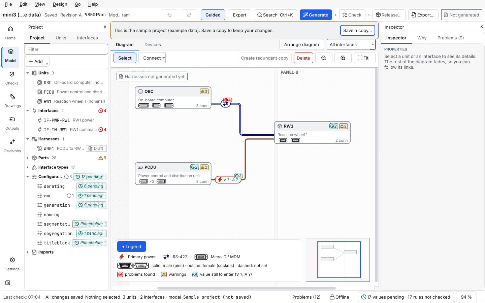
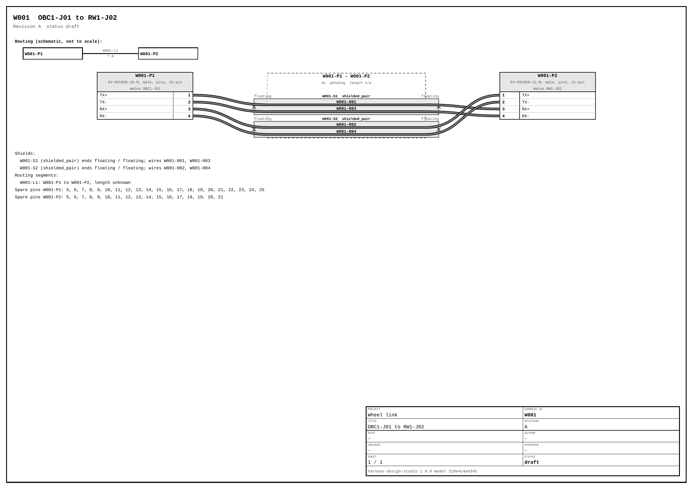
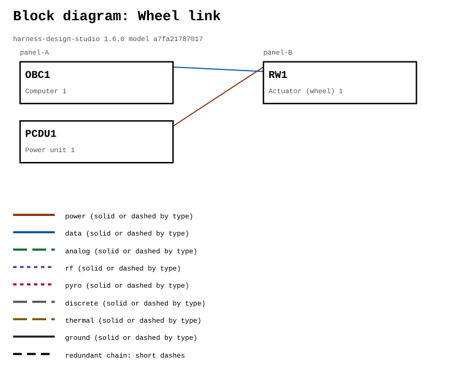

# Getting started: your first harness in 45 minutes

You will start from a small example, look at what the tool makes of it, fix a finding, export the build workbook and lists, and (optionally) see what a release looks like. Every step shows what you should see, and what to do if you do not.

## Contents

- [Part 1: create a practice project](#part-1-create-a-practice-project)
- [Part 2: look around](#part-2-look-around)
- [Part 3: generate the harnesses](#part-3-generate-the-harnesses)
- [Part 4: read what the tool made](#part-4-read-what-the-tool-made)
- [Part 5: read and answer the Problems](#part-5-read-and-answer-the-problems)
- [Part 6: export the build workbook and lists](#part-6-export-the-build-workbook-and-lists)
- [Part 7: fill in values, and see wires get sized](#part-7-fill-in-values-and-see-wires-get-sized)
- [Part 8: bring in your own data](#part-8-bring-in-your-own-data)
- [Optional: give the wires a colour](#optional-give-the-wires-a-colour)
- [Part 9 (optional, practice only): release a harness](#part-9-optional-practice-only-release-a-harness)
- [Part 10: build your own from blank](#part-10-build-your-own-from-blank)
- [Where to go next](#where-to-go-next)

**Looking for the whole route?** [`LEARNING_PATH.md`](LEARNING_PATH.md) puts this tutorial in context: before it, a ten-minute read; after it, a realistic small spacecraft, a worksheet for your own design, real data, release and automation.

**You need:** the tool installed ([`INSTALL.md`](INSTALL.md), five minutes) and nothing else. No spacecraft data, no network.

**Words you do not know?** Read [`CONCEPTS.md`](CONCEPTS.md) first (ten minutes) or look words up as you go.

You can follow the steps in the **app**, on the **command line**, or both. The command line steps give the same results and are easy to paste into a script. The command line tool is called `harness-design-studio`; the short name `harness` still works and runs the same program.

## Part 1: create a practice project

The tool ships five examples. List them:

```
harness-design-studio new --list
```

```
blank              An empty project: starter parts and interface types, no units.
first-steps        Three units, a power link and an RS-422 link. Nothing is generated yet: start here.
minimal-satellite  Seven units, nominal only: power, computer, radio, wheel and sun sensor. Adapt it.
small-satellite    14 units with nominal and redundant chains. Generate it to see a realistic system.
flatsat            A complete bench: 23 flight and ground units, generated, with example numbers.
```

**Which version do you have?** This tutorial is written for 1.6.0 (the commands work the same on 1.5.0, 1.4.0, 1.3.0, 1.2.0, 1.1.0 and 1.0.0; the window is the one of 1.3.0 and later, so the app steps and the picture look different in 1.2.0 and earlier, which had tabs along the top). The five examples, the `design-worksheet.md` template, the wiring-diagram drawing with wire colours and *Edit > Wire colours...* are not in the 0.1.0 packages (see [`CHANGELOG.md`](../CHANGELOG.md)): check with the command above, 1.0.0 lists five examples, 0.1.0 lists three (`blank`, `first-steps` and `small-satellite`). With a 0.1.0 package the tutorial still works from `first-steps`, but the drawings and the optional colour step differ.

Create a practice project from `first-steps`. Pick a folder that does not exist yet:

```
harness-design-studio new wheel-link --template first-steps --name "Wheel link"
```

```
Project 'Wheel link' created in wheel-link (3 units, 2 interfaces).
Next: harness-design-studio validate wheel-link   or open it in the app (File > Open project).
```

Check it:

```
harness-design-studio validate wheel-link
```

```
INFO    placeholder_config: Placeholder rule configuration still in use: derating, emc, generation, segmentation, segregation, titleblock. An engineer must review these before results are trusted.
3 units, 2 interfaces, 9 connectors, 0 harnesses: 0 error(s), 0 warning(s).
```

0 errors is what you want. The INFO line is normal: it says the engineering values are not filled in yet (Part 7).

**In the app:** start **Harness Design Studio**, choose **File > Open project…** and pick the `wheel-link` folder. The app also opens a built-in sample the first time and offers a short tour; **Skip tour** or follow it. To start a new practice project inside the app, use **File > New project from an example…** (the same examples) or **File > New project…** (an empty one); both open one window where you choose the folder, the name and the example.

## Part 2: look around



*(The screenshot shows the app's built-in sample, which uses slightly different IDs such as `OBC` and `IF-PWR-RW1`; the layout is the same.)*

| Where | What it is |
| --- | --- |
| Rail (left edge) | **Home**, **Model**, **Checks**, **Drawings**, **Outputs**, **Revisions**, **Settings** |
| Top bar | the project name, whether it is saved, the revision, a short model hash, where you are, **Undo**, **Redo**, **Guided / Expert**, **Search** (Ctrl+K), the steps **Generate** (the one blue button), **Check** and **Release…** (each shows what is done and what is next), **Export…** and a status chip (*Up to date*, *Plans out of date* ...) |
| Tabs | **Diagram**, **Harness**, **Lists**, **Checks**, **Releases**, **Devices** (Ctrl+1 to Ctrl+6); each area of the rail shows its own: Model has **Diagram** and **Devices**, Drawings has **Harness**, Outputs has **Lists**, Revisions has **Releases** |
| Middle, **Diagram** | units in lanes (*panel-A*, *panel-B*), links between them. Every kind of link has its own picture and colour; the legend (bottom left of the diagram) shows them (power is red in the light theme). Small badges show problems, values still to enter and locks |
| Left, **Project** | a tree of units, interfaces, harnesses, parts, interface types, configuration files and imports; **Add** adds a unit or an interface |
| Left, **Units** and **Interfaces** | every unit and every interface as a table you can sort, filter, edit with the keyboard and paste into from Excel (Ctrl+Shift+J, Ctrl+Shift+T) |
| Right, **Inspector** | the selected unit or interface: names, **Max current (A)**, notes, and where it is used. The tabs **Why** and **Problems** (with a **To do** list above the problem cards) are beside it |
| Bottom | the status bar (the running job with **Cancel**, **Problems (n)**, *Offline*, the zoom) and, when you open it (Ctrl+Shift+M), the Problems panel with every open problem |
| Above the diagram | **Select** and **Connect** (the arrow beside **Connect** lists the interface types), **Delete**, zoom |
| Right end of the Model tab bar | **Arrange diagram** and the **Show** list (all interfaces, one class, one connector, one bundle) |

Try this:

1. Click the unit `RW1`. The Inspector shows it. Click the red link: it is the interface `IF-001`, power from `PCDU1` to `RW1`, with **Max current (A)** 2.
2. Open the **Interfaces** tab on the left (Ctrl+Shift+T): every interface in a table (this view also works with a screen reader). The **Project** tab beside it lists the same objects as a tree.
3. Press **Ctrl+Z** after any change to undo it. You cannot break anything here: the example is a practice copy.

## Part 3: generate the harnesses

**In the app:** press **Generate** in the top bar (the menu item is **Design > Generate harnesses**, Ctrl+G). A preview lists what will be added. Read it, then press **Apply**; the **Harness** tab opens.

**On the command line:**

```
harness-design-studio generate wheel-link
```

```
2 added, 0 changed, 0 unchanged, 0 removed, 0 frozen (released); 0 locked pin(s) kept
2 interfaces and 6 wires checked: 0 error(s)
```

Two harnesses were made, one for each pair of connectors the interfaces use: `W001` carries the RS-422 link (four wires), `W002` carries power (two wires). Run it a second time and nothing changes: generation is repeatable.

Run the independent check, which shares no code with the generator:

```
harness-design-studio verify wheel-link
```

```
2 interfaces and 6 wires checked: 0 error(s)
```

## Part 4: read what the tool made

In the app open the **Harness** tab (Ctrl+2, the **Drawings** area) and pick `W002` in the list at the top left:

- **Wires** shows the two wires `PWR` and `RTN`, and **Connectors and pins** shows every pin and the wire on it. The **Lists** tab has the same as tables you can sort, filter and copy.
- **Why** says, for the wire, connector or pin you select, the rule that decided it. Read a few. This is the tool's answer to "why is it like this?".
- **Drawing** previews the drawing sheet; use the wheel to zoom and the buttons to change sheet. Export writes it as a PDF only when you ask for the drawings (Part 6).

Notice the wire gauge says **pending**. That is deliberate and is the subject of Part 7.

## Part 5: read and answer the Problems

Open the **Problems** tab (right panel) or the Problems panel at the bottom (Ctrl+Shift+M), or the **Checks** tab for all 35 rules and their result, or run:

```
harness-design-studio drc wheel-link
```

```
# Design rule check: Wheel link

Model hash: `a7fa21787017`. Rules run: 35.
Open: 0 error(s), 10 warning(s), 8 note(s). Waived: 0.

Placeholder configuration in use: derating, emc, generation, segmentation, segregation, titleblock. Results that depend on it are marked as not checked.
```

You see **0 errors**, 10 warnings and 8 notes. The warnings are all the same kind:

- **`Part EX-MICROD-15-F is not approved yet but is used (2 place(s))`**, and nine more like it (other Micro-D sizes, the Ethernet jack, the two wire parts). The starter library contains *example* parts; none is approved, and only approved parts may be built into flight hardware. Part 8 imports an approved parts list and clears some of them.

A warning can be fixed, or **waived**. **Waive one (app):** in the Problems tab press **Waive…** on one of the part warnings, type a reason of at least 10 characters (for example *Example part, practice project only*) and confirm. The card moves to **Waived** and stays in the report with your reason. Errors cannot be waived.

The **notes** say *not checked*: EMC separation, shield grounding and so on are not checked, **because the engineering values are still placeholders**. A silent pass would be a lie, so the tool says nothing was checked.

The **To do** list at the top of the **Problems** tab shows what is left, including *N auto-filled connector assignments to review*: the connectors on `IF-001` and `IF-002` were chosen by the tool, and a person should confirm them. In the app, select an interface and press **Confirm auto-filled connectors** in the Inspector.

## Part 6: export the build workbook and lists

The main output of an export is a **build workbook** for every harness: an Excel file to build the harness from, with a cut list, a block for every connector, the parts, the labels and a test sheet. The PDF drawings are optional (see below). The build workbook and the `--drawings` option are not in the latest release (1.6.0) yet; they come with 1.7.0.

**In the app:** press **Export…** in the top bar (Ctrl+E) and then **Export** in the window that opens; it also lists the files written. The check box **Include the PDF drawings** in that window is not ticked the first time. Afterwards the **Lists** tab (Outputs) shows **Exported files** with the SHA-256 of each file and whether it still matches the export. **On the command line:**

```
harness-design-studio export wheel-link
```

```
34 files written to wheel-link/outputs (model a7fa21787017).
```

The files are checked independently before they are written; if that check fails, nothing is written. Look in `wheel-link/outputs/`. The table shows the main files; the folder also holds `manifest.json` and more files under `system/` (for example `bom.csv`, `drc_findings.csv`, `provenance.json`, `system.xlsx`). [`OUTPUTS.md`](OUTPUTS.md) lists all of them.

| File (main files only) | What it is |
| --- | --- |
| `harnesses/W001/W001_build.xlsx` | the **build workbook**: the document to build the harness from |
| `harnesses/W001/wirelist.csv` | every wire: signal, interface, connectors, pins, gauge, part, length |
| `harnesses/W001/pinouts.csv` | every connector pin and the wire on it |
| `harnesses/W001/bom.csv`, `mass_length.csv` | parts list; mass and length with what is still unknown |
| `harnesses/W001/tests.csv`, `labels.csv` | continuity and isolation tests; wire labels |
| `harnesses/W001/wireviz.yaml`, `W001.xlsx` | a WireViz-style description; all tables of the harness as an Excel workbook (data, not a build document) |
| `system/block_diagram.pdf` | the units and their links |
| `system/harness_overview.pdf`, `box_pinouts.csv`, `mating_matrix.csv`, `traceability.csv` | all harnesses at a glance; the pinout of every unit connector; which cable mates with which unit; which interface is carried by which wires |
| `system/drc_report.md`, `changelog.csv`, `revision_report.md`, `export.json` | the Problems report; the change log; the revision report; the whole model as one JSON |

Open `harnesses/W001/W001_build.xlsx` in Excel or LibreOffice Calc. The first sheet, **Start here**, says `Ready to build: no` and lists what is open: the four wires have no length, no gauge and no colour (marked `TO FIX`), and some pins have no termination and the example parts are not approved (marked `NOTE`). The **Cut list** shows `to fill in` on an amber cell wherever the design has no value. These are the same open questions the tool called `pending` and `n/a` in the lists. Gauge and length are answered in the next two parts; the optional step after Part 8 gives the wires a colour. The workbook is explained sheet by sheet in [`user-manual/export-the-outputs.md`](user-manual/export-the-outputs.md).

**The PDF drawings (optional).** `export` writes no harness drawings. Add `--drawings` to write them as well (in the app: tick **Include the PDF drawings**):

```
harness-design-studio export wheel-link --drawings
```

```
40 files written to wheel-link/outputs (model a7fa21787017).
```

The six new files are `harnesses/W001/drawing_A3.pdf`, `drawing_A4.pdf`, `drawing_A3_s1.svg` and the same three for `W002`. A later `export` without `--drawings` removes them again and says so. The harness drawing (it needs `export --drawings`), with a title block and the model hash at the bottom (the picture is the `W001` sheet of the first export of this tutorial, made with 1.6.0, so the version and the model hash at the bottom are the ones your tool prints; with another version they differ):



The block diagram (`system/block_diagram.pdf`) is always written:



Look at the drawing. The cable block says `pending` for the wire gauge and `length n/a`, and the wires are grey because no wire colour is set (the tool defines no colours). Gauge and length are the open questions, and the next two parts answer them. The optional step after Part 8 gives the wires a colour.

Can you release this harness yet? Try. A release needs a name and a comment of at least 10 characters:

```
harness-design-studio release wheel-link W002 --by "A. Engineer" --comment "First release of the wheel power harness"
```

```
blocked: [placeholder_config] These configuration files are still placeholders: derating, emc, generation, segmentation, segregation, titleblock. Have an engineer review the values and set "placeholder" to false in each file (`harness-design-studio config DIR` lists them). Or release on placeholders with a written reason (command line: --accept-placeholders REASON); the reason is kept in the change log.
blocked: [parts_unapproved] 2 part(s) used by W002 are not approved (or are example data): EX-MICROD-9-M, EX-WIRE-SINGLE. Approve them in the parts list, or release with a written reason (command line: --accept-unapproved-parts REASON); the reason is kept in the change log.
blocked: [gauge_pending] 2 wire(s) have no gauge decided (first: W002-001). Fill in the derating values (the file config/derating.json; `harness-design-studio config DIR` lists what is missing) or set the gauge by hand.
blocked: [length_unknown] 2 wire(s) have no length (first: W002-001). Enter the routing segment lengths (`harness-design-studio import-lengths DIR FILE` loads them from a table).
```

The tool refuses and says why, in words. Nothing was changed. The first two reasons (placeholders and unapproved parts) wait until Part 9; the next part removes the other two.

## Part 7: fill in values, and see wires get sized

A wire's gauge depends on the current, the derating factors, the length and the allowed voltage drop. The tool cannot know your programme's numbers, so it asks:

```
harness-design-studio config wheel-link
```

```
Engineering values: 0 of 17 set.
- MISSING config/derating.json ampacity_a_by_awg: current each wire gauge may carry, in amperes, as {"20": 5.0, ...}. Needed for: wire sizing, wire current check.
...
```

For learning, the tool ships **demo values**. They are **not engineering data**; they exist so you can see the machinery work. Copy them over the practice project's configuration, and import the segment lengths from a table:

```
harness-design-studio templates my-templates
cp my-templates/config-demo-values/*.json wheel-link/config/
harness-design-studio import-lengths wheel-link my-templates/segment-lengths.csv --unit mm
harness-design-studio generate wheel-link
harness-design-studio export wheel-link
```

Now `outputs/harnesses/W002/wirelist.csv` says:

```
W002-001,PWR,IF-001,W002-P1,1,W002-P2,1,22,EX-WIRE-SINGLE,,1,W002-S1,
W002-002,RTN,IF-001,W002-P1,2,W002-P2,2,22,EX-WIRE-SINGLE,,1,W002-S1,
```

Gauge 22 and length 1 m. The **Why** pane of the **Harness** tab now explains it:

```
wire-sizing: ampacity: AWG 22 carries 2.16 A derated (factor 0.72) for 2 A
wire-sizing: voltage drop: AWG 22 gives 0.211345 V over 2 conductor(s), limit 0.5 V
contact-check: not done for PCDU1-J01 (contact rating or derating factor is a placeholder)
```

The smallest gauge in the table that carries 2 A after derating (0.8 for the bundle times 0.9 for temperature), then checked for voltage drop over the imported length. The last line shows the tool still refusing to check what it has no number for. Open `config/derating.json` to see where each number came from. `tests.csv` now carries the test limits from the demo values too. Open `harnesses/W002/W002_build.xlsx` again: the cut list has the gauge and the length, and on *Start here* only the colour of the two wires is still marked `TO FIX`.

> **Important.** The files stay marked `"placeholder": true`, so every result built on them still says it rests on placeholders. For a real design your programme's values replace the demo values, and you set `"placeholder": false` only after an engineer reviewed them. Never release a real design with demo values.

The three CSV files in `my-templates/` (`interfaces.csv`, `approved-parts.csv`, `segment-lengths.csv`) are templates: copy one, put your data in, import it. Part 8 does it for parts.

## Part 8: bring in your own data

Every import first shows what it would do. On the command line add `--dry-run` to look without changing anything. Try the approved parts list from the templates, and say what the approval values in it mean (the tool never decides that a part is approved):

```
harness-design-studio import-parts wheel-link my-templates/approved-parts.csv --approved Approved --pending Review --rejected Rejected --dry-run
harness-design-studio import-parts wheel-link my-templates/approved-parts.csv --approved Approved --pending Review --rejected Rejected
```

```
Imported 5 part(s). Project parts library (version 0), source: approved-parts.csv (sha256 b3e2067afea8), date: not recorded.
```

(The `row N: OK updated ...` lines come first. The dry run ends with `Dry run: nothing was changed.`)

Ask the rules what they think now:

```
harness-design-studio drc wheel-link
```

```
Open: 1 error(s), 7 warning(s), 5 note(s). Waived: 0.
```

One **error**: *The model changed after the harness plans were generated. Generate again before releasing.* Approving parts changed the design's library, so the plans and outputs are out of date. That is exactly what the check is for. Make the plans and outputs current:

```
harness-design-studio generate wheel-link
harness-design-studio export wheel-link
```

```
harness-design-studio drc wheel-link
```

```
Open: 0 error(s), 7 warning(s), 5 note(s). Waived: 0.
```

0 errors, and 7 warnings: the three parts you approved no longer warn. Other imports work the same way:

| You have | Do |
| --- | --- |
| segment lengths from CAD or a spreadsheet | `harness-design-studio import-lengths wheel-link my-templates/segment-lengths.csv --unit mm --dry-run` |
| the interfaces as a table | app only (there is no command for it): **File > Import > Import interfaces…** with `my-templates/interfaces.csv` |
| the connector pinout of a unit in KiCad | `harness-design-studio import-netlist wheel-link my-templates/wheel-connectors.net --unit RW1 --prefix J --connector J1=RW1-J01 --connector J2=RW1-J02 --dry-run` |

Details and column names: [`IMPORTS.md`](IMPORTS.md), [`KICAD.md`](KICAD.md).

## Optional: give the wires a colour

This step is not in 0.1.0 packages (see the note in Part 1). A wire's colour is data that you choose; the tool has no colours of its own, which is why the wires of `wheel-link` are grey.

**In the app:** choose **Edit > Wire colours...**. The window lists each signal of the project (`PWR`, `RTN`, `TX+` and so on); pick a colour for `PWR` (for example red) and `RTN` (for example black) from the IEC 60757 list and confirm. The message *Wire colours saved. Generate the harnesses to apply them.* appears. Then press **Generate**, **Apply** and **Export…**. The colours are saved in `config/generation.json` as `wire_colour_by_signal`.

On the command line the same two commands apply colours that are already in `generation.json` (the command line has no command to set them; [`CONFIG.md`](CONFIG.md) shows the format):

```
harness-design-studio generate wheel-link
harness-design-studio export wheel-link
```

The wire list now has the colour in its *Colour* column (`red`, `black`), and the harness drawing (if you export it with `--drawings`) draws the wires in those colours with the IEC 60757 code written as text. A wire between two different signals (`TX+/RX+`) takes the colour of the first. In the build workbook the *Colour* cell of the cut list is now filled with the colour and holds its name and code (`red (RD)`), and *Start here* of `W002` says `Ready to build: yes`.

## Part 9 (optional, practice only): release a harness

With the demo values and the lengths of Part 7 the gauge and length reasons of Part 6 are gone, but two are left: the configuration files are still marked `"placeholder": true`, and the parts are the example parts, which nobody has approved. A release is refused until a person has reviewed the values and approved the parts, or accepts both with a written reason:

```
harness-design-studio release wheel-link W002 --by "A. Engineer" --comment "First release of the wheel power harness"
```

```
blocked: [placeholder_config] These configuration files are still placeholders: derating, emc, generation, segmentation, segregation, titleblock. Have an engineer review the values and set "placeholder" to false in each file (`harness-design-studio config DIR` lists them). Or release on placeholders with a written reason (command line: --accept-placeholders REASON); the reason is kept in the change log.
blocked: [parts_unapproved] 1 part(s) used by W002 are not approved (or are example data): EX-WIRE-SINGLE. Approve them in the parts list, or release with a written reason (command line: --accept-unapproved-parts REASON); the reason is kept in the change log.
```

For a real design the engineer reviews the values and sets `"placeholder": false` in each file, and the parts list approves the parts. For this practice project, accept both and say why; the reasons are kept in the change log and in the baseline:

```
harness-design-studio release wheel-link W002 --by "A. Engineer" --comment "First release of the wheel power harness" --accept-placeholders "Practice project: demo values only" --accept-unapproved-parts "Practice project: example parts only"
```

```
Release W002 revision A: done.
Outputs re-exported with the released status (34 files).
```

`W002` is now **released (locked)**: it, the interfaces it carries and the pins it uses cannot be edited, nor can the parts, interface types and configuration values it uses (a later `harness-design-studio import-parts` or `harness-design-studio config --apply-profile` that would change them ends with `This change was blocked because it touches released items`), a baseline and a change log entry are stored, and the build workbook (and the drawing, if the last export had drawings) says *released*. The release writes the outputs again with the same set of files as the last export, so the drawings are written again only if that export had them. To change it you start a revision with `harness-design-studio revise wheel-link W002 --by NAME --comment "..."`; `harness-design-studio log wheel-link` prints the history, including the reasons for releasing on placeholders and with unapproved parts. In the app the same steps are **Release…** (also a step in the top bar) and **New revision…** in the **Releases** tab (or the **Harness** tab), and **Change log…** in the **More** menu of the **Harness** tab; the release window lists what the release locks and asks for the reason when placeholders remain.

Do this only in the practice project. Releasing on placeholders and example parts teaches the flow and nothing more: the change log records that the release rested on them.

## Part 10: build your own from blank

Now do it yourself. Create a blank project and rebuild the wheel link:

```
harness-design-studio new my-first-design --name "My first design"
```

In the app, **File > Open project…** it. The empty diagram says where to start: it has the button **Add a device** (until the first unit exists) and the hint to use **Add** in the project panel. Then:

1. Press **Add** in the Project tab on the left, choose **Unit…**, and add a **Power unit**, a **Computer** and an **Actuator (wheel)** (**Edit > Add unit** has the same list; **Add a device**, Ctrl+Shift+N, adds a unit whose connectors and pins you define yourself in the **Devices** tab, see [`user-manual/define-a-device.md`](user-manual/define-a-device.md)). Units appear in the lanes; drag them where you like. Each gets an ID (`PCDU1`, `OBC1`, `RW1`) and some connectors. Rename them in the Inspector if you want.
2. Open the arrow beside **Connect** above the diagram (or **Edit > Connect with**), pick **Primary power**, click `PCDU1`, then click `RW1`. Units that cannot take this interface are greyed out, with the reason beside them.
3. Select the new link and set **Max current (A)** to 2. Without a current, a power wire's gauge stays pending.
4. Pick **RS-422**, click `OBC1`, then `RW1`.
5. Look at **Problems** and its **To do** list, then **Generate**, **Apply**, **Export…**. **Ctrl+S** saves.

You have now done everything the tool does, once. Add a **Create redundant copy** of the wheel (select it, press the button) and watch the tool build the backup chain and warn when something connects nominal to redundant.

There is one more way in: a harness made by hand, with no interface at all. Use **New harness…** in the **Drawings** area (Ctrl+Shift+H); see [`user-manual/build-a-harness-by-hand.md`](user-manual/build-a-harness-by-hand.md).

## Where to go next

| You want | Read |
| --- | --- |
| a recipe for one task (import, KiCad, release, Git, CI) | [`HOWTO.md`](HOWTO.md) |
| every command and option | [`CLI.md`](CLI.md) |
| the screen, shortcuts, glossary | the user guide ([`guide/USER_GUIDE.md`](guide/USER_GUIDE.md); **F1** in the app) |
| the whole route from beginner to release | [`LEARNING_PATH.md`](LEARNING_PATH.md) |
| a one-page summary of commands and keys | [`CHEATSHEET.md`](CHEATSHEET.md) |
| to try a small but realistic spacecraft | `harness-design-studio new mini --template minimal-satellite`, then generate it |
| to try a large system with redundancy | `harness-design-studio new sat --template small-satellite`, then generate it |
| to see a complete bench setup with ground equipment | `harness-design-studio new bench --template flatsat`, then [`FLATSAT_EXAMPLE.md`](FLATSAT_EXAMPLE.md) |
| to plan a design on paper first | `design-worksheet.md` in the templates (`harness-design-studio templates my-templates`) |
| something went wrong | [`FAQ.md`](FAQ.md) |
| what the examples and templates contain | [`../src/harness_design_studio/resources/examples/templates/README.md`](../src/harness_design_studio/resources/examples/templates/README.md) |

Next: [user manual](user-manual/README.md), [`CONCEPTS.md`](CONCEPTS.md), [`LEARNING_PATH.md`](LEARNING_PATH.md).
