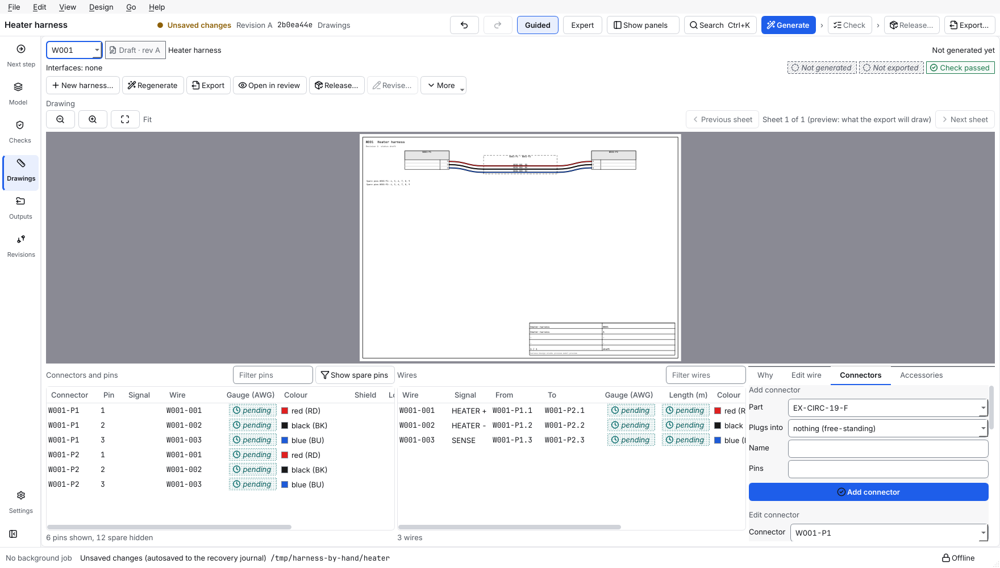

# Build a harness by hand

This page shows how to make a harness from nothing: no interface, no Generate. You make the harness, add its connectors, and draw its wires. From there it is a harness like any other: it is checked, drawn, listed, reviewed and released.

> **New in 1.5.0.** Before, a harness could only come from Generate. The steps in the app are described from the program's code and its tests; the program was not watched on a screen while this page was written.

## Contents

- [When to build by hand](#when-to-build-by-hand)
- [Before you start](#before-you-start)
- [1. Start with nothing](#1-start-with-nothing)
- [2. Make the harness](#2-make-the-harness)
- [3. Add its connectors](#3-add-its-connectors)
- [4. Say what each pin does](#4-say-what-each-pin-does)
- [5. Draw the wires](#5-draw-the-wires)
- [6. Check, list and release](#6-check-list-and-release)
- [What Generate does with it](#what-generate-does-with-it)
- [Common mistakes](#common-mistakes)

## When to build by hand

- You design a harness that has no units and interfaces yet (a test cable, a heater harness, a breakout).
- You describe an existing harness and want its build workbook and lists.
- You want the whole design in the tool, from a blank project, before any interface table exists.

When the system is described by units and interfaces, let Generate make the harnesses ([generate harnesses](generate-harnesses.md)) and use [edit a wire](edit-a-wire.md) for the changes you need.

## Before you start

- A project is open. A new one is empty: **File > New project…**, then the example *blank* ([draw the design](draw-the-design.md), step 1).
- The **parts library** holds the connector parts you need. A blank project has the starter parts. Add your own in the **Devices** tab (**New part…**) or import a parts list ([import data](import-data.md)).
- A harness that Generate made takes no connector by hand: Generate would replace it. Build by hand in a harness you made with **New harness**.

## 1. Start with nothing

1. **File > New project…**, choose an empty folder, type a name, keep the example *blank*.
2. Choose **Drawings** on the rail. The Harness tab says *No harnesses yet* and offers **New harness…**.

## 2. Make the harness

1. Press **New harness…** (or **Edit > New harness…**, Ctrl+Shift+H).
2. Type a name, for example `Heater harness`. The harness gets the next free ID of the naming pattern (`W001`, then `W002`; [naming and title block](naming-and-title-block.md)).
3. The harness appears, empty, and the **Connectors** tab beside the drawing opens.

The harness is a draft. Undo (Ctrl+Z) takes it away again.

## 3. Add its connectors

In the **Connectors** tab, under **Add connector**:

- **Part**: a connector part of the library. The connector gets its pins `1` to the part's pin count, and its gender from the part's description.
- **Plugs into**: choose a connector of a unit, and the new connector is the other half of it. The tool takes the mating part from the library (else the same part), the opposite gender, the keying and all the pins of the unit's connector, with their function, contact size and termination. Choose *nothing (free-standing)* for a connector that plugs into no unit.
- **Name**: optional. Left empty, the next free one (`P1`, `P2`, …) is used.
- **Pins**: optional, the pin names separated by commas (`A1, A2, B1`). Left empty, the pins are those described above. Fill it in for a part that has no pin count, or to name the pins yourself.

Press **Add connector**. Add the second connector the same way. Each connector gets an ID of the naming pattern (`W001-P1`).

## 4. Say what each pin does

Under **Pin of a connector**, choose the connector and the pin, then type a **Function** (your words, for example `HEATER +`), choose the **Termination** (crimp, solder, or not said) and a **Contact size**, and press **Set pin**. The function and the termination appear in the pinout tables, and the labels print the function.

**Delete connector** removes the chosen connector, if it has no wires. If it has, the form names them: delete the wires first.

## 5. Draw the wires

Draw wires as in [edit a wire](edit-a-wire.md), section 4: **New wire** in the **Edit wire** tab, choose the connector and pin at each end, type a signal name, press **Add wire**. Then set gauge, type, colour and length, or twist wires together ([edit a wire](edit-a-wire.md), sections 2 and 6).

## 6. Check, list and release

- **Checks** shows the design checks. A harness by hand has no interface, so the checks that need one (a link's current, signal directions) have nothing to say; the rest apply. With no gauge, the gauge stays *pending*: the tool never guesses.
- **Outputs** writes the build workbook, wire list, pinouts, bill of materials, labels and tests for it, like any harness (and the drawings, if you ask for them: [export the outputs](export-the-outputs.md#5-the-pdf-drawings-optional)). `harness-design-studio verify DIR --outputs` compares them with the design.
- **Review**, **Release** and **Revise** work as for a harness from Generate ([release a harness](release-a-harness.md)).

## What Generate does with it

Nothing. **Generate** leaves a harness you made, its connectors and its wires exactly as they are. It reports nothing as removed because of it. Delete the harness yourself with **More > Delete harness…** (a draft or a harness in review).

## Common mistakes

- **The Connectors tab is grey and says *made by Generate*.** That harness takes its connectors from the design. Make a new one with **New harness**, or change the design.
- **A wire cannot be drawn.** A wire joins two pins of the connectors of its harness; add the connectors first.
- **A connector with no pins.** The pins come from the part's pin count. A part without one gets none: type the names in **Pins**.
- **A released harness.** It is locked; start a new revision ([change a released harness](change-a-released-harness.md)).

Next: [edit a wire](edit-a-wire.md), [export the outputs](export-the-outputs.md)
