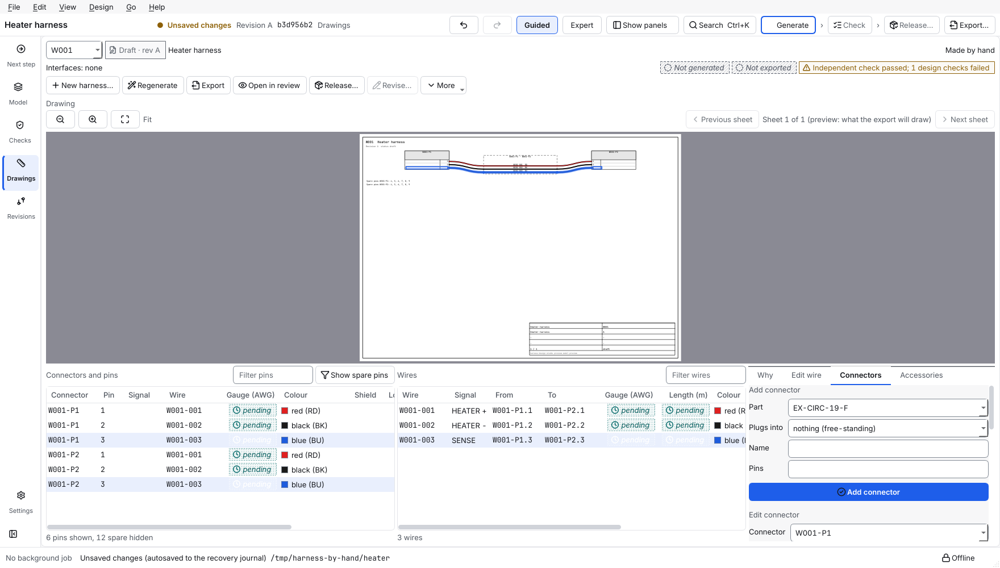

# Build a harness by hand

This page shows how to make a harness from nothing: no interface, no Generate. You make the harness, add its connectors, and draw its wires. From there it is a harness like any other: it is checked, drawn, listed, reviewed and released.

> **Since 1.5.0.** Before, a harness could only come from Generate. The steps in the app are described from the program's code and its tests; the program was not watched on a screen while this page was written.

## Contents

- [When to build by hand](#when-to-build-by-hand)
- [Before you start](#before-you-start)
- [1. Start with nothing](#1-start-with-nothing)
- [2. Make the harness](#2-make-the-harness)
- [3. Add its connectors](#3-add-its-connectors)
- [4. Say what each pin does](#4-say-what-each-pin-does)
- [Change a connector and its pins](#change-a-connector-and-its-pins)
- [5. Draw the wires](#5-draw-the-wires)
- [6. Check, list and release](#6-check-list-and-release)
- [A cable with a loose end](#a-cable-with-a-loose-end)
- [What Generate does with it](#what-generate-does-with-it)
- [Common mistakes](#common-mistakes)

## When to build by hand

- You design a harness that has no devices and interfaces yet (a test cable, a heater harness, a breakout).
- You describe an existing harness and want its build workbook and lists.
- You want the whole design in the tool, from a blank project, before any interface table exists.

When the system is described by devices and interfaces, let Generate make the harnesses ([generate harnesses](generate-harnesses.md)) and use [edit a wire](edit-a-wire.md) for the changes you need.

## Before you start

- A project is open. A new one is empty: **File > New project…**, then the example *blank* ([draw the design](draw-the-design.md), step 1).
- The **parts library** holds the connector parts you need. A blank project has the starter parts. Add your own in the **Devices** tab (**New part…**) or import a parts list ([import data](import-data.md)).
- A harness that Generate made takes no connector by hand: Generate would replace it. Build by hand in a harness you made with **New harness**.

## 1. Start with nothing

1. **File > New project…**, choose an empty folder, type a name, keep the example *blank*.
2. Choose **Drawings** on the rail (Ctrl+2). The Harness tab says *No harnesses yet* and offers **New harness…**. (The Systems engineer's rail does not list Drawings, and that role's **Go** and **Edit** menus leave out **Go to Harness** and **New harness…**; on an empty project its Next step page offers *or make a harness by hand* with the same button, and the keys Ctrl+2 and Ctrl+Shift+H and the command palette, Ctrl+K, still work.)

## 2. Make the harness

1. Press **New harness…** (or **Edit > New harness…**, Ctrl+Shift+H).
2. Type a name, for example `Heater harness`. The harness gets the next free ID of the naming pattern (`W001`, then `W002`; [naming and title block](naming-and-title-block.md)).
3. The harness appears, empty, and the **Connectors** tab beside the drawing opens.

The harness is a draft. Undo (Ctrl+Z) takes it away again.

## 3. Add its connectors

In the **Connectors** tab, under **Add connector**:

- **Part**: a connector part of the library. The connector gets its pins `1` to the part's pin count, and its gender from the part's description.
- **Plugs into**: choose a connector of a device, and the new connector is the other half of it. The tool takes the mating part from the library (else the same part), the opposite gender, the keying and all the pins of the device's connector, with their function, contact size, termination and cable contact. Choose *nothing (free-standing)* for a connector that plugs into no device.
- **Name**: optional. Left empty, the next free one (`P1`, `P2`, …) is used.
- **Pins**: optional, the pin names separated by commas (`A1, A2, B1`). Left empty, the pins are those described above. Fill it in for a part that has no pin count, or to name the pins yourself.

Press **Add connector**. Add the second connector the same way. Each connector gets an ID of the naming pattern (`W001-P1`).

## 4. Say what each pin does

Under **Pin of a connector**, choose the connector and the pin, then type a **Function** (your words, for example `HEATER +`), choose the **Termination** (crimp, solder, or not said), a **Contact size** and a **Contact**, and press **Set pin**. The function and the termination appear in the pinout tables, and the labels print the function. **Contact** is a part of the library with the category *contact*: the contact this wire uses on the pin (`Contact` appears in the pinout tables and in the build workbook). **Contact for all pins of this connector** gives the contact chosen in **Contact** to every pin of the connector in one undo step. The crimp tool belongs to the contact part, not to the pin ([enter the build data](enter-the-build-data.md)). On a connector of a harness that Generate made these controls are off, because the contact is set on the pin of the device. A cable pin that has no signal of its own shows, in `pinouts.csv`, the signal and the interface of the wires that end on it (since 1.10; different values are sorted and joined with `;`), so the wire's signal name is read there too.

**Delete connector** removes the chosen connector, if it has no wires. If it has, the form names them: delete the wires first.

## Change a connector and its pins

Everything you set when you added a connector can be changed later (since the workshop milestone M3). In the **Connectors** tab, under **Edit connector**, choose the connector, then change:

- **Part**: another connector part of the library. When the part's description says male or female, **Gender** follows it (change it if it is wrong). The pins are **not** touched; a part with another number of pins is said under the fields (*The part has 15 pins and the connector 9. Add or delete pins below.*) and shows in the rule **Mating halves**.
- **Gender**: male, female or *not said*. The design rule **Mating halves** (`mate-mismatch`: both ends of a mated pair of one gender, the keying differing, the pin count differing) reads it.
- **Keying**: the key or coding, in words.
- **Name**: the name in the harness (`P1`); two connectors of one harness cannot have the same name.

Press **Apply to connector** (one undo step; a mistake is said under the form and nothing changes). Under **Pin of a connector** the pin form also has a **Signal** (what the pin carries, printed on the pinout) and a **Role** (power, return, ground, signal, shield or spare; it is kept in the file, nothing is computed from it on a cable pin). **Pin ID** with **Add pin** (several IDs separated by commas, as many as the part's pin count allows), **Rename pin** (the wires on the pin follow) and **Delete pin** (refused while a wire uses it, naming the wires) change the pins themselves.

**A connector of a harness that Generate made** can be edited too, but only in part. The Connectors tab says *made by Generate* and adds no connector, yet **Part**, **Gender**, **Keying**, the **Signal**, **Role**, **Function**, **Termination** and **Contact size** of its pins can be set. Such an edit makes the connector *yours*: Generate keeps the part, gender, keying and those pin details, the way it keeps the gauge of a locked wire, and the tab says *Edited by you* with the button **Give back to Generate** (the next Generate takes everything from the device again). What stays with the device, because the wires depend on it: the connector's name, its pins (their IDs and how many) and the contact of each pin. Add, rename or delete a pin on the device, in the **Devices** tab. If the device connector goes away, Generate names the edited connector in the warning `locked_data_lost`.

## 5. Draw the wires

Draw wires as in [edit a wire](edit-a-wire.md), section 4: **New wire** in the **Edit wire** tab, choose the connector and pin at each end, type a signal name, press **Add wire**. Then set gauge, type, colour and length, or twist wires together ([edit a wire](edit-a-wire.md), sections 2 and 6).

## 6. Check, list and release

- **Checks** shows the design checks. A harness by hand has no interface, so the checks that need one (a link's current, signal directions) have nothing to say, and a note says that the current, voltage-drop and bundle checks did not run for those wires; the rest apply. With no gauge, the gauge stays *pending*: the tool never guesses.
- **Strip lengths and accessories** are entered as for any harness: the strip lengths in the **Edit wire** tab, the sleeving, heat shrink, labels and backshells in the **Accessories** tab ([enter the build data](enter-the-build-data.md)). `harness-design-studio import-build-data` can read the contacts of this harness from a table.
- **Outputs** writes the build workbook, wire list, pinouts, bill of materials, labels and tests for it, like any harness (and the drawings, if you ask for them: [export the outputs](export-the-outputs.md#5-the-pdf-drawings-optional)). `harness-design-studio verify DIR --outputs` compares them with the design. A wire part that is a twisted pair has `conductors` 2 (the starter part `EX-WIRE-TWISTED-SHIELDED` does): the bill of materials and the mass then count the metres of the cable, the sum of the lengths of its wires divided by 2, and not the metres of every wire (since 1.11). Give your own pair parts a *Conductors* column in the parts import ([import data](import-data.md)).
- **Review**, **Release** and **Revise** work as for a harness from Generate ([release a harness](release-a-harness.md)).

## A cable with a loose end

A cable can end in a **loose end**: the other end of a cable drawn from a port, with no connector chosen and not plugged into anything. It is a connector of the harness like the others, with the role *loose* and the placeholder part `TBD-CONNECTOR` (which the part lists do not offer), and its pins and wires are the ones you drew: one wire from each pin of the port that has a signal (else every pin), the loose pins carrying the same signal names.

**Make one.** On the diagram, press on a port and drag the cable onto empty ground ([connect two connectors](connect-two-connectors.md#pick-up-a-cable-and-plug-it-in)). Without the mouse: select the device, then **Edit > Cable ends > Leave a loose end…** and choose the port, or right-click a connector of a device in Expert mode and choose **Leave a loose end from J01**. Each is one undo step and makes a new harness (*Cable 1*, *Cable 2* ...) whose **Origin** in the inspector is *Drawn by hand*.

**Where you see it.**

- **On the diagram** the end hangs on a line out of its port, as a plug with a dashed outline and the words *open end*; the tooltip says *Open end of W001 (Cable 1): no connector chosen yet*. It follows its device. Drag it to move it (only its place on the diagram changes, not the design); right-click it for **Put the end back where the tool puts it**.
- **In the project tree** it is listed under its harness, with the chip *Open end*. A click picks it.
- **In the inspector** (a click on the end) you see its harness, the harness's origin, its pins, *Connector part: TBD-CONNECTOR (loose end), Not chosen yet* and *Plugged into: Nothing: open end*, and the fields to **Rename** it, **Use this part**, **Plug into…** and **Unplug**. A harness shows its **Origin** too: *Interfaces (made by Generate)*, *Connection L1* or *Drawn by hand*.

**Decide it.**

- **Plug it in:** drag the end onto a port (or onto a device: the tool takes the connector whose pin names fit), or press **Plug into…** in the inspector or **Edit > Cable ends > Plug loose end into…** and choose the port. Its pins are paired with the pins of the port by signal name (TX to RX included), else by pin number; where the names disagree the plug is refused with the pins named, so that nothing is paired wrongly without a word. The cable is then drawn as a line between the two ports.
- **Give it a connector part:** choose the part in the inspector and press **Use this part**, or choose it in the **Connectors** tab of the **Harness** tab. It becomes an ordinary cable connector that plugs into nothing.
- **Unplug** a connector of a harness you drew (the inspector's **Unplug**, **Edit > Cable ends > Unplug a cable end…**, or the right-click menu of the connector of the device it sits on) and it is a loose end again: its pins and wires stay, its part goes back to `TBD-CONNECTOR`. A harness made from a connection keeps both ends plugged in and refuses, with the reason (the menu entry is greyed out and says why). A cable with no end plugged in anywhere is not drawn on the diagram; it stays in the project tree.

Every one of these is one undo step. What the rest of the tool does with a loose end:
- **Checks:** the design rule *Approved parts* says *N cable end(s) have no connector chosen yet (loose end)*; that is a choice to make, not a part to approve.
- **Build workbook:** a harness with a loose end gets a ninth check, *Ends not decided*, and *Ready to build* is *no* until the end is decided, whatever else is complete.
- **Release:** blocked with `loose_end_unresolved`, see [release a harness](release-a-harness.md#optional-a-cable-with-a-loose-end).
- **Written files:** they name the end as an **open end**: the part reads `TBD-CONNECTOR (loose end)` and what it mates with `open end` (pinout table, drawing, build workbook), the label `W009-P2 open end`, the bill of materials has one line `(open end)` with the approval *to fill in* and the number of ends instead of a line for `TBD-CONNECTOR`, the mass never counts the end and lists it as missing, the tests at the end say `(open end)` and *test when the end is decided*, the drawing draws the end dashed, and the Connectors sheet of the build workbook says *open end, to fill in*. The whole list is in [Outputs](../OUTPUTS.md#a-loose-cable-end).

## What Generate does with it

Nothing. **Generate** leaves a harness you made, its connectors and its wires exactly as they are. It reports nothing as removed because of it. Delete the harness yourself with **More > Delete harness…** (a draft or a harness in review).

## Common mistakes

- **The Connectors tab says *made by Generate* and adds nothing.** That harness takes its connectors from the design. Make a new one with **New harness**, or change the design; a connector of it can still be edited (see above).
- **Name, pins or contact are grey on a generated harness.** They follow the device: change them in the **Devices** tab.
- **A wire cannot be drawn.** A wire joins two pins of the connectors of its harness; add the connectors first.
- **A connector with no pins.** The pins come from the part's pin count. A part without one gets none: type the names in **Pins**.
- **A released harness.** It is locked; start a new revision ([change a released harness](change-a-released-harness.md)).

Next: [edit a wire](edit-a-wire.md), [enter the build data](enter-the-build-data.md), [export the outputs](export-the-outputs.md)
