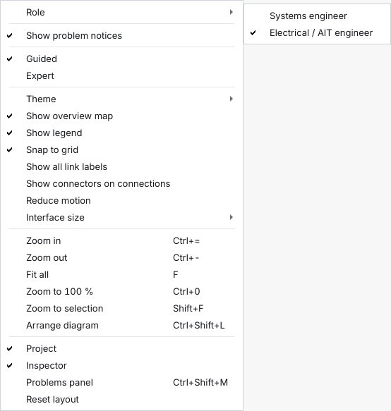
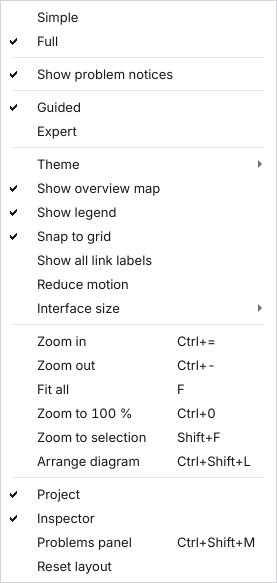
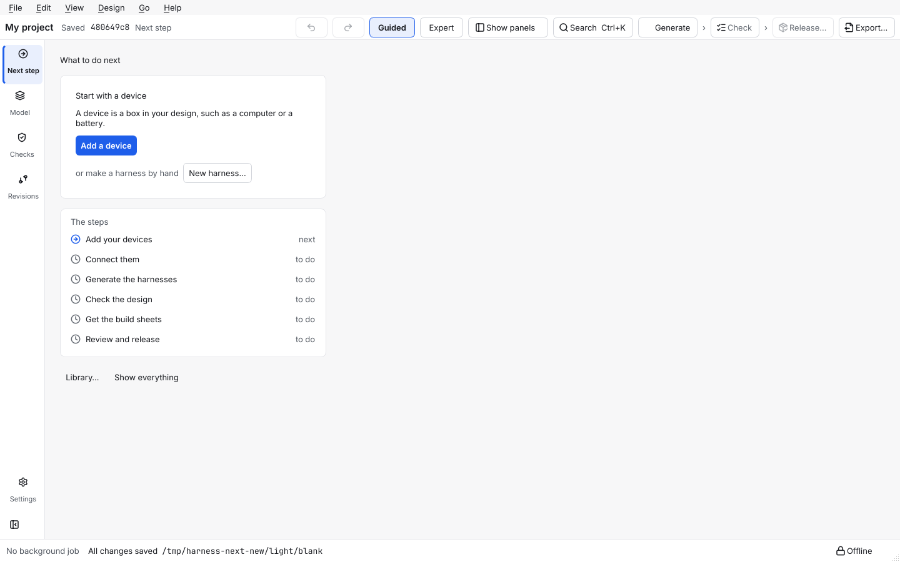
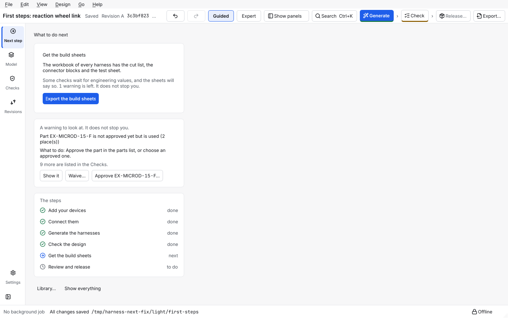
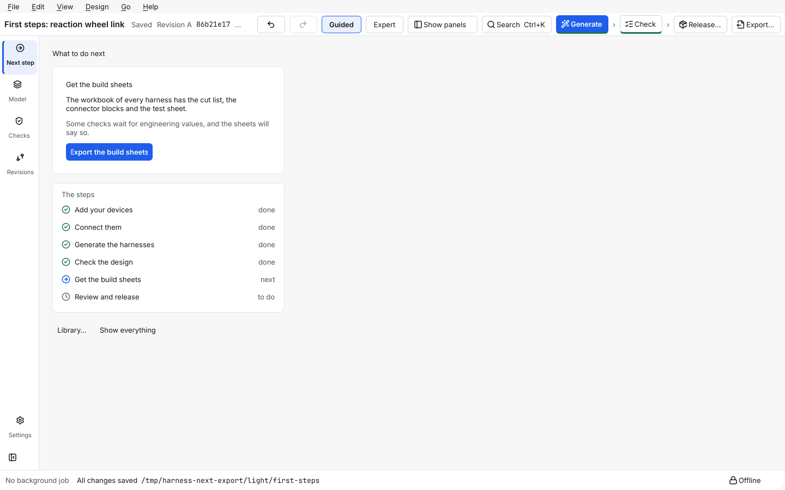

# Choose your role

The editor has three **roles**: Systems engineer, Electrical engineer and AIT engineer. A role says who you are working as, and it decides what the window shows first: which areas the rail lists, whether the side panels are open, which page a project opens on and whether problem notices appear. This page describes the three roles and the **Next step** page, one page that tells you what to do now, in plain words, with one button.

**In one minute.** Pick the role that fits your work. A **Systems engineer** thinks in devices and the connections between them, an **Electrical engineer** in connectors, pins and wires, an **AIT engineer** in building, testing and the records of what was built. The **Role** button in the top bar changes it at any time; nothing is locked, only what you see first changes. If you want nothing but a quick block diagram, turn on **Quick mode** in the same button and follow [Make a block diagram in five minutes](quick-diagram.md).

> **Three roles since the transparency work, stage S9 (decisions D-191, D-193).** The role that was called *Electrical / AIT engineer* is now two: the **Electrical engineer** (the role you had, with the same name of the stored setting `electrical`; a stored `electrical_ait` is read as Electrical) and the new **AIT engineer** (assembly, integration and test), next to the **Systems engineer**, which is unchanged. Nothing is taken away from a person who used the old role: the Electrical engineer lists every area and menu entry the old role listed, except the new **As-built** page, which is the AIT engineer's. The AIT role is new and has settings keys of its own, so no saved layout is overwritten.

> **New in the workshop milestone M5 (decision D-176, version 1.8.0).** The two roles **replace** the *Simple* and *Full* workspaces of version 1.7.0 (decision D-171): the *Simple* workspace is now the **Systems engineer** role and the *Full* workspace is the **Electrical engineer** role, and nothing on screen says *Simple*, *Full* or *workspace* any more. A project from an earlier version opens as it is, and nothing that is written to disk changes: a role is a view of the program, never a permission, and it is never stored in a project.

## Contents

- [What it is for](#what-it-is-for)
- [The three roles](#the-three-roles)
- [What each role lists](#what-each-role-lists)
- [Choose and change your role](#choose-and-change-your-role)
- [What the Systems engineer role shows less](#what-the-systems-engineer-role-shows-less)
- [Quick mode: a short layout on top of any role](#quick-mode-a-short-layout-on-top-of-any-role)
- [The Next step page](#the-next-step-page)
- [What it says, step by step](#what-it-says-step-by-step)
- [Where the buttons go](#where-the-buttons-go)

## What it is for

The workshop of October 2026 said the tool is too crowded, that a user feels overwhelmed too fast, and that it should have two user modes: one for systems engineers and one for electrical and AIT engineers. (The test users of version 1.6.0 had said the same: the editor showed too much at once.) A systems engineer thinks in devices and the connections between them; an electrical or AIT engineer thinks in connectors, pins and wires. Each role therefore starts with the things that person works with, and the rest stays one step away.

## The three roles

| | **Systems engineer** | **Electrical engineer** | **AIT engineer** |
|---|---|---|---|
| Thinks in | devices, the connections between devices, subsystems, the library, the checks | connectors, pinouts, harnesses, wires, the engineering values and the models | the build data, the build sheets, the outputs, the as-built records, the workflow |
| A project opens on | the **Next step** page | the diagram (**Model**) | the **Next step** page |
| Rail | Next step, Model, Checks, Revisions, Settings | Next step, Home, Model, Checks, Drawings, Outputs, Revisions, Settings | Next step, Home, Checks, Drawings, Outputs, As-built, Revisions, Settings |
| Side panels (project tree, inspector) | closed until asked for (**Show panels**) | open | open |
| Minimap, legend, status counts | off | on | on |
| Tools above the diagram | **Select**, **Connect**, **Add device**, **More** | all of them | all of them |
| Problem notices | off until you turn them on | on | on |
| Leaves out of the menus | the engineering entries (42, see below) and the as-built entries | the as-built entries | the editing of the diagram (30 entries) |
| Needs nothing else | the **Connections** group of the project tree, **File > Library…** and the **Library…** button of the Next step page are there | everything else is there | the **As-built records…** button on the Next step page, **Go > Go to As-built** and **File > Import > Import as-built sheet…** are there |

No role locks anything. A role is only what you see first; everything a role leaves out is still in the menus, on its keys and in the command palette (Ctrl+K), and the **Next step** page is reachable in all three (it is the first item of the rail).

## Choose and change your role

- **At the first start** (a settings file with nothing stored yet), a small window asks **Who are you working as?** with three big buttons, each with one sentence, and says *You can change this later in View > Role.* It is asked once, before the tour of the first start. Closing the window without choosing means Electrical engineer, which shows everything.

- **Always in view:** the top bar has a **Role** button that says who the window is set up for (for example *Role: Systems engineer*). One click lists the three roles; pick one and the window changes at once. It is in the bar in every role and it is the same choice as **View > Role** (since 1.14).
- **Later**, choose **View > Role > Systems engineer**, **Electrical engineer** or **AIT engineer**, or the row **Role** at the top of the Editing section of the **Settings** page. The menu and the Settings row follow each other, and the command palette (Ctrl+K) finds both entries. The three entries exclude each other.
- **The change is at once.** No restart is needed. The page you are on stays; the next project you open starts on the first page of the role.
- **Each role remembers its own layout** (the panels, the minimap, the legend, the problem notices, and for each project the open area). Switching from one role to the other and back gives you the layout you had; closing the window in a role opens it in that role next time. The settings keys of the Electrical engineer are the ones of the old *Full* workspace and those of the Systems engineer the ones of the *Simple* workspace, so nobody lost a layout.
- **If you already used the editor** (a settings file that holds values and no role, or one that stores `electrical` or `electrical_ait`) you are an **Electrical engineer** without being asked, because that is what you had; the **AIT engineer** is in **View > Role** and in the question of the first start. A person who chose *Simple* in version 1.7.0 becomes a Systems engineer.
- **The command line has no role**, and a role is not part of the project: two people can open the same project in different roles.

The View menu with its **Role** submenu open (the picture is from before the AIT role was added and shows two entries; there are three now):

This is separate from **Guided / Expert** in the top bar, which only changes how much the diagram shows.

The same project as a Systems engineer, with the side panels, the minimap, the legend, the status counts and the problem notices (the status chip of the top bar and the badges on the diagram) left out, a rail of five areas, and **Select**, **Connect**, **Add device** and **More** above the diagram. **Show panels** is in the top bar:

The same project as an Electrical engineer, with the project tree on the left, the Inspector on the right, the full tool row, the legend and the minimap of the diagram, and the counts in the status bar:

## What each role lists

A role is a named set of the pages on the rail and the entries of the menus. The table says what each role **lists**; whatever it does not list is still reachable (the command palette, Ctrl+K, runs every command; the keys work; **View > Role** changes the role). A test (`tests/test_ui_role_pages.py`) opens the window in each role, lists the visible entries, and fails if an area or an entry is hidden in every role.

| Area (rail) | Systems engineer | Electrical engineer | AIT engineer |
|---|---|---|---|
| Next step | listed | listed | listed |
| Home | `Go > Go to Home` | listed | listed |
| Model (diagram, devices) | listed | listed | `Go > Go to Diagram` is not listed; Ctrl+1 and the palette reach it |
| Checks | listed | listed | listed |
| Drawings | Ctrl+2, the palette | listed | listed |
| Outputs | Ctrl+3, the palette, the Next step buttons | listed | listed |
| As-built | `Go > Go to As-built`, the palette | `Go > Go to As-built` is not listed; the palette reaches it | listed |
| Revisions | listed | listed | listed |
| Settings | listed | listed | listed |

**The pending-values link (fixed in S9).** The status bar's link *n values pending, m rules not checked* is a problem notice, and problem notices are off for the Systems engineer; so the Systems engineer used to see no sign that engineering values were still to set. The Next step page now says it in every role, in a quiet line under the steps (*n engineering values are still to set. Until they are set, some rules cannot be checked*), with the button **Set the values…** that opens the engineering values; the same count is in *What this step uses and makes* (below). The menu entry **Design > Engineering values…** is still left out of the Systems engineer's menus; the button, Ctrl+K and the Settings page reach the same window.

## What the Systems engineer role shows less

To show less at once, the Systems engineer role starts with these things closed or off. Nothing is removed: each one is still in the **View** menu (with its shortcut where it has one, for example Ctrl+Shift+M for the Problems panel), and in the command palette (Ctrl+K).

| Thing | Systems engineer | Electrical engineer |
|---|---|---|
| Project tree and Interfaces tab (left) | closed | open |
| Inspector (right) | closed | open |
| Problems panel (bottom) | closed | closed until asked |
| Problem notices: the **Problems** button and count, the count on the inspector tab, the top-bar status chip, the chip and the badges on the diagram, the pending-values link, the *out of date* banner | off | on |
| Minimap and legend of the diagram | off | on |
| Status bar | the save state, the running job, *Offline* and the project path | everything, with the counts, the *Problems* button (while the problem notices are on) and the zoom value |
| Tools above the diagram | **Select**, **Connect**, **Add device** and **More** | all of them |
| Rail | Next step, Model, Checks, Revisions, Settings | the same and Home, Drawings and Outputs |

- **The menus list less (since 1.9).** The Systems engineer's menus leave out the entries for wires, harnesses, zones, aligning devices, the interface-first way (**Connect with an interface type…**, **New interface…**), the drawing options of the diagram, revisions of a harness, the engineering values and the detail views. Every one of them is still in the command palette (Ctrl+K) and on its key; the Electrical engineer's menus list all of them.
- **After each step you stay where you are (since 1.9).** Adding a device, generating, creating a harness from a connection and adding library devices leave the Systems engineer on the Next step page or the diagram, not in a detail tab.
- **More** holds the other tools: *Create redundant copy*, *Delete*, *Zoom out*, *Zoom in*, *Fit all*, *Arrange diagram*, and a **Show only** menu (all interfaces, by signal class, by connector, by bundle).
- **Show panels** (a button in the top bar, and **Show side panels** first in the View menu) opens or closes the project tree and the inspector together. It is only there for the Systems engineer. The project tree has the **Connections** group (see [connect two connectors](connect-two-connectors.md)).
- **Home, Drawings and Outputs are not listed in the rail**, but they are reachable: **Go > Go to Home** (Ctrl+7); **Go to Harness** (Ctrl+2) and **Go to Lists** (Ctrl+3), which the Systems engineer's **Go** menu does not list since 1.9 but which work on their keys and in the command palette; and the buttons of the Next step page (**Go to Releases**, **Open the Outputs**). The area you are in is always listed, and goes from the rail again when you leave it. The library is **File > Library…** (Ctrl+Shift+O), the **Library…** button of the Next step page and the command palette.
- **Show everything**, under the steps of the Next step page, switches to the Electrical engineer role and opens the Model area.
- Selecting something with the inspector closed shows a short message once per window with a **Show panels** button. Opening a problem from the Problems panel or a check opens the inspector by itself.
- **Problem notices are off for the Systems engineer.** Without them the window does not show a problem count, a status chip or badges until you ask: press **Check** (F5), open the **Checks** area (**Show the problems** on the Next step page does it) or the Problems panel (Ctrl+Shift+M). To see them anyway, choose **View > Show problem notices**; each role remembers its own choice, so this does not change the Electrical engineer. What says why something cannot be done (read-only, locked, damaged files, the sample project) is not a problem notice and stays. See [read and fix problems](read-and-fix-problems.md#turn-the-problem-notices-off).

To see the problem notices as a Systems engineer, tick **Show problem notices** in the **View** menu (the picture is the View menu of the Electrical engineer, where it is ticked; for the Systems engineer there is one more entry at the top, **Show side panels**):

## Quick mode: a short layout on top of any role

Quick mode is for the person who only wants to draw the devices of a set-up and their connections, for a test or a meeting, and has no use for the checks and the paperwork around them. It is **not a fourth role**: it is a switch that works with every role (**Role** button in the top bar, below the three roles, or **View > Quick mode**, or the check box on the **Settings** page next to *Show problem notices*, or Ctrl+K and *Quick mode*). It is off until you turn it on, it takes effect at once without a restart, and the tool remembers it.

While it is on, the window shows less:

- **The rail** lists the **Model**, **Home** and **Settings**. Next step, Checks, Drawings, Outputs, Revisions and As-built are left out (the area that is open stays listed until you leave it).
- **The top bar** keeps the project name, the save marker, Undo and Redo, the Role button, a **Quick** marker (click it to leave Quick mode), the search and one button, **Export diagram**. Generate, Check, Release, Export, the model hash, the revision and the status chip are left out.
- **Problem notices** are off whatever you chose in *Show problem notices* (your own choice comes back when you leave Quick mode): no Problems count, no badges on the diagram, no *out of date* banner. The banners that say why something cannot be done (read-only, released data) stay.
- **No tour** and no first-start question about the role. A project opens on the diagram, whatever the role.
- The banner of the sample project stays and is shorter.

Nothing is locked and nothing is deleted. Every hidden area and command is still in the menus (**Go**, **View**, **File**, **Design**) and in the command palette (Ctrl+K), and the keys (Ctrl+G, F5, Ctrl+E) work. Quick mode changes only what the window shows and what it asks; it never changes a project file, the model hash or a written file. Turn it off and the layout of your role is back exactly as it was.

The five steps of the quickest way to a picture are on one page: [Make a block diagram in five minutes](quick-diagram.md).

## The Next step page

Open it with **Next step**, the first item of the rail on the left; a Systems engineer's project opens on it. It works the same in every role. It has:

- the heading **What to do next**;
- one card with a short title, one sentence that says why, and **one** main button; on an empty project the card also offers *or make a harness by hand* with the button **New harness…**;
- the six steps of the work, each with an icon **and** a word: *done*, *next*, *to do*, and *not possible* when the project is read-only;
- two link-style buttons, **Library…** and **Show everything**, for the Systems engineer only (the library window, and the switch to the Electrical engineer role), and, for the AIT engineer, the button **As-built records…**;
- a quiet line, only while engineering values are still to set, with the button **Set the values…**;
- a disclosure, **What this step uses and makes**, closed until you open it: the project files and outputs the step uses and makes, the intermediate results you can look at, and where the project stands in each step of the whole workflow. It is the same table as [follow the workflow](follow-the-workflow.md).

The page of a new, empty project: the card says *Start with a device* and offers **Add a device**, and *or make a harness by hand* with **New harness…**. The six steps below it show *next* on the first one and *to do* on the others:

When checks fail with an error, the card says *Fix what is marked*, how many failed, and offers **Show the problems**. Under it a second card shows **the first open problem** (errors first): what is wrong, *What to do* in one sentence, and the buttons that apply (since 1.9): **Show it** goes to the thing the problem is about; **Waive…** asks for a written reason and is there only where the check allows a waiver (warnings, not errors); **Approve …** is there for an unapproved part and asks first (*Approve part X?*): it marks that part approved and no longer example data, as one undo step you can undo, and it is refused for a part somebody marked *not approved* or that a release has locked. Only press it for a part you or your team have checked. **A warning does not hold the page:** when only warnings are left, the page goes on to the next step (*Get the build sheets*, *Review and release*) and says *n warnings are left. They do not stop you.*; the card keeps showing the first one. This is the tutorial project after Generate, with its parts not approved yet, which is a warning (the picture shows the card of the next step and under it the card of the first open problem, here that warning):

When the design is checked and nothing fails, the card says *Get the build sheets* and offers **Export the build sheets**. Some checks still wait for engineering values, and the card says so in one sentence:

## What it says, step by step

The page names the first step that is not done. The rules run in this order.

| What is true of the project | Title | Button |
|---|---|---|
| A job is running | Working… | none; please wait |
| The project is read-only (saved by a newer version, or open in another window) | You can only look at this project | none; **Save a copy** is in the banner |
| No device and no harness | Start with a device | **Add a device** |
| No connection (an interface, or two connectors joined pin by pin) and no harness | Connect your devices | **Connect two devices** |
| Connections between connectors, but no harness and no interface (new in 1.8.0) | Make the harness of your connection | **Create harness** |
| No harness yet, or the plans are out of date (not for a project whose harnesses were all made by hand) | Generate the harnesses (again) | **Generate the harnesses** |
| The design was not checked | Check the design | **Check the design** |
| Checks failed | Fix what is marked | **Show the problems** |
| The files are not up to date | Get the build sheets | **Export the build sheets** |
| A harness is not released | Review and release | **Go to Releases** |
| Everything is released | Everything is released | **Open the Outputs** |

When some checks wait for engineering values, the *Get the build sheets* card says so in one sentence; it never blocks you, because the build workbook marks what is still open.

## Where the buttons go

Each button opens something that already exists: **Add a device** opens the window **Add device**, which asks for the name first (the same as **Edit > Add device > Device…**, with the picture in [define a device](define-a-device.md#1-add-the-device)), and **New harness…** opens the same window as in the Drawings area; **Connect two devices** opens the diagram with the Connect tool, which opens the window **Link connectors** after two devices ([connect two connectors](connect-two-connectors.md)); **Create harness** shows what the harness will contain and makes it only when you agree, for the first connection that has no harness yet; **Generate the harnesses**, **Check the design** and **Export the build sheets** do what their menu entries do (for a project that has no folder yet, **Export** first asks where to save it: the note on the page says *Export first asks where to save the project.*); **Show the problems** opens the Checks area with the failed rules; **Go to Releases** and **Open the Outputs** open those areas.

The window that **Add a device** opens (also the **Add device** tool above the diagram of the Systems engineer), with a name typed and the ID suggested from it (the window also has **Number of these devices** and an optional **First connector**, both in the picture; [define a device](define-a-device.md#1-add-the-device)):

Next: [follow the workflow](follow-the-workflow.md), [record what was built](record-what-was-built.md), [generate harnesses](generate-harnesses.md), [read and fix problems](read-and-fix-problems.md), [export the outputs](export-the-outputs.md).
