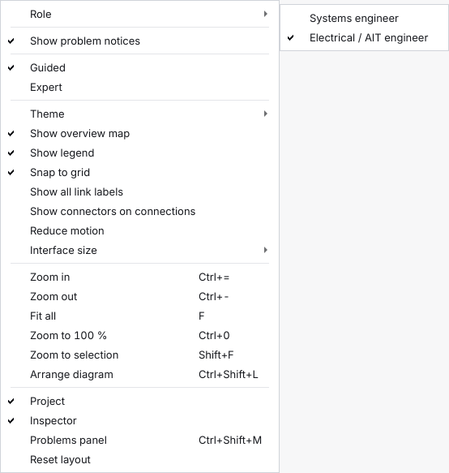

# Choose your role

The editor has two **roles**. A role says who you are working as, and it decides what the window shows first: which areas the rail lists, whether the side panels are open, which page a project opens on and whether problem notices appear. This page describes the two roles and the **Next step** page, one page that tells you what to do now, in plain words, with one button.

> **New in the workshop milestone M5 (decision D-176; not in a release yet).** The two roles **replace** the *Simple* and *Full* workspaces of version 1.7.0 (decision D-171): the *Simple* workspace is now the **Systems engineer** role and the *Full* workspace is the **Electrical / AIT engineer** role, and nothing on screen says *Simple*, *Full* or *workspace* any more. A project from an earlier version opens as it is, and nothing that is written to disk changes: a role is a view of the program, never a permission, and it is never stored in a project.

## Contents

- [What it is for](#what-it-is-for)
- [The two roles](#the-two-roles)
- [Choose and change your role](#choose-and-change-your-role)
- [What the Systems engineer role shows less](#what-the-systems-engineer-role-shows-less)
- [The Next step page](#the-next-step-page)
- [What it says, step by step](#what-it-says-step-by-step)
- [Where the buttons go](#where-the-buttons-go)

## What it is for

The workshop of October 2026 said the tool is too crowded, that a user feels overwhelmed too fast, and that it should have two user modes: one for systems engineers and one for electrical and AIT engineers. (The test users of version 1.6.0 had said the same: the editor showed too much at once.) A systems engineer thinks in devices and the connections between them; an electrical or AIT engineer thinks in connectors, pins and wires. Each role therefore starts with the things that person works with, and the rest stays one step away.

## The two roles

| | **Systems engineer** | **Electrical / AIT engineer** |
|---|---|---|
| Thinks in | devices, the connections between devices, subsystems, the library, the checks | connectors, pinouts, harnesses, wires, build sheets, tests |
| A project opens on | the **Next step** page | the diagram (**Model**) |
| Rail | Next step, Model, Checks, Revisions, Settings | every area: Next step, Home, Model, Checks, Drawings, Outputs, Revisions, Settings |
| Side panels (project tree, inspector) | closed until asked for (**Show panels**) | open |
| Minimap, legend, status counts | off | on |
| Tools above the diagram | **Select**, **Connect**, **Add device**, **More** | all of them |
| Problem notices | off until you turn them on | on |
| Needs nothing else | the **Connections** group of the project tree, **File > Library…** and the **Library…** button of the Next step page are there | everything is there |

Neither role locks anything. A role is only what you see first; everything a role leaves out is still in the menus, on its keys and in the command palette (Ctrl+K), and the **Next step** page is reachable in both (it is the first item of the rail).

## Choose and change your role

- **At the first start** (a settings file with nothing stored yet), a small window asks **Who are you working as?** with two big buttons, each with one sentence, and says *You can change this later in View > Role.* It is asked once, before the tour of the first start. Closing the window without choosing means Electrical / AIT engineer, which shows everything.

- **Later**, choose **View > Role > Systems engineer** or **Electrical / AIT engineer**, or the row **Role** at the top of the Editing section of the **Settings** page. The menu and the Settings row follow each other, and the command palette (Ctrl+K) finds both entries. The two entries exclude each other.
- **The change is at once.** No restart is needed. The page you are on stays; the next project you open starts on the first page of the role.
- **Each role remembers its own layout** (the panels, the minimap, the legend, the problem notices, and for each project the open area). Switching from one role to the other and back gives you the layout you had; closing the window in a role opens it in that role next time. The settings keys of the Electrical / AIT engineer are the ones of the old *Full* workspace and those of the Systems engineer the ones of the *Simple* workspace, so nobody lost a layout.
- **If you already used the editor** (a settings file that holds values and no role) you become an **Electrical / AIT engineer** without being asked, because that is what you had. A person who chose *Simple* in version 1.7.0 becomes a Systems engineer.
- **The command line has no role**, and a role is not part of the project: two people can open the same project in different roles.

The View menu with its **Role** submenu open (the picture is the Electrical / AIT engineer):

This is separate from **Guided / Expert** in the top bar, which only changes how much the diagram shows.

The same project as a Systems engineer, with the side panels, the minimap, the legend, the status counts and the problem notices (the status chip of the top bar and the badges on the diagram) left out, a rail of five areas, and **Select**, **Connect**, **Add device** and **More** above the diagram. **Show panels** is in the top bar:

The same project as an Electrical / AIT engineer, with the project tree on the left, the Inspector on the right, the full tool row, the legend and the minimap of the diagram, and the counts in the status bar:

## What the Systems engineer role shows less

To show less at once, the Systems engineer role starts with these things closed or off. Nothing is removed: each one is still in the **View** menu (with its shortcut where it has one, for example Ctrl+Shift+M for the Problems panel), and in the command palette (Ctrl+K).

| Thing | Systems engineer | Electrical / AIT engineer |
|---|---|---|
| Project tree and Interfaces tab (left) | closed | open |
| Inspector (right) | closed | open |
| Problems panel (bottom) | closed | closed until asked |
| Problem notices: the **Problems** button and count, the count on the inspector tab, the top-bar status chip, the chip and the badges on the diagram, the pending-values link, the *out of date* banner | off | on |
| Minimap and legend of the diagram | off | on |
| Status bar | the save state, the running job, *Offline* and the project path | everything, with the counts, the *Problems* button (while the problem notices are on) and the zoom value |
| Tools above the diagram | **Select**, **Connect**, **Add device** and **More** | all of them |
| Rail | Next step, Model, Checks, Revisions, Settings | the same and Home, Drawings and Outputs |

- **More** holds the other tools: *Create redundant copy*, *Delete*, *Zoom out*, *Zoom in*, *Fit all*, *Arrange diagram*, and a **Show only** menu (all interfaces, by signal class, by connector, by bundle).
- **Show panels** (a button in the top bar, and **Show side panels** first in the View menu) opens or closes the project tree and the inspector together. It is only there for the Systems engineer. The project tree has the **Connections** group (see [connect two connectors](connect-two-connectors.md)).
- **Home, Drawings and Outputs are not listed in the rail**, but they are reachable: **Go > Go to Home** (Ctrl+7), **Go > Go to Harness** and **Go to Lists**, the same entries in the command palette, and the buttons of the Next step page (**Go to Releases**, **Open the Outputs**). The area you are in is always listed, and goes from the rail again when you leave it. The library is **File > Library…** (Ctrl+Shift+O), the **Library…** button of the Next step page and the command palette.
- **Show everything**, under the steps of the Next step page, switches to the Electrical / AIT engineer role and opens the Model area.
- Selecting something with the inspector closed shows a short message once per window with a **Show panels** button. Opening a problem from the Problems panel or a check opens the inspector by itself.
- **Problem notices are off for the Systems engineer.** Without them the window does not show a problem count, a status chip or badges until you ask: press **Check** (F5), open the **Checks** area (**Show the problems** on the Next step page does it) or the Problems panel (Ctrl+Shift+M). To see them anyway, choose **View > Show problem notices**; each role remembers its own choice, so this does not change the Electrical / AIT engineer. What says why something cannot be done (read-only, locked, damaged files, the sample project) is not a problem notice and stays. See [read and fix problems](read-and-fix-problems.md#turn-the-problem-notices-off).

To see the problem notices as a Systems engineer, tick **Show problem notices** in the **View** menu (the picture is the View menu of the Electrical / AIT engineer, where it is ticked; for the Systems engineer there is one more entry at the top, **Show side panels**):

## The Next step page

Open it with **Next step**, the first item of the rail on the left; a Systems engineer's project opens on it. It works the same in both roles. It has:

- the heading **What to do next**;
- one card with a short title, one sentence that says why, and **one** main button; on an empty project the card also offers *or make a harness by hand* with the button **New harness…**;
- the six steps of the work, each with an icon **and** a word: *done*, *next*, *to do*, and *not possible* when the project is read-only;
- two link-style buttons, **Library…** and **Show everything**, for the Systems engineer only (the library window, and the switch to the Electrical / AIT engineer role).

The page of a new, empty project: the card says *Start with a device* and offers **Add a device**, and *or make a harness by hand* with **New harness…**. The six steps below it show *next* on the first one and *to do* on the others:

When checks fail, the card says *Fix what is marked*, how many failed, and offers **Show the problems**. This is the tutorial project after Generate, with one check that fails because its parts are not approved yet:

When the design is checked and nothing fails, the card says *Get the build sheets* and offers **Export the build sheets**. Some checks still wait for engineering values, and the card says so in one sentence:

## What it says, step by step

The page names the first step that is not done. The rules run in this order.

| What is true of the project | Title | Button |
|---|---|---|
| A job is running | Working… | none; please wait |
| The project is read-only (saved by a newer version, or open in another window) | You can only look at this project | none; **Save a copy** is in the banner |
| No device and no harness | Start with a device | **Add a device** |
| No connection (an interface, or two connectors joined pin by pin) and no harness | Connect your devices | **Connect two devices** |
| Connections between connectors, but no harness and no interface (after 1.7.0, not in the latest release yet) | Make the harness of your connection | **Create harness** |
| No harness yet, or the plans are out of date (not for a project whose harnesses were all made by hand) | Generate the harnesses (again) | **Generate the harnesses** |
| The design was not checked | Check the design | **Check the design** |
| Checks failed | Fix what is marked | **Show the problems** |
| The files are not up to date | Get the build sheets | **Export the build sheets** |
| A harness is not released | Review and release | **Go to Releases** |
| Everything is released | Everything is released | **Open the Outputs** |

When some checks wait for engineering values, the *Get the build sheets* card says so in one sentence; it never blocks you, because the build workbook marks what is still open.

## Where the buttons go

Each button opens something that already exists: **Add a device** opens the window **Add device**, which asks for the name first (the same as **Edit > Add device > Device…**, with the picture in [define a device](define-a-device.md#1-add-the-device)), and **New harness…** opens the same window as in the Drawings area; **Connect two devices** opens the diagram with the Connect tool, which opens the window **Link connectors** after two devices ([connect two connectors](connect-two-connectors.md)); **Create harness** shows what the harness will contain and makes it only when you agree, for the first connection that has no harness yet; **Generate the harnesses**, **Check the design** and **Export the build sheets** do what their menu entries do (for a project that has no folder yet, **Export** first asks where to save it: the note on the page says *Export first asks where to save the project.*); **Show the problems** opens the Checks area with the failed rules; **Go to Releases** and **Open the Outputs** open those areas.

The window that **Add a device** opens (also the **Add device** tool above the diagram of the Systems engineer), with a name typed and the ID suggested from it:

Next: [generate harnesses](generate-harnesses.md), [read and fix problems](read-and-fix-problems.md), [export the outputs](export-the-outputs.md).
