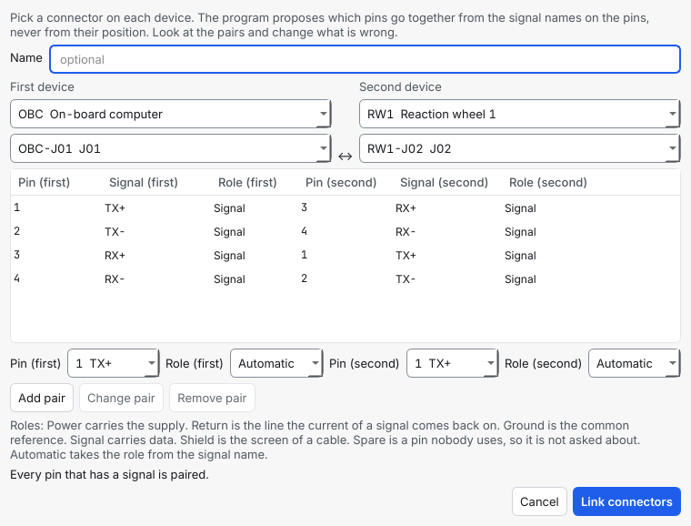
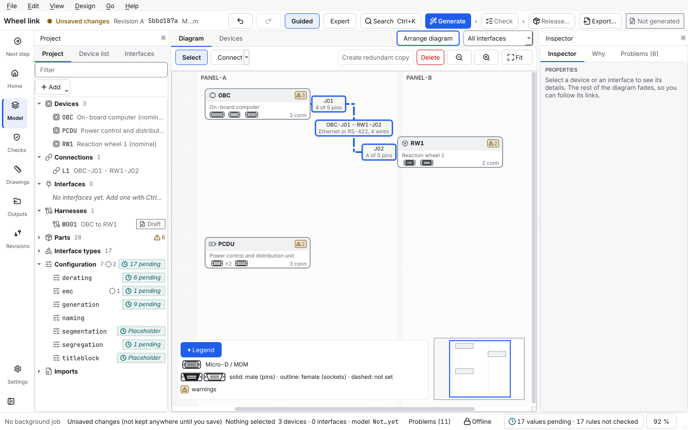

# Connect two connectors

This page shows how to join a connector of one device to a connector of another, pin by pin, starting from the names you gave the pins. The program proposes which pins go together, you look at the pairs and change them, and the program reviews the result and makes a harness only when you ask it to.

> **New in 1.8.0.** This is milestone M2 of the workshop feedback (decision D-173). Connecting by interface type, as before, is still there ([draw the design](draw-the-design.md), step 3). The steps in the app are described from the program's code and its tests; the program was not watched on a screen while this page was written.

## Contents

- [When to connect connectors](#when-to-connect-connectors)
- [Before you start](#before-you-start)
- [1. Link the connectors](#1-link-the-connectors)
- [2. How the pairs are proposed](#2-how-the-pairs-are-proposed)
- [3. Look at the pairs and change them](#3-look-at-the-pairs-and-change-them)
- [Add a connector, pair by pin number and paste a pairing](#pair-by-pin-number-and-paste-a-pairing)
- [What a pin is for: power, return and ground](#what-a-pin-is-for-power-return-and-ground)
- [4. See your connections](#4-see-your-connections)
- [5. Check my connections](#5-check-my-connections)
- [6. Create the harness](#6-create-the-harness)
- [Change, rename or delete a connection](#change-rename-or-delete-a-connection)
- [What the program never does](#what-the-program-never-does)
- [Common mistakes](#common-mistakes)

## When to connect connectors

- You already know what is on each pin of two devices (a pinout from the supplier, a spreadsheet or your own table), and you want the connection to follow your pinout, not the other way round.
- You want the program to say whether the pairing looks right: a pin left over, two outputs on one wire, a power pin with no return.
- You want a harness with one wire for each pair of pins, without describing an interface first.

When you would rather say only *what* must be connected (an RS-422 link, a power supply) and let the program choose the pins, use an interface and Generate ([draw the design](draw-the-design.md), [generate harnesses](generate-harnesses.md)). Both ways can be used in one project.

## Before you start

- A project with two devices, and on each device the connector you want to join, with its pins named (a signal on each pin you use). Add the devices and connectors, and type the signal names, in the **Devices** tab ([define a device](define-a-device.md)), or load the pinouts from a spreadsheet ([define a device](define-a-device.md#take-the-pinout-from-a-spreadsheet)). A pin with no signal is never proposed and never asked about.
- The example below is two devices: a computer `OBC` with the connector `OBC-J01` (pins 1 to 4 named `TX+`, `TX-`, `RX+`, `RX-`) and a reaction wheel `RW1` with `RW1-J02` (the same four names). The names are example data.
- As a Systems engineer the tree and the inspector are closed; **Show panels** in the top bar opens them. The steps below work in both roles.

## 1. Link the connectors

Use any of these. They open the same window.

- **Edit > Link connectors…** (Ctrl+Shift+K).
- The **Connect** button above the diagram, or the key **C**: click the first device, then the second. (The arrow next to the button is the older way, by interface type.)
- Right-click the **Connections** group of the project tree and choose **Link connectors…**, or right-click a device on the diagram and choose **Link connectors from here…**.

The window **Link connectors** opens:

1. Pick the **First device** and its **Connector**, then the **Second device** and its connector. A connection joins two **different** devices; the window says so if you pick one device twice. A connector can be in several connections, but a pin in one pair of one connection only.
2. The table **Pairs of pins** shows what the program proposes: the pin, its signal and its role on the first connector, beside the pin, signal and role on the second.
3. **Name** is optional. Without a name the connection is called after its two connectors, `OBC-J01 - RW1-J02`.
4. Press **Link connectors**. The connection is made as one undo step (Ctrl+Z takes it back) and the diagram shows it.

## 2. How the pairs are proposed

The program reads the **signal names** on the pins. It never pairs by position: pin 1 does not go with pin 1 unless the names say so.

- **The same name goes with the same name.** `PWR` with `PWR`, `RTN` with `RTN`, `CANH` with `CANH`.
- **The two ends of one line cross over.** A transmit pin meets a receive pin: `TX` with `RX`, `TXD` with `RXD`, `TX+` with `RX+`, `TX-` with `RX-`, `TXP` with `RXP`, `TXN` with `RXN`, whichever device has which. In the picture pin 1 (`TX+`) of the computer is paired with pin 3 (`RX+`) of the wheel. Case does not matter.
- **The directions must fit.** Where an interface type tells which way a signal goes, an output is paired with an input, and with a pin that goes both ways or that has no direction. An output is **not** paired with an output, nor an input with an input; the notes under the table say which names were left out and why.
- **A pin is used once.** A pin that another connection already pairs is not offered again, and the notes say so.
- **A pin with no counterpart is left out, and listed.** The line under the table names the pins that have a signal and no pair: *Not paired on OBC-J01: 4.* A pin with no signal is never proposed and never listed. A pin you do not use can be given the role Spare, and then it is not listed either.

The proposal is the same every time for the same pins. It is a proposal only: nothing is saved until you press **Link connectors**.

## 3. Look at the pairs and change them

- **Change pair:** pick a row, choose another pin on either side under the table, press **Change pair**.
- **Add pair:** choose a pin on each side and press **Add pair**.
- **Remove pair:** pick a row and press **Remove pair**.
- A pin in two pairs, no pair at all, or the same device twice is refused at once, in words under the table, and the button stays off until you fix it. That is all that stops you; the program does not forbid what only looks odd.
- **What looks wrong** is written under the table while you work, in plain words: two outputs on one pair, names that differ across a pair, a pin that is named but not paired, power with no return. The same review is *Check my connections* (step 5). You may still make the connection; the review keeps asking until you have fixed it or accepted it.

## Pair by pin number and paste a pairing

Pins that have no signal names, as on a connector that was just added to a device, get no proposal by name. Three buttons in the window help (since 1.9). Each shows what it would do and waits for you.

- **Add a connector…** sits under each device. Use it when the device has no connector yet (the window says *Device … has no connector yet. Press Add a connector under it.*) or has the wrong one. Pick the kind of connector (family, pins, gender) and, if you like, its name; the pins are numbered `1` to `N` with no signal names. The connector is made together with the connection, as part of the same undo step, and not at all if you cancel the window. It is not available when you change the pairs of a connection that exists.
- **Pair by pin number** proposes pin 1 with pin 1, pin 2 with pin 2 and so on (the same pin number or name on both connectors, case ignored). Pins that have no partner are listed as left over.
- **Paste a pairing…** takes two columns from a table (a pin of the first connector, a tab, a pin of the second; one line is one pair; a heading line is skipped). Commas, semicolons and spaces work too, and more columns are ignored. A line that cannot be used (a pin that does not exist, a pin used twice) is named and skipped; the other lines are proposed.

A proposal appears in a box under the buttons with the pairs and the notes (what was left out and why). **Nothing is paired until you press Accept the pairs**; **Discard** forgets it. Accepted pairs join the table above, never replace it, and a pin that is in the table already or in another connection is not offered again. Changing a device or a connector drops a proposal that waits. Then check the table and press **Link connectors** as usual. The program proposes, you decide.

## What a pin is for: power, return and ground

Each pin has a **role**, shown in the table and set with **Role (first)** and **Role (second)**. **Automatic** takes the role from the signal name; you set a role yourself where the name does not say it, for example a heater return named `HTR-`.

| Role | What it means |
| --- | --- |
| **Power** | The pin carries the supply. A signal of a power interface type, such as `PWR`, is power. |
| **Return** | The line the current of a signal or of the power comes back on. A pin named `RTN` is a return. |
| **Ground** | The common reference. A pin named `GND` is ground. (The metal structure of the spacecraft is the usual reference.) |
| **Signal** | A data or control line. Any other named pin is a signal. |
| **Shield** | The screen of a cable. |
| **Spare** | A pin nobody uses. It is not asked about, and the review does not report it as unpaired. |

**Return** is the one that people ask about: a current needs a way back. A power pair with no return pair on the same connection is reported (*Check my connections*). Roles are saved on the pins of the devices, so every connection that uses the pin sees them.

## 4. See your connections

- **On the diagram.** A connection is a dash-dotted line between the two devices (an interface is a solid line). The label on the line is the two connectors, and under it what the pairs carry, worked out from the pins and never stored: for example *Ethernet or RS-422, 4 wires* (when two interface types have the same signals the label names both) or *CAN, 2 wires*. You never had to include an interface. In Expert mode the line ends at the connectors it joins. Click a line to select it.
- **In the project tree.** The group **Connections** lists them. Double-click one to change its pairs; right-click for the actions; the tooltip shows the pairs, the harness (or *No harness yet*) and what the check says.
- **Edit > Selected connection** has the same actions for the connection you selected: **Edit the pairs…**, **Rename…**, **Create harness**, **Show the harness**, **Delete connection**. The same entries are in the right-click menu of a line.
- **The connectors at the ends (since the workshop milestone M3).** In **Expert** mode, and in Guided mode when **View > Show connectors on connections** is ticked (also a box on the Settings page, remembered), a small box at each end of the line names the connector and says how many of its pins the connection pairs, for example `J01` and `4 of 5 pins`. A click on a box picks the connection. The boxes are not drawn at all while both are off.
- **The harness path.** Once a harness was made from a connection, hovering the line adds a row **Path**: `OBC-J01 - W001-P1 - W001-P2 - RW1-J02` (device connector, cable connector, cable connector, device connector). **Show the harness** (the right-click menu of the line, **Edit > Selected connection**, or the project tree) opens the Harness tab on that harness; it is off, and says *No harness has been made from this connection yet*, until there is one.

## 5. Check my connections

**Design > Check my connections** reviews every connection and **changes nothing**. It opens the Problems panel at the bottom, filtered to **Connections**, and says *Every connection looks fine.* or how many things there are to look at. Each finding is a card that says what is wrong, why and how to fix it; **Show** jumps to the connection on the diagram ([read and fix problems](read-and-fix-problems.md)). With no connection yet it says so.

Four design rules read connections (they are in the list of rules like the others, [`RULES.md`](../RULES.md)):

| Rule | Kind | What it finds | What you do |
| --- | --- | --- | --- |
| `link-unpaired` | warning (waivable) | A pin with a signal that no pair of the connection uses. | Pair the pin, or set its role to Spare. |
| `link-direction` | error | Two outputs on one pair, or two inputs. | Pair the pin with one that fits, or correct the signal. |
| `link-signal-mismatch` | warning (waivable) | A pair whose signal names differ and are not the two ends of one line, or where one pin has no name. | Check the pairing, or rename a signal. |
| `link-power-return` | warning (waivable) | A power pair and no return pair on the same connection. | Pair the return pin, or set the role of the return pin to Return. |

*Check my connections* looks at the pairing only. It does not check a current: a harness made from a connection has wires without an interface, and the current checks do not run on those wires (section 6).

The integrity checks add what cannot be right at all: a connection whose connector or pin no longer exists, a pin in two pairs, both connectors on one device. They are errors and are named in the Problems panel too.

## 6. Create the harness

The connection says which pins go together. It is not yet a harness. When you want one, press **Create harness** (**Edit > Selected connection > Create harness**, the project tree, or the button of the Next step page, which offers it as the next step while you have a connection and no harness and no interface).

1. A window says exactly what will be added: *This adds the harness … with 2 cable connectors and 4 wires, one wire for each pair of OBC-J01 - RW1-J02.* A note says that lengths, gauges and colours stay empty until you enter them.
2. Press **Create harness**. The harness is made as one undo step and the Harness tab opens on it.
3. Enter the lengths, gauges and colours in **Edit wire** ([edit a wire](edit-a-wire.md)); the wires have no length, gauge or colour until you do ([enter the build data](enter-the-build-data.md)). The harness is yours: **Generate** leaves it alone, and it is checked, listed, exported and released like any other ([build a harness by hand](build-a-harness-by-hand.md#what-generate-does-with-it)). One limit: the wires carry no interface, so the current, voltage-drop and bundle checks do not run on them, and a gauge you type is not checked against a current; the Checks area says so with a note (*Current, voltage-drop and bundle checks did not run for … wires … they have no interface*).

The button says why it cannot when it cannot: no pairs yet, or the connection has a harness already. To see the harness again later, use **Show the harness** (section 4). A connection whose harness is released is locked with it ([change a released harness](change-a-released-harness.md)).

## Change, rename or delete a connection

- **Edit the pairs…** opens the same window with the connectors fixed; change the pairs and the roles and press **Save the pairs**. To use other connectors, delete the connection and link again.
- **Rename…** asks for a name (empty clears it).
- **Delete connection** removes the connection. A harness made from it stays, and belongs to you. Deleting a device deletes its connections.
- A harness already made from a connection is **not** changed when you change the pairs; edit its wires in **Edit wire**.
- A pin that a connection pairs cannot be deleted or renamed in the **Devices** tab until the connection changes.

## What the program never does

- **It never makes a harness on its own.** Only the button **Create harness** does, after you have read what it adds.
- **It never decides the pairing for you.** It proposes; the pairs are saved when you press **Link connectors**.
- **It never changes your pinout.** The pins and signals you typed are the source of truth, and **Generate** keeps them.
- It never invents a length, a gauge or a colour.

## Common mistakes

- **No pairs are proposed.** The pins have no signal names, or the names have no counterpart on the other side (`SIGNAL-A` and `SIGNAL-B`), or the pins are paired in another connection already. Name the pins in the **Devices** tab, or add the pairs by hand.
- **The two devices are the same.** A connection joins two different devices; pick the second one.
- **A device has no connector.** The window says *Device … has no connector yet. Press Add a connector under it.* Press **Add a connector…** (or add one in the **Devices** tab first).
- **Create harness does nothing.** Read the line at the button: the connection may have no pairs, or a harness already. Open that harness, or delete it first.
- **Power is reported without a return.** Pair the `RTN` pin, or set the return pin's role to **Return** if its name does not say so.
- **I cannot find the older way.** It is under **Edit > Connect with an interface type…** and in the arrow next to the **Connect** button.

Next: [Enter the build data](enter-the-build-data.md), [edit a wire](edit-a-wire.md), [read and fix problems](read-and-fix-problems.md)
