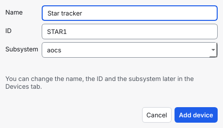
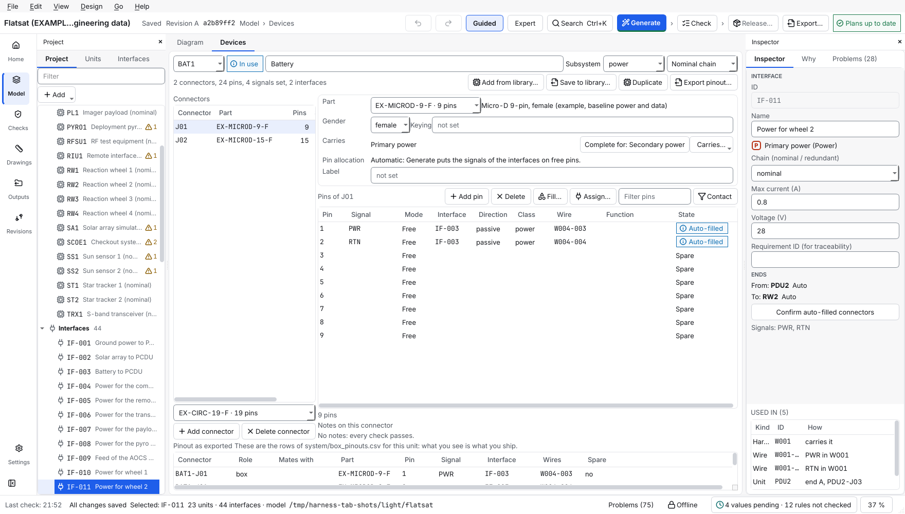

# Define a device

This page shows how to define a device of your own down to each pin: its connectors, the name or number of every pin, the signal on it, and which interface uses which pins. You can do it by hand in the **Devices** tab, or load the pinout from a spreadsheet.

## Contents

- [Before you start](#before-you-start)
- [1. Add the device](#1-add-the-device)
- [2. Add its connectors](#2-add-its-connectors)
- [3. Name the pins and give them signals](#3-name-the-pins-and-give-them-signals)
- [4. Put an interface on pins](#4-put-an-interface-on-pins)
- [Take the pinout from a spreadsheet](#take-the-pinout-from-a-spreadsheet)
- [Check the result and write it out](#check-the-result-and-write-it-out)
- [Use a device in another project](#use-a-device-in-another-project)
- [Change a device later](#change-a-device-later)
- [What a pin can hold](#what-a-pin-can-hold)
- [Common mistakes](#common-mistakes)

## Before you start

- You have a project (for example `harness-design-studio new wheel-link --template first-steps`). The steps in the app are described from the program's code and its tests; the program was not watched on a screen while this page was written. As a Systems engineer press **Model** in the rail (or Ctrl+6) to reach the Devices tab; **Show panels** opens the **Project** tab.
- A **device** is a device with connectors of its own. The **Devices** tab (Ctrl+6; in the **Model** area, beside **Diagram**) shows one device at a time: the device you select on the diagram or in the project tree is the one shown.
- The tool never decides what is approved. A connector part or an interface type that you make here is marked *pending* or *unverified*, and a harness that uses it says so when it is released.
- Everything you do is one undo step with a name, for example *Undo Edit pin GYRO1-J01.A2*.

## 1. Add the device

1. Choose **Edit > Add device > Device…** (Ctrl+Shift+N; on an empty diagram the button **Add a device** does the same, and so do the button of the **Next step** page and the **Add device** tool of the Systems engineer role). A small window, **Add device**, asks for the device first:

   

   - **Name** is required. The hint says *for example Star tracker*.
   - **ID** is suggested as soon as you type the name: the first word, letters and digits only, in upper case, at most 8 characters, followed by the first number that is free. *Star tracker* gives `STAR1`, and the next device with that name gives `STAR2`; *Gyro 3* gives `GYRO3`. You can type another ID. Once you have edited the ID it no longer follows the name.
   - **Subsystem** offers the subsystems the project already has (a new project offers *general*); you can also type a new word.
   - **First connector** (since 1.9) is optional. Pick the kind (the families come from the connector parts of the library, for example *Micro-D* or *D-sub*), the number of pins and, where the library has both halves, the gender. The device then starts with a connector whose pins are numbered `1` to `N` and have no signal names yet; you name them in the **Devices** tab or pair them by number when you connect the device ([connect two connectors](connect-two-connectors.md#pair-by-pin-number-and-paste-a-pairing)). *No connector yet* is the default, and a connector can always be added later (section 2).
   - A line under the fields says why the device cannot be added yet, for example *A device needs a name.*, *A device needs an ID.* or *ID STAR1 is already used by another device.* The button **Add device** stays off until there is no such line.
2. Press **Add device**. The device (and its first connector, if you picked one) appears in a free place of the diagram, as one undo step. As an Electrical / AIT engineer the **Devices** tab opens with its name selected; as a Systems engineer you stay on the Next step page or the diagram. The window says *You can change the name, the ID and the subsystem later in the Devices tab*: there the name is edited by pressing Enter after typing; the **Chain** box says nominal, redundant or none.

The kinds in **Edit > Add device** (computer, power unit and so on, [draw the design](draw-the-design.md#2-add-devices)) do not ask: they add a device at once with an ID and name of their own.

The state chip next to the name says **Draft** while no interface ends on the device, **In use** when one does, and **Locked** once a released harness uses it.

## 2. Add its connectors

1. Under the connector list, open the part picker (Ctrl+Shift+C goes to it). Type to search the library. The first entry is **New part…**: it asks for an ID, the number of pins, the gender and optionally the maker and the part number, and can make the **mating half** at the same time. Both parts are marked *pending* and *unverified*.
2. Press Enter, or **Add connector**. The connector appears with pins `1` to `N`, the number the part has, and its gender is the one the part says.
3. On the connector's card you can change the **part** (a part with another number of pins asks, on one line, whether to resize the pins and set the gender; both happen in one step), the **gender**, the **keying** and what it **Carries**. If the pins already carry every signal of an interface type, the card offers *Complete for: CAN*.

**Delete connector** shows first what it touches. An interface that ends on the connector keeps its device and loses the connector.

## 3. Name the pins and give them signals

Click a cell and type, or press F2 or Enter. Enter keeps the value and goes down; Esc cancels. A pin name is checked while you type: letters, digits, `_`, `-` and `.`, at most 16 characters, and no two pins that differ only in case.

| Key (pin table) | What it does |
| --- | --- |
| F2, Enter | edit the cell |
| Tab, Shift+Tab | next and previous cell (Tab leaves the table after the last cell) |
| Insert | add a pin after the current one, with the next free number |
| Delete | clear the signal of the selected pins |
| Shift+Delete | delete the selected pins, after a line that says what they touch |
| Space | cycle the **Mode** of the selected pins: *Free*, *Fixed*, *Locked* |
| Ctrl+V | paste cells copied from a spreadsheet |
| Ctrl+L | fill the selected pins from an interface type |
| Ctrl+Enter | assign the selected pins to an interface |

- **Signal** is a box with the signals of the project's interface types and free text. A name no interface type has is allowed, and the notes say that nothing can connect to it.
- **Mode**: *Fixed* means the device defines the pin; the interface connects to the pin of its signal's name, and the pin never moves. *Locked* means Generate never moves the pin. *Free* leaves it to Generate. Mind that one fixed pin with a signal makes the connector a *fixed pinout*: every signal of every interface on it then needs a pin of its own name, and pins without a name are never used. The card says so in words.
- **Pasting.** Copy cells in the spreadsheet. A column of signals pastes from the current cell down, one pin per row. A table whose first row has headings (*Pin*, *Signal*, *Mode*, *Contact size*, *Termination*) names its pins and adds the pins that do not exist. One paste is one undo step.
- **Contact** shows the contact size and the termination, and the new column **Cable contact** (between **Termination** and **Function**; since 1.7.0). No design rule reads them. The pinout tables show the termination when any pin has one, and the build workbook shows both for each pin of a cable connector (the termination reads `to fill in` for a pin in use that has none).
- **Cable contact** is the contact the **cable side** uses on this pin: an editable choice of the parts of the library that have the category *contact*. The tooltip says `The contact the cable side uses on this pin. Generate copies it to the cable connector.` Select pins and press **Cable contact…** (or use the entry of the context menu; both are shown while **Contact** is on) to give them all the same contact in one undo step. Pasted headers *Cable contact*, *Contact part* and *Cable contact part* fill this column; *Contact* alone still means the contact size. The contact part and its crimp tool: [enter the build data](enter-the-build-data.md).

## 4. Put an interface on pins

- **Fill…** (Ctrl+L): select the pins, choose an interface type, check the preview, press **Fill pins**. The signals of the type go on the pins in order (`CANH`, `CANL`), and the pins become *Fixed*. If the type you need is not there, **New interface type…** in the dialog makes one (one line per signal: name, direction `out`, `in`, `bidir` or `passive`, and a pair name for twisted signals); it is marked *unverified*.
- **Assign…** (Ctrl+Enter): select the pins, choose an interface that ends on this device, pick the pin for each signal, press **Assign pins**. The pins become *Locked* to that interface with its signals. An interface end that has no connector yet gets this one in the same step.

The **Direction** and **Class** columns come from the interface type of the pin's signal. They are empty, with the reason in the tooltip, when nothing can be said. They are never guessed.



*The Devices tab on the `flatsat` example (version 1.8.0).*

## Take the pinout from a spreadsheet

Save the table as CSV or XLSX, one pin per row. The columns are found by their headings: *Connector*, *Pin*, *Signal*, *Mode* (or *Fixed* with yes and no), *Contact size*, *Termination*, *Function*, *Cable contact* (or *Contact part*: a library part of the category *contact*) and, if you have them, *Part* and *Gender*. A *Function* column is stored as the pin's function when the table also has a *Signal* (or *Net*) column; a table with only a *Function* column reads it as the signal, as before 1.4.0. Columns the project cannot store (a description, remarks, a voltage, a direction) are named in a warning and left out.

In the app: **File > Import > Import device pinout…**, pick the file, choose the device (an existing device, or **New device…** with a name), the library part for the new connectors, and read the preview. A row with a problem is listed with its reason, and then nothing is imported. **Import** is one undo step, *Import pinout (1 connector, 6 pins)*.

On the command line (the same planner):

```
harness-design-studio import-pinout wheel-link gyro-pinout.csv --device GYRO1 --new-device "Gyro unit" --default-part EX-MICROD-9-F --dry-run
```

```
GYRO1-J01: OK added (6 pin(s))
warning: Column 'Remarks' is not imported: a pin has no field for it.
Signals that match no interface type (nothing can connect to them until a type has them):
  HEATER_ENABLE: GYRO1-J01 pin 5
Dry run: nothing was changed.
```

Run it again without `--dry-run` to apply. `--part J1=PART` gives a part per connector, `--column pin=Contact` says which column is which when the headings are not recognised, and `--replace` drops the pins of an existing connector that the table does not name. A bad row stops the whole import:

```
row 2: ERROR No part for the new connector J01: give one for it (--part J01=PART) or one for all
Nothing was changed.
```

Signals that match no interface type stay as free text; they are listed so that you can add the type or correct the name.

## Check the result and write it out

- Under the pin table the **notes** list what is odd about the connector, each with the pin it is about: a pin name that is the same ignoring case, fewer pins than the part has, a signal on two pins, a signal no interface type has, an interface type that is only half there on a fixed pinout (for example `CANH` without `CANL`), a locked pin whose interface does not end on this connector, a gender that nobody states. They are notes, not design rules: nothing here changes the design rules or what Generate does.
- **Pinout as exported** shows exactly the rows of `system/box_pinouts.csv` for this device. **Export pinout…** saves them as CSV or Excel, to compare with the interface control document. The command line does the same:

```
harness-design-studio export-pinout wheel-link --device GYRO1
```

```
# harness-design-studio 1.10.0 model <hash>
Connector,Role,Mates with,Part,Pin,Signal,Interface,Wires,Spare
GYRO1-J01,box,,EX-MICROD-9-F,A1,PWR,,,no
GYRO1-J01,box,,EX-MICROD-9-F,A2,RTN,,,no
GYRO1-J01,box,,EX-MICROD-9-F,3,CANH,,,no
GYRO1-J01,box,,EX-MICROD-9-F,4,CANL,,,no
GYRO1-J01,box,,EX-MICROD-9-F,5,HEATER_ENABLE,,,no
GYRO1-J01,box,,EX-MICROD-9-F,6,,,,yes
```

The first line is the stamp (the tool version and the model hash, which depends on the project). `-o file.csv` or `-o file.xlsx` writes a file. A file written this way can be imported again with `import-pinout`.

- Then connect the device to others as usual (**Ctrl+I**) and **Generate**. The pins you defined are used as you defined them; a second Generate changes nothing.

## Use a device in another project

Define a device once and keep it in a **device library file**, a JSON file that you can store anywhere, share, or keep in Git.

- **Save:** in the Devices tab choose the device and press **Save to library…**. Pick a file; if it exists the device is added to it and the others stay. If the file has a different device with the same ID you are asked first: **Replace**, **Save as** a new ID (for example `RW1-2`), or **Cancel**; the same device again is not asked about. The file holds the device, its connectors with every pin (signal, function, contact size, termination, fixed, and the ID of the cable contact), and the connector parts and interface types they name. The contact parts of the pins are in the file too, so the device can be added to a project that does not have them; a part the project has already is kept as the project has it. The zone, and anything that Generate allocated in this project, are not saved.
- **Add:** in the other project press **Add from library…** in the Devices tab, pick the file, tick the devices, and read the sentence under the list: which ID each gets, what is kept. **Add devices** is one undo step. A device that has a problem is named with its reason and the others are still added.
- Nothing in your project is replaced. If the ID is taken the device is added as `GYRO1-2`; a part or interface type that the project already has stays as it is, and the sentence says when the file's differs. Parts that come with the file keep the approval status the file says; the tool tells you when it is not *approved*, because the file's status is not a decision of your project.
- On the command line: `harness-design-studio export-devices DIR FILE --device GYRO1` and `harness-design-studio import-devices DIR FILE --list`, then `--device GYRO1 --dry-run`, then without `--dry-run`.

A whole folder of devices, and sets of devices with their connections (subsystems), are in the library window: [use the library](use-the-library.md).

Then connect the device as usual and **Generate**.

## Change a device later

Edit a cell, add or delete pins, change the part: each is one step, and **Undo** takes it back. When a released harness uses the device:

- a banner says which harness, with **Start new revision…**;
- the pin names and the number of pins of a connector that a released cable plugs into are frozen, and so are the part, the gender and the keying; every cell of a pin that carries a released interface is disabled, with the reason as tooltip;
- the **spare** pins of that connector can still get a signal, a contact size or a termination, and the names and notes of the device can be changed.

Where a harness made by hand (not generated) has a wire on a pin, the pin cannot be deleted or renamed until that harness is deleted or revised. A generated harness only becomes out of date and is rebuilt by the next Generate.

## What a pin can hold

A pin has a name or number, a signal, a mode, a contact size, a termination, a **cable contact** (a library part, since 1.7.0), a **function** (free text, since 1.4.0) and, once Generate or **Assign…** has put an interface on it, that interface. The function is your own words for what the pin does ("Battery voltage sense"); the tool carries it to the pinout tables and to the cable end of the pin and decides nothing with it. There is still **no field** for remarks, a voltage, a current or a direction of a pin, and the tool does not pretend there is. Direction and class are shown from the interface type; for the rest keep your interface control document next to the project.

## Common mistakes

- **Fixed pins and a missing name.** After you fix one pin with a signal, an interface whose signal has no pin of that name fails with *has a fixed pinout and no free pin named …*. Add the pin or fill it from the interface type.
- **Two interfaces on one connector.** The app offers one interface per connector. Use a second connector.
- **A signal typed a little differently** (`canh` for `CANH`): it is free text and nothing connects to it. The note says *Did you mean CANH?*.
- **A part with no gender in its description.** The cable end cannot be checked to fit. Set the gender on the card.
- **Changing a part of a released device.** Start a new revision first ([change a released harness](change-a-released-harness.md)).

Next: [generate harnesses](generate-harnesses.md), [import data](import-data.md), [edit a wire](edit-a-wire.md), [enter the build data](enter-the-build-data.md)
