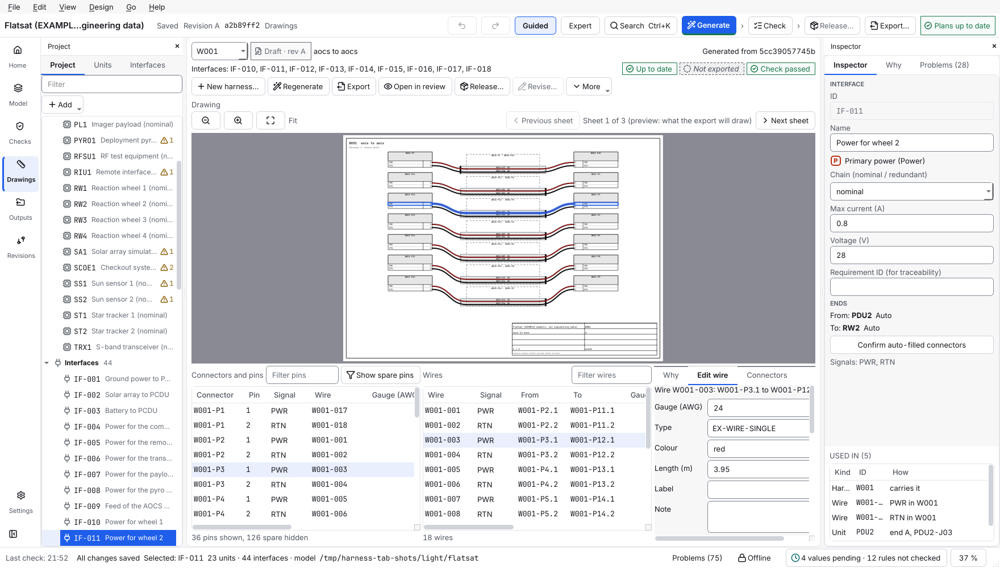

# Edit a wire

This page shows how to change a wire after the tool has generated it (its gauge, type, colour, length, the strip length at each end, a label for the wire labels, and a note), how to draw a wire of your own, how to put several wires on one pin, how to twist or shield wires together, and how to label the harness and its connectors.

> **New in 1.4.0.** Before 1.4.0 the app had no way to change or draw a single wire (only the colour of a whole signal, see [set wire colours](set-wire-colours.md)). The steps in the app are described from the program's code and its tests; the program was not watched on a screen while this page was written.

*The Edit wire tab (right of the wire table) on the `flatsat` example; the window is 1760 pixels wide. In a narrower window the form scrolls.*

To make a whole harness yourself, with its own connectors, see [build a harness by hand](build-a-harness-by-hand.md).

## Contents

- [Before you start](#before-you-start)
- [1. Pick the wires](#1-pick-the-wires)
- [2. Change the fields](#2-change-the-fields)
- [3. Give a wire back to generation](#3-give-a-wire-back-to-generation)
- [What shows up in the outputs](#what-shows-up-in-the-outputs)
- [4. Draw a wire yourself](#4-draw-a-wire-yourself)
- [5. Several wires on one pin](#5-several-wires-on-one-pin)
- [6. Twist or shield wires together](#6-twist-or-shield-wires-together)
- [7. Labels on the harness and its connectors](#7-labels-on-the-harness-and-its-connectors)
- [8. Function and soldering](#8-function-and-soldering)
- [Common mistakes](#common-mistakes)

## Before you start

- You have a generated project with a harness that is not released. A released harness is locked: start a new revision first ([change a released harness](change-a-released-harness.md)).
- The tool generates the wires, and generates them again whenever you press **Generate**. A value that you type for a wire stays; the rest follows the design.
- The tool sets **no gauge or colour of its own** on your behalf: what you type is what is kept.

## 1. Pick the wires

1. Choose **Drawings** on the rail, then the harness.
2. Click a wire in the **Wires** table or on the drawing. To change several wires at once, select several rows (Ctrl or Shift and click).
3. Open the **Edit wire** tab beside **Why**. It names the wire and the two pins it joins. For several wires it says how many are selected, and a field that differs between them is empty and says *various*.

## 2. Change the fields

| Field | What it is | Kept when you generate again? |
| --- | --- | --- |
| **Gauge (AWG)** | A whole number, for example `22`. | Yes: the wire is locked. |
| **Type** | A wire part of the project's parts library. | Yes: the wire is locked. |
| **Colour** | A colour of the IEC 60757 list (black, brown, red, ...) or your own text. A colour the tool does not know is drawn grey. | Yes: the wire is locked. |
| **Length (m)** | The length in metres, for example `1.5` (a comma works too). | Yes: the wire is locked. |
| **Strip A (mm)** | Insulation stripped at the **From** end, in millimetres, for example `6` (a comma works too). **New in 1.7.0.** | Always: it does not lock the wire. |
| **Strip B (mm)** | The same at the **To** end. **New in 1.7.0.** | Always: it does not lock the wire. |
| **Label** | Text that the wire labels print instead of the signal name. | Always. |
| **Note** | Your remark. It appears in the wire list. | Always. |

Only the fields you touch change; the others stay as they are on every selected wire. Press **Apply** (or Ctrl+Enter). The change is one step in the undo list (Ctrl+Z).

A mistake is said in words under the form (a gauge that is not a whole number, a length that is not a number, a type that is not a wire part of the library) and nothing is changed.

For **Strip A (mm)** and **Strip B (mm)** a field that differs between the selected wires says *various*, and an empty field clears the value. **Apply strip lengths to all wires of this harness** gives every wire of the harness the two values in the fields and says, for example, `Strip lengths changed on 4 of 4 wires of W001.` (one undo step). The form says it too: `Strip lengths do not lock the wire against Generate: they are always kept, like the note.` Strip lengths can also be read from a table ([enter the build data](enter-the-build-data.md)).

Gauge, type, colour and length lock the wire, so the **Locked** column of the wire table shows it and the line under the fields says *Your values*. A label, a note or a strip length alone does not lock the wire.

## 3. Give a wire back to generation

Select the wires and press **Reset to generated**. They are unlocked: the next **Generate** sets their gauge, type, colour and length from the design again (with placeholder values the gauge is *pending* again). Their label and note stay.

You cannot clear a gauge, type, colour or length on one wire; use **Reset to generated** instead.

## What shows up in the outputs

- The **wire list** gets two columns, **Label** and **Note**, as soon as any wire in the project has one. A project without labels and notes keeps the wire list it had before.
- The wire list gets **Strip A (mm)** and **Strip B (mm)** as soon as any wire in the project has a strip length, and the **Cut list** of the build workbook always shows them (`to fill in` while a wire has none).
- The **wire labels** (`labels.csv`) print the label in place of the signal name: `W001-0003 Heater supply to J2.4`.
- The independent check (`harness-design-studio verify DIR --outputs`) compares both with the design.

## 4. Draw a wire yourself

Generation makes the wires the interfaces need. For a wire that no interface asks for (a heater supply, a test wire, a jumper), draw it:

1. In the **Edit wire** tab, find **New wire** at the bottom.
2. Under **From** and **To** choose a connector of the harness and a pin of that connector, and type a **Signal** name if you like.
3. Press **Add wire**. The wire gets the next free wire ID, is marked as yours and is selected, so you can now set its gauge, colour and the rest as above.

A wire you drew:

- is kept exactly as it is when you press **Generate** again. If its connector or pin is gone (the interface was deleted, so the harness goes), Generate says which wire it lost.
- can have its ends moved: select it and change the **From** and **To** connector and pin under **Ends**, then **Apply**.
- can be deleted with **Delete wire** (one undo step). A generated wire is removed by changing the design: delete its interface, or change the pin in the **Devices** tab, then **Generate**.
- has no interface, so the checks that need an interface (signal directions, the current of a link) have nothing to say about it.

The pins of a **generated** wire follow its interface and the pin assignment of the devices, so you change them in the **Devices** tab (see [define a device](define-a-device.md)), not here.

## 5. Several wires on one pin

You may put two wires on one pin: draw the second wire to a pin that already has one. The design rule **Several wires on one pin** (`pin-shared`, a warning) names every such pin, so nobody finds it by surprise; waive it with a reason if the design needs it. The pinout table lists all the wires of a pin, and the independent check (`harness-design-studio verify`) says *pin_shared* as a warning when a wire you drew is one of them. Two **generated** wires on one pin are still an error (*pin_reused*): that is a fault in the generation.

## 6. Twist or shield wires together

Select the wires, choose a kind under **Group** and press **Group**:

| Kind | Wires |
| --- | --- |
| Twisted pair | exactly 2 |
| Shielded pair | exactly 2 |
| Quad | exactly 4 |
| Coax | exactly 1 |
| Overall shield | 2 or more |

The wires must be in one harness and in no group yet (a generated twisted pair is a group too). The group gets the next free shield ID, shows in the **Shield group** column of the wire list and as a sleeve in the drawing, and is kept by **Generate**. Its shield ends are those of the generation settings (floating while they are still placeholders, which the rule **Shield termination** then points out). To take a group apart select one of its wires and press **Ungroup**; only groups you made can be taken apart, because a generated group follows the construction of the interface type.

## 7. Labels on the harness and its connectors

At the bottom of the **Edit wire** tab, **Labels** has a **Harness label**, a list of the cable connectors of the harness and a **Connector label**. Type the texts and press **Apply labels** (one undo step). A box connector gets its label on its card in the **Devices** tab (the **Label** field). `labels.csv` prints them: a connector label reads `Rate sensor end (W001-P1 mates GYRO1-J01)`, a cable end without a label of its own prints the label of the box connector it plugs into, and a harness with a label gets a row of the kind `harness`. Generate keeps all of them.

## 8. Function and soldering

- A **function** is your own words for what a pin does; type it in the **Function** column of the pin table in the **Devices** tab (see [define a device](define-a-device.md)). It appears as a column in the pinout tables.
- The **Termination** of a pin (crimp or solder) is a column of the same table, hidden until you press **Contact**, and so is **Cable contact**, the contact part the cable side uses on the pin ([enter the build data](enter-the-build-data.md)). When any pin has one, the pinout tables get a **Termination** column too, and the build workbook shows it for every pin in use (`to fill in` while it is not set). What more the lists should say about soldering is still open; tell the owner what you need.

## Common mistakes

- **Typing a gauge and finding the wire "locked".** That is intended: a value you type is yours. Use **Reset to generated** to hand it back.
- **Expecting a label to change the drawing.** The label is for the wire labels and the lists (the column *Signal or label* of the build workbook's cut list shows it); the drawing shows the signal name.
- **Looking for the pins of a generated wire.** They follow the interface; change them in the **Devices** tab, or draw a wire of your own.
- **Editing a wire of a released harness.** The form is off and says why. Start a new revision.

More: [`FILE_FORMAT.md`](../FILE_FORMAT.md) (the fields `Wire.label` and `Wire.note`), [`OUTPUTS.md`](../OUTPUTS.md).

Next: [enter the build data](enter-the-build-data.md), [set wire colours](set-wire-colours.md), [export the outputs](export-the-outputs.md)
