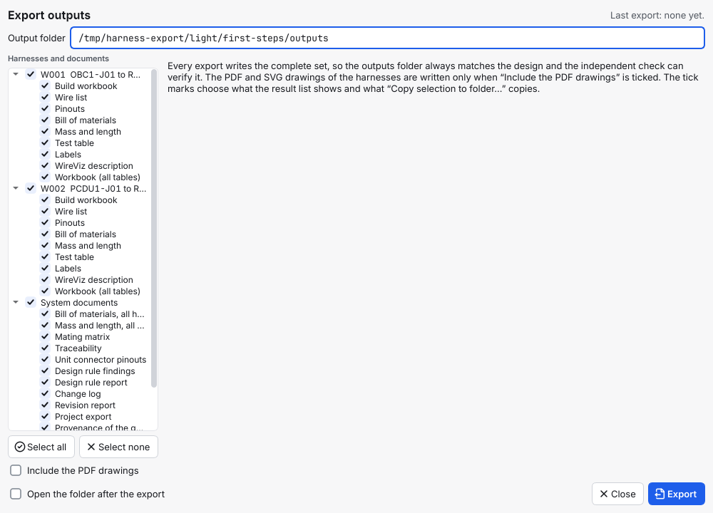
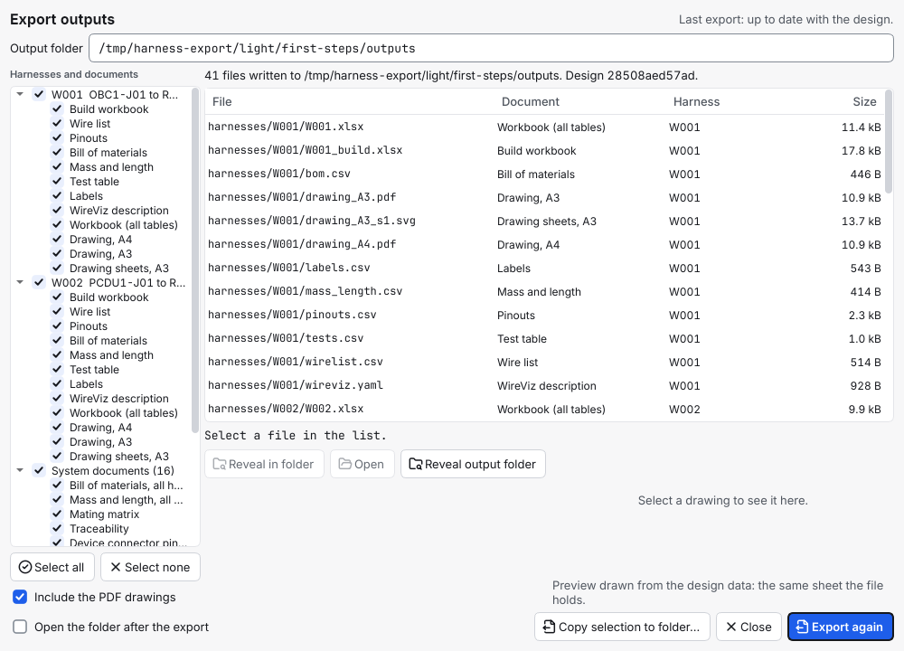

# Export the outputs

This page shows how to write the build workbook and the lists of a design (wire lists, pinouts, parts list, test tables, labels, block diagram) into the project's `outputs` folder, how to build a harness from the workbook, how to add the PDF drawings, and how to check that the files are current. The build data a technician needs (strip lengths, contacts, crimp tools, accessories) is entered first: [enter the build data](enter-the-build-data.md).

> **Since 1.7.0.** The build workbook (`<ID>_build.xlsx`) and the option `--drawings` are part of 1.7.0 (decision D-169). In 1.6.0 and earlier, `export` always wrote the PDF drawings and there was no build workbook; see the [changelog](../../CHANGELOG.md). The strip lengths, contacts, crimp tools and accessories in the workbook are from 1.7.0 too (decision D-170).

## Contents

- [Before you start](#before-you-start)
- [1. Export](#1-export)
- [2. What you get](#2-what-you-get)
- [3. The build workbook, sheet by sheet](#3-the-build-workbook-sheet-by-sheet)
- [4. Build a harness from the workbook](#4-build-a-harness-from-the-workbook)
- [What the build workbook holds, and what it does not](#what-the-build-workbook-holds-and-what-it-does-not)
- [5. The PDF drawings (optional)](#5-the-pdf-drawings-optional)
- [6. Read a file](#6-read-a-file)
- [7. Check that the outputs are current](#7-check-that-the-outputs-are-current)
- [Common mistakes](#common-mistakes)

## Before you start

- You have a generated project ([generate harnesses](generate-harnesses.md)), or a project with connections ([connect two connectors](connect-two-connectors.md)). Export needs at least one harness or one connection. A project with connections and no harness exports the connection list ([section 2](#2-what-you-get)); the files of a harness come after **Create harness** or Generate.
- Everything in `outputs/` is made from the design alone. Nothing in it is typed by hand and nothing needs editing. Change the design, export again. The `outputs` folder is always safe to delete and make again.
- Placeholder values show in the outputs: gauges say `pending` and test limits say `TBD (placeholder)` until the values exist ([fill in the engineering values](fill-in-engineering-values.md)). In the build workbook a missing value says `to fill in`.

## 1. Export

**In the app** (GUI, not run): press **Export…** in the top bar (or **File > Export…** or **Design > Export…**, Ctrl+E; on the Next step page of the Systems engineer role the button is **Export the build sheets**, which opens the same window). The **Export outputs** window opens. It shows the output folder, a tree of harnesses and documents, the check box **Include the PDF drawings** and the button **Export**. A project that has harnesses or connections but no folder yet (the built-in sample, or a project you never saved) first asks where to save: a folder chooser opens with the title *Choose an empty folder to save the project in. The files are then exported next to it*; the project is saved there and the window then opens on the new `outputs` folder. If you cancel the chooser, nothing else happens. A project that is open read-only or has damaged files cannot be exported: the window says why and, for a damaged project, lists up to five of the files that could not be loaded and says *and N more* for the rest (save a copy to a new folder, or repair the files). A project with neither a harness nor a connection says *There are no harnesses yet. Generate harnesses first.* (a project with connections and no harness can be exported: the tree then shows the system documents only, with the connection list). The check box is ticked only when the previous export into this folder had drawings; the first time it is not ticked, and the tree then lists no drawing documents ([section 5](#5-the-pdf-drawings-optional)). When the export is done the window lists the files written ("35 files written to …") and the app says "35 files written to the outputs folder (design <hash>)." (your numbers will differ; the app counts `manifest.json`, the command line below does not, so it says 34 for the same files). In the list, **Open** opens the selected file, **Reveal in folder** shows it in the file manager, and selecting a drawing shows a picture of it. The same files, with their checksums, are listed afterwards under **Exported files** in the Outputs area ([section 7](#7-check-that-the-outputs-are-current)). The export always writes the whole set of the harnesses; the check box is the only choice. The ticks in the tree choose which files the list shows and which ones **Copy selection to folder…** copies.



**On the command line**:

```
harness-design-studio export wheel-link
```

```
34 files written to wheel-link/outputs (model <hash>).
```

With `--drawings` the PDF drawings are written too ([section 5](#5-the-pdf-drawings-optional)).

The files are checked independently before they are written. If that check fails, nothing is written and the window shows a notice, "The independent check found n problem(s) in the outputs, so nothing was written", with the first problems, until the next export succeeds. The check compares every cell of the pinouts, BOM, test tables, labels, mass table, mating matrix, traceability, box pinouts and design rule findings with the design, the values in the YAML files, the pins and signals in the drawings, the texts of the PDFs, the sheets of the Excel workbooks (the build workbook cell by cell) and the provenance values. A workbook that cannot be built (for example because the temporary folder is full) gives a message that says why. Export is refused, in the app and on the command line, for a project that is read-only or has damaged files ("This project is read-only, so nothing was exported. Save a copy to a new folder first."); an export or generation that was started before you edited the project is dropped ("The project was edited while this ran, so the result was dropped. Please try again.").

## 2. What you get

This is the list for the practice project, which has no build data. The export counts 34 files; with `manifest.json` there are 35. With `--drawings` it counts 40, and the six extra files are the lines marked below. Each harness with accessories adds one file, `accessories.csv`:

```
wheel-link/outputs/
  manifest.json                  tool version, model hash, a checksum of every file
  harnesses/W001/
    W001_build.xlsx              the build workbook: the file to build the harness from
    wirelist.csv  pinouts.csv  bom.csv  mass_length.csv  tests.csv  labels.csv
    accessories.csv              only for a harness that has accessories (1.7.0)
    wireviz.yaml                 a WireViz-style description (best effort)
    W001.xlsx                    all tables of the harness as an Excel workbook (data)
    drawing_A3.pdf  drawing_A4.pdf  drawing_A3_s1.svg   the harness drawing (only with --drawings)
  harnesses/W002/ ...            the same for each further harness
  system/
    block_diagram.pdf  block_diagram.svg      the devices and their links
    harness_overview.pdf  harness_overview.svg
    bom.csv  mass_length.csv  box_pinouts.csv  mating_matrix.csv  traceability.csv
    drc_report.md  drc_findings.csv  changelog.csv  revision_report.md
    export.json  provenance.json  system.xlsx
    connections.csv  connections.xlsx   the connection list: only when the project has connections (1.9)
```

| File | What it is for |
| --- | --- |
| `<ID>_build.xlsx` | The build workbook of one harness: what is ready and what is missing, the cut list, one block per connector, the parts, the accessories, the labels and the test sheet ([section 3](#3-the-build-workbook-sheet-by-sheet)). |
| `wirelist.csv` | Every wire: signal, interface, connectors, pins, gauge, part, colour, length. Two columns, *Label* and *Note*, are added only when you gave a wire one (1.4.0), and two more, *Strip A (mm)* and *Strip B (mm)*, only when any wire of the project has a strip length (1.7.0). |
| `pinouts.csv`, `box_pinouts.csv` | Every pin of every cable connector, and of every connector on a device, with the wire on it and whether it is spare. The columns *Function* and *Termination* (crimp or solder) are added only when a pin has one (1.4.0), and *Contact* only when a pin has a contact part (1.7.0). |
| `bom.csv` | The bill of materials ([BOM](../GLOSSARY.md)): parts and quantities, with approval status. Since 1.7.0 it counts the contact parts used on pins and the parts of accessories as well. |
| `accessories.csv` | The accessories of a harness (sleeving, heat shrink, labels, backshells): kind, part, what it is on, where, length of one piece, quantity, note. Only written for a harness that has some (1.7.0, [enter the build data](enter-the-build-data.md)). |
| `mass_length.csv` | Wire length and mass, and what is still unknown. Totals count only what is known. |
| `tests.csv` | A continuity test for each wire and an isolation test for each wire and shield. |
| `labels.csv` | One label for each connector and two for each wire, and one for the harness when it has a label. A label you gave (1.4.0) is printed instead of only the ID or the signal name. |
| `mating_matrix.csv` | Which cable connector mates with which device connector, with the gender of each. |
| `traceability.csv` | Which interface is carried by which wires. In a project with connections it lists them too (1.9): the first heading reads *Interface or connection*, a last column *Kind* says which, and a connection row names the harness made from it and its wires. |
| `connections.csv`, `connections.xlsx` | The connection list (ICD style), written only for a project that has connections (1.9): one row for each pair of pins with the device, connector, pin, signal and role at both ends, the interface type the pair belongs to, the harness made from the connection and its note. The workbook has the same rows, a summary sheet with a line for each connection, and is the file to hand over. They need no harness. Columns: [`OUTPUTS.md`](../OUTPUTS.md#connection-list-systemconnectionscsv-and-xlsx). |
| `<ID>.xlsx` | The tables of the harness as sheets (wire list, pinouts, BOM, mass and length, tests, labels, and the accessories when it has some), as data. It is not the build workbook and has no layout for building. |
| `drc_report.md` | The same report as `harness-design-studio drc`. |
| `changelog.csv`, `revision_report.md` | The change log and the history of each harness ([release a harness](release-a-harness.md)). |
| `export.json` | The whole model in one JSON file, for other tools. |
| `provenance.json` | Which tool version and which design made the outputs, the library, and every config file with its placeholder flag. |

Only the A3 drawing is also written as SVG; the A4 drawing is a PDF only. Full list and limits: [`OUTPUTS.md`](../OUTPUTS.md).

## 3. The build workbook, sheet by sheet

`harnesses/<ID>/<ID>_build.xlsx` is made to build a harness from. It holds only what the design holds: where a value is missing, the cell says `to fill in` on an amber background, and the tool never puts a default there. It has no formulas, and the same design gives the same bytes. It is a normal Excel file. LibreOffice Calc opens it and prints it (checked by converting it to PDF); the drop-down lists and the green tick colour were not tried by hand in Excel or Calc. The eight sheets are in the order you work in:

| Sheet | What it holds | What to do with it |
| --- | --- | --- |
| **Start here** | The harness and its revision and status, `Ready to build` (yes or no), a table of checks, the author, checker, approver and release date from the design, a short guide to the sheets and a sign-off block to fill in by hand. | Read it first. If the answer is no, fix what is marked. |
| **Cut list** | One row per wire, in cut order: AWG, part, length, **Strip A (mm)** and **Strip B (mm)**, from, to, signal or label, shield group and note. The colour is a coloured cell with its name and its IEC 60757 code beside it (`red (RD)`). The column **Cut (x)** is for a tick. The last row counts the wires and adds their lengths. | Cut the wires from the top to the bottom and tick each one. |
| **Connectors** | One block for every connector: a heading row with its ID, part, gender, what it mates with and its label, then one row for each pin: signal, function, wire, colour, AWG, where the wire goes, termination, contact size, **Contact** (the contact part of the pin), **Tool** (the crimp tool of that part), and the tick columns **Terminated (x)**, **Inserted (x)** and **Checked (x)**. A pin with no wire is grey, and says `(spare)`. | Work through one connector at a time. |
| **Parts** | The bill of materials of this harness: part, category, manufacturer, part number, description, approval, quantity, unit, wires without length, and where it is used. The approval is coloured and written in words: green for approved, amber for pending, red for anything else (for example a part that is missing from the parts list). | Take the parts from stock. A part that is not approved is easy to see. |
| **Accessories** | The accessories of the harness with the column **Done (x)**: accessory, kind, part, target (a harness-level accessory shows `(harness)`), position, length (mm), quantity and note. With none entered the sheet says `No accessories entered.` | Fit sleeving, heat shrink, labels and backshells, and tick each. |
| **Labels** | The labels of `labels.csv` (connector labels, and a label for each end of each wire) with the column **Done (x)**. | Print and fit the labels, and tick each. |
| **Tests** | The continuity and insulation tests of `tests.csv` with the expected value, the limit and the test voltage (they read `TBD (placeholder)` until the values are set). The columns **Measured**, **Result**, **Initials** and **Date** are empty. | Test, and write down the result. **Result** offers `Pass` and `Fail` and turns green or red. |
| **About** | The tool version and the model hash the workbook was made from (and the full hash). | Check that it is the design you mean. |

The table on **Start here** has eight checks, each with a count of what is open and a status:

| Check | Status when something is open |
| --- | --- |
| Wires without a length | `TO FIX` |
| Wires without a gauge | `TO FIX` |
| Wires without a colour | `TO FIX` |
| Wires without a part | `TO FIX` |
| Pins in use without a termination (crimp or solder) | `NOTE` |
| Wires without strip lengths | `NOTE` |
| Pins in use without a contact part | `NOTE` |
| Parts that are not approved | `NOTE` |

`Ready to build` says `yes` when no line is marked `TO FIX`. While the configuration files are still placeholders it says `yes (values rest on placeholder configuration: …)` and a line *Placeholder files* under *From the design* lists them: the gauges and limits then rest on values nobody has reviewed. A `NOTE` does not stop it; it is shown so that you see it. Each open line says what to do (for example import the lengths, or set the colour of the signal). *Wires without strip lengths* counts a wire that lacks the strip length at either end; *Pins in use without a contact part* counts the pins with a wire that have no contact.

How the cut list is sorted: thick wires before thin ones (a smaller AWG number is a thicker wire), then by colour name, then the shorter wire first, so that the same wire is cut in one go. A wire without a gauge comes last; inside a gauge, a wire without a colour comes last in its group, and a wire without a length after the others of its colour. The tick columns hold an `x` (the cell offers it in a list); a cell with an `x` turns green.

On **Cut list**, **Connectors**, **Parts**, **Accessories**, **Labels** and **Tests** the bold header row stays on screen when you scroll, and it is repeated on every printed page. These six sheets and **Start here** print on A4, landscape, with the tool version and model hash at the left of the footer, the sheet name in the middle and the page number at the right. **Cut list**, **Parts**, **Accessories**, **Labels** and **Tests** have filters; **Start here** and **Connectors** have none. The print of **Connectors** has page breaks between the connector blocks.

## 4. Build a harness from the workbook

1. **Export** the project. Open `outputs/harnesses/<ID>/<ID>_build.xlsx`.
2. **Read Start here.** If `Ready to build` says `no`, fix the lines marked `TO FIX` in the design, for example [fill in the engineering values](fill-in-engineering-values.md), [import the lengths](import-data.md) or [set the wire colours](set-wire-colours.md), generate again and export again. Read the `NOTE` lines too and decide whether they matter for this harness.
3. **Work on a copy.** Save a copy of the workbook outside `outputs/` (in the app, **Copy to folder…** in **Exported files**, or just copy the file) and print or fill in that copy. The next export overwrites the file in `outputs/`, and a file in `outputs/` that you typed in is reported by `harness-design-studio verify DIR --outputs` as changed (`out_modified`) and not matching the design (`out_build`).
4. **Take the parts** listed on **Parts** (the contacts and accessory parts are in it), and the labels on **Labels**.
5. **Cut** the wires in the order of **Cut list**, strip each end by **Strip A (mm)** and **Strip B (mm)**, and tick each row.
6. **Terminate**: for each connector, go through its block on **Connectors**. Fit the **Contact** with the **Tool** it names, and tick **Terminated**, **Inserted** and **Checked** as you go.
7. **Fit the accessories** on **Accessories** and tick each.
8. **Test.** Write the measured value, the result, your initials and the date on **Tests**.
9. **Sign off** on **Start here** (the five steps, with name, date and signature).
10. If the design changes later, export again and compare the model hash in the footer with the one of the copy you built from. A different hash means a different design.

The tick columns and the sign-off block are for people. The tool never reads them back.

## What the build workbook holds, and what it does not

Since 1.7.0 the workbook holds the build data a technician needs, **when you have entered it** ([enter the build data](enter-the-build-data.md)):

- the **strip length** of each wire end (*Strip A (mm)*, *Strip B (mm)* on **Cut list**);
- the **contact** on each pin and the **crimp tool** for it (*Contact*, *Tool* on **Connectors**);
- **sleeving, heat shrink, labels and backshells** with where they go in words, a length and a quantity (**Accessories**).

What you have not entered reads `to fill in`, and the two `NOTE` lines on **Start here** count it. The tool sets none of these values itself and checks none of them: it does not know whether a contact fits a pin, whether a strip length is sensible or which tool is right. What the lists should say about soldering beyond the termination column is still open; tell the owner what you need. Where a label goes is the *Position* of an accessory of the kind *label*, in your words; the workbook does not draw it.

## 5. The PDF drawings (optional)

The PDF and SVG drawings of the harnesses (`drawing_A3.pdf`, `drawing_A4.pdf`, `drawing_A3_s<n>.svg`) are no longer written by default. Everything else is: the system diagrams (`block_diagram` and `harness_overview`, PDF and SVG) are always written.

**On the command line**, add `--drawings`:

```
harness-design-studio export wheel-link --drawings
```

```
40 files written to wheel-link/outputs (model <hash>).
```

An export without `--drawings` into a folder that holds the drawings of an earlier export removes them and says so: `The PDF drawings of the earlier export were removed; add --drawings to write them again.`

**In the app** (GUI, not run), tick **Include the PDF drawings** in the **Export outputs** window before you press **Export**. The box is ticked at the start only when the previous export into this folder had drawings. While it is ticked, the tree lists the drawing documents. Unticking it and exporting removes the drawings an earlier export wrote.



The window above is for the practice project (a generated `first-steps` project with its parts approved): the 41 files are the 40 of the command line plus `manifest.json`.

**After a release** the outputs are written again with the same set as the export before it: with the drawings if that export had them, without if it had not ([release a harness](release-a-harness.md)).

The independent check accepts a set with the drawings of every harness and a set with none.

## 6. Read a file

Every file carries the tool version and a **model hash** (a short fingerprint of the design): CSV and YAML files start with a comment line, for example

```
# harness-design-studio 1.11.0 model <hash>
```

A program that reads the CSV must skip lines that start with `# `. The Excel workbooks carry the same stamp on their **About** sheet, and the build workbook also in the footer of every printed sheet and on **Start here**. A printed sheet can be traced to the exact design it came from by that hash.

The first rows of `harnesses/W002/pinouts.csv`:

```
Connector,Role,Mates with,Part,Pin,Signal,Interface,Wires,Spare
W002-P1,cable,PCDU1-J01,EX-MICROD-9-M,1,,,W002-001,no
W002-P1,cable,PCDU1-J01,EX-MICROD-9-M,2,,,W002-002,no
W002-P1,cable,PCDU1-J01,EX-MICROD-9-M,3,,,,yes
```

The harness drawing (written only with `--drawings`, [section 5](#5-the-pdf-drawings-optional)) is a wiring diagram. The connectors are tables left and right, with every used pin and its signal. The wires run between them. In between, each cable has a block that lists its wires with the number of wires, the gauge ("pending" when undecided) and the length. A title block closes the sheet. Wire colours are drawn only if you set them ([set wire colours](set-wire-colours.md)); unset wires are grey. The wiring-diagram drawing is not in the 0.1.0 packages (see the [changelog](../../CHANGELOG.md)); the 0.1.0 drawing is the older wire-by-wire sheet.

The title block of the drawing shows the author, checker, approver and date as "-" until the harness has been reviewed and released. Its fields come from `config/titleblock.json` ([naming and title block](naming-and-title-block.md)); `sheet` may be left out. A pin ID is drawn whole (smaller, or in a wider pin column), a connector or wire ID of up to 64 characters is drawn in a smaller font instead of being cut, and a shield keeps its end A on every sheet. The harness overview draws every pair of devices that a harness joins.

Numbers in the tables and the YAML keep all their digits (a length of 1234.567 mm is written as it is); only the text on the drawings is rounded. A CSV cell that starts with `=`, `+`, `-` or `@` and is not a plain number is written with a leading `'` so a spreadsheet program does not run it as a formula (`+5V` appears as `'+5V`; `-12` stays `-12`); the guard can be undone exactly, so such a signal exports and verifies. The Excel files are written without lxml, so the same design gives identical bytes on every machine.

## 7. Check that the outputs are current

The status chip in the top bar and the header of the **Harness** tab show the state (*Up to date*, *Outputs out of date*, *Not exported*, *Outputs changed*); a banner under the top bar offers **Export…** when the files are out of date. The top-bar chip and the *out of date* banner are problem notices: with **View > Show problem notices** off (the default as a Systems engineer) they are not shown, and the header of the **Harness** tab, the **Lists** tab and `harness-design-studio verify --outputs` still tell the state ([read and fix problems](read-and-fix-problems.md#turn-the-problem-notices-off)). Hover the outputs chip in the header of the **Harness** tab and it spells the state out: "Outputs: up to date with the design.", "Outputs: out of date, the design changed after the last export.", "Outputs: not exported yet.", "Outputs: files were changed after export."

The list **Exported files** goes one step further. Open the **Lists** tab (**Outputs** on the rail, Ctrl+3): under the tables it lists every file in the `outputs` folder with its document, harness, format, size, time written, **SHA-256** and a state. The state compares the file on disk with the `manifest.json` that the export wrote: *Matches export*, *Changed since export*, *Missing* (the manifest lists it, the folder does not hold it) or *Not in the export* (the folder holds it, the manifest does not list it). The checksums are worked out in the background, so a big folder does not stop the window. **Open**, **Reveal in folder** and **Copy to folder…** act on the selected files, and **Verify** reads the folder again. The list never changes a file. On the command line:

```
harness-design-studio verify wheel-link --outputs
```

```
2 interfaces and 6 wires checked: 0 error(s)
```

After you change the design without exporting again, the same command fails (exit code 1). The first lines are:

```
error: [outputs_outdated] The model changed after the harness plans were generated. Generate again before releasing.
error: [out_stale] The outputs were made from an older version of the design.
```

It also finds files that were edited or deleted after the export (`[out_modified]`; a build workbook that was edited also gives `[out_build]`). Fix: `harness-design-studio generate wheel-link` and `harness-design-studio export wheel-link`.

## Common mistakes

- **Export opens a folder chooser first.** The project has no folder yet (the sample, or a project you never saved). Choose an empty folder: the project is saved in it and the files are exported next to it. Cancel the chooser to stop. On the Harness tab the button **Export** says it beside it: *Asks where to save first*; for a read-only project it says *Read-only: save a copy first*.
- **"error: there are no harnesses to export; run `harness-design-studio generate` first."** The project has no harness and no connection. Connect two connectors in the app (the connection list is then exported without a harness), or Generate.
- **Editing a file in `outputs/`.** The next export overwrites it, and `harness-design-studio verify --outputs` reports it as changed. Change the design instead. This includes ticking boxes in the build workbook: work on a copy ([section 4](#4-build-a-harness-from-the-workbook)).
- **The drawing PDFs are not in `outputs/`.** Since 1.7.0 `export` writes them only with `--drawings` (in the app: tick **Include the PDF drawings**) ([section 5](#5-the-pdf-drawings-optional)).
- **Committing `outputs/` by accident.** The `.gitignore` the tool writes covers lock, backup and temporary files, not `outputs/`. Add `outputs/` yourself if you do not want it in Git ([use Git and CI](use-git-and-ci.md)).
- **Opening the CSV in a spreadsheet shows a first line starting with `#`.** That is the stamp. It is meant to be there.
- **`warning: [out_pdf_chars] These characters cannot be shown in the PDF ...`** A name or note holds characters outside the Windows-1252 set (for example Ω or Greek letters). The PDF prints `?`; the SVG, the CSV files and the workbook keep them. The warning names every character, and the files are written ([troubleshooting](../TROUBLESHOOTING.md)).

More: [`TROUBLESHOOTING.md`](../TROUBLESHOOTING.md).

Next: [naming and title block](naming-and-title-block.md), [release a harness](release-a-harness.md), [set wire colours](set-wire-colours.md)
