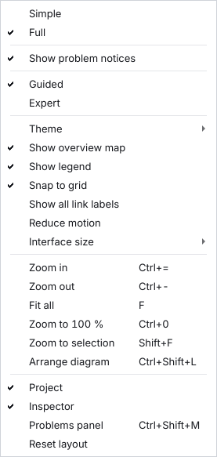

# Read and fix problems

This page shows how to read the tool's findings (errors, warnings and notes), fix them or waive them with a reason, and run the same check from the command line.

## Contents

- [Before you start](#before-you-start)
- [1. The three kinds of finding](#1-the-three-kinds-of-finding)
- [2. In the app](#2-in-the-app)
- [2a. The Checks tab](#2a-the-checks-tab)
- [Turn the problem notices off](#turn-the-problem-notices-off)
- [3. On the command line](#3-on-the-command-line)
- [4. Fix one, waive one](#4-fix-one-waive-one)
- [What the notes mean](#what-the-notes-mean)
- [Good to know](#good-to-know)
- [Common mistakes](#common-mistakes)

## Before you start

- You have a project. The examples use `wheel-link` from `harness-design-studio new wheel-link --template first-steps`, generated with `harness-design-studio generate wheel-link` ([generate harnesses](generate-harnesses.md)).
- The tool checks the design at two speeds. **Quick checks** run on every edit (a link without a connector, a device with no link, connectors chosen by the tool and not confirmed, a link between the nominal and the redundant chain). The **design rules** (39 of them, all listed in [`RULES.md`](../RULES.md)) run in the background a moment after you stop editing.

## 1. The three kinds of finding

| Kind | In the app it starts with | What you do |
| --- | --- | --- |
| **Error** | ✕ Error: | Fix it. An error cannot be waived. |
| **Warning** | ⚠ Warning: | Fix it, or **waive** it with a written reason of at least 10 characters. A waived warning stays in the report with its reason. |
| **Note** | ⓘ Info: | Information, for example "not checked because a value is still a placeholder". |

## 2. In the app

1. Open the **Problems** tab (in the right panel; as a Systems engineer the right panel is closed, so press **Show panels** in the top bar first, or press **Show the problems** on the Next step page, which opens the **Checks** area with the failed rules). The tab title shows how many open errors and warnings there are, for example "Problems (10)". While the design rules run, the status line says "Design rules: checking…" and then, for example, "Design rules: 39 rules, 20 passed, 2 failed, 12 not checked." A rule that could not run because a value is missing counts as *not checked*, never as passed. The **Checks** tab (Ctrl+4) lists all 39 rules with a result for each; see [section 2a](#2a-the-checks-tab).
2. Each finding is a card. (GUI, not run: described from the program's texts and code.) It says what is wrong and why it matters. Many cards have a button that fixes it in one click. The cards have these buttons:
   - **Show** jumps to the device, link or harness it is about.
   - A fix button, named after the fix, for example **Choose connectors automatically**, **Confirm connectors** or **Connect to a redundant copy of OBC1**.
   - **Waive…** (warnings only).
3. Three or more errors or notes of the same rule about the same object are shown as one card with a list. (Warnings always get a card each, because each one can be waived on its own.)
4. The **To do** list at the top of the Problems tab says what is left to do, for example "2 auto-filled connector assignments to review". It is a short list of actions, not the same as the problem cards below it.
5. The **Inspector** of a link has **Confirm auto-filled connectors**. Press it once you have looked at the connectors the tool chose.

Click a card or a to-do line to jump to the item.

**The Problems panel.** Press **Problems (n)** in the status bar, or Ctrl+Shift+M (**View > Problems panel**; there is no **Problems (n)** button while the problem notices are off, which is the case as a Systems engineer until you turn them on, see [below](#turn-the-problem-notices-off)), to open a list of every open problem at the bottom of the window. It has the columns Severity, Rule, Object and Message, and the filters **All**, **Error**, **Warning** and **Connections** (since 1.8.0: only what the check says about the connections between connectors; **Design > Check my connections** opens the panel with this filter on). Click a row to go to the object, whether it is a device, a link, a harness, a parts file or a value file. **Details and fixes** (right-click a row, or press Shift+Enter) shows the problem as a card in the Inspector. The panel counts findings and the Problems tab counts groups of to-do lines, so the two numbers can differ.

**Connections.** Four design rules read the connections between connectors ([connect two connectors](connect-two-connectors.md)), and they say nothing in a project that has none: `link-unpaired` (a warning: a pin with a signal that no pair of the connection uses; set its role to Spare if it is not used), `link-direction` (an error: two outputs, or two inputs, on one pair), `link-signal-mismatch` (a warning: the two names of a pair differ) and `link-power-return` (a warning: a power pair and no return pair; pair the return pin, or set its role to Return). A connection whose connector or pin is gone, a pin in two pairs or both connectors on one device are errors of the quick checks. The **Show** button of such a card jumps to the connection on the diagram. **Design > Check my connections** reviews all connections and changes nothing.

## 2a. The Checks tab

The **Checks** tab has one row for each design rule: its ID, name, severity, a **Result** chip and how many findings are open or waived.

- The result is **Pass**, **Fail**, **Not checked** or **Pending**, each with an icon and a word; **Pass (placeholder values)** means the rule passed on values nobody has reviewed. A strip above the table counts the results; each count is a button that filters the table.
- Select a rule to read what it found, what it needs and the requirements it serves. **Enter** or a double-click on an offending object shows it on the diagram.
- A rule that is *not checked* names the value it waits for and has **Supply value…**. It opens **Engineering values**, where you type the values (see [fill in the engineering values](fill-in-engineering-values.md)); **Apply** sets them as one undo step and the checks run again.
- **Check** in the top bar (F5) runs the rules now; they also run by themselves a moment after you stop editing. When the design changes, the tab says *Out of date* until the rules have run again (**Check again** runs them now).

## Turn the problem notices off

The tool shows some problem signs without being asked: the **Problems (n)** button and its count in the status bar, the count on the **Problems** tab of the inspector, the status chip of the top bar, the chip in the corner of the diagram, the badges for problems, warnings, values still to enter and *not checked* on the devices and links, the link *n values pending · n rules not checked* and the banner that says the plans or the outputs are *out of date*. They are called **problem notices**. If they bother you, choose **View > Show problem notices** (or tick **Show problem notices** in **Settings > Editing**) to switch them all off at once.



- **Each role keeps its own choice.** The notices are on in the Electrical / AIT engineer role and off as a Systems engineer until you say otherwise.
- **Turning them off hides nothing you ask for.** The **Check** button (F5) and its result, the **Checks** area, the **Problems** panel (**View > Problems panel**, Ctrl+Shift+M), the **Next step** page and the error texts in windows stay. So do the banners that say why something cannot be done: read-only, locked, damaged files and the sample project.
- **Turn them on again** with the same menu entry. The picture above is the View menu of the Electrical / AIT engineer role (made from the real window; the Systems engineer role has one more entry at the top, **Show side panels**).

## 3. On the command line

```
harness-design-studio drc wheel-link
```

```
# Design rule check: Wheel link

Model hash: `4780a7655706`. Rules run: 39.
Open: 0 error(s), 10 warning(s), 8 note(s). Waived: 0.

Placeholder configuration in use: derating, emc, generation, segmentation, segregation, titleblock. Results that depend on it are marked as not checked.
```

After that line come the lists "Errors" (only if there are any), "Warnings" and "Not checked / note". Each item has a short title, the rule name in brackets, why it matters, and how to fix it. Items that serve a requirement of a standard name it ("Requirement: ESCC3901-4.4").

The exit code is 0 when there are no unwaived errors and 1 when there is at least one. Warnings and notes do not change it.

To check only that the folder is sound (no rule check):

```
harness-design-studio validate wheel-link
```

```
INFO    placeholder_config: Placeholder rule configuration still in use: derating, emc, generation, segmentation, segregation, titleblock. An engineer must review these before results are trusted.
3 devices, 2 interfaces, 13 connectors, 2 harnesses: 0 error(s), 0 warning(s).
```

The INFO line is normal until an engineer has reviewed the engineering values ([fill in the engineering values](fill-in-engineering-values.md)).

The command line cannot waive a finding. Waivers are made in the app.

## 4. Fix one, waive one

**An error you can make appear.** Change a value in `config/generation.json` after you generated (for example `service_loop_m` from `null` to `0.1`, inside `values`), then run the check:

```
harness-design-studio drc wheel-link
```

```
Open: 1 error(s), 10 warning(s), 8 note(s). Waived: 0.
```

```
- **The model changed after the harness plans were generated. Generate again before releasing.** (`verify-mismatch.outputs_outdated.design.83e4b6`)
```

The command exits with 1. Fix: generate again.

```
harness-design-studio generate wheel-link
```

```
0 added, 0 changed, 2 unchanged, 0 removed, 0 frozen (released); 0 locked pin(s) kept
2 interfaces and 6 wires checked: 0 error(s)
```

The report then shows `Open: 0 error(s), 10 warning(s), 8 note(s).` Export again (`harness-design-studio export wheel-link`) if you want current outputs.

**A warning you can waive.** On a practice project the starter library's example parts give warnings such as "Part EX-MICROD-15-F is not approved yet but is used (2 place(s))".

1. In the **Problems** tab press **Waive…** on that card.
2. Type a reason, for example *Example part, practice project only*. Fewer than 10 characters are refused: "Please explain why this is acceptable (at least 10 characters)."
3. Press **Waive with justification**. The card moves to **Waived**, and the reason appears in the report.

The real way to clear a part warning is to import the approved parts list ([import data](import-data.md#approved-parts-list)).

## What the notes mean

A note like "Current and derating limits were not checked: the derating values are still placeholders" means the rule could not run because a number nobody has entered is missing. The tool says so instead of passing silently. Clear these notes by filling in the values ([fill in the engineering values](fill-in-engineering-values.md)). A note cannot be waived.

The notes also name what could not be checked on a wire or a harness instead of skipping it quietly: wires and harnesses whose current or voltage drop could not be checked (no bundle factor for that many wires, no gauge, no length), temperature margins that are not set, and parts without a `max_temp_c` rating. Where a check compares a number with a limit (contact current, wire current, voltage drop, voltage, temperature, bundle current, spare pins), a value exactly at the limit passes, with a relative tolerance of 1e-9, in the generator and in the rule alike.

## Good to know

- **A design rule check that fails is shown as failed.** If the background check cannot run, the status line says "Design rule check failed: ..." and the Problems panel adds an error finding. It never says "all 39 rules checked" then. A check that does not answer within three minutes is stopped and run again inside the editor.
- **Each problem has its own ID.** If one object has several problems (the two ends of a dangling wire, several problems of one connector), each finding has its own ID, so a waiver covers one problem only. A waiver made in an earlier version for a *model-inconsistent* warning no longer matches and shows as stale; waive the finding again.
- **Routing segments must form a tree.** The error `segment-loop` means two routes join twice, so a wire's route (and its length) is not unique. Remove or merge a segment ([`RULES.md`](../RULES.md)).
- **A wire from a pin to itself** is an error that `harness-design-studio validate` reports (`wire_to_itself`); the independent check calls it `wire_same_pin`.

## Common mistakes

- **Waiving everything.** A waiver says "a person accepted this". Reviewers read the reasons. Waive only what you have judged.
- **Reading "0 errors" as "correct".** The tool checks what it has numbers for. The notes list what it did not check.
- **Using the wrong word for a waiver.** In the compliance records, "waived by the owner" means something else: the owner accepts that a process requirement is not met. See the [glossary](../GLOSSARY.md).
- **Errors after an import.** The library changed, so the plans are out of date. Generate and export again.

More: [`TROUBLESHOOTING.md`](../TROUBLESHOOTING.md).

Next: [fill in the engineering values](fill-in-engineering-values.md), [import data](import-data.md)
