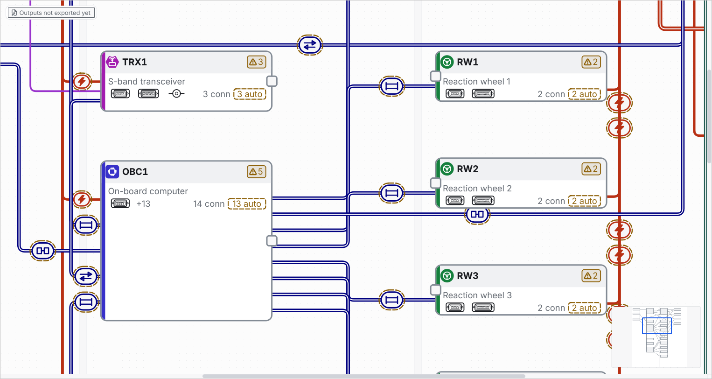
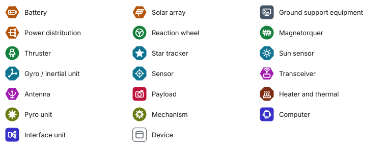

# Telling devices apart

This page is about what a device looks like on the block diagram. Every device card has a picture of the kind of equipment it is (a battery, a reaction wheel, a computer ...), a colour for the family of that kind and a shape for the badge the picture sits in. By default you do not set any of it: the tool reads it from the name of the device, and you can set the **Kind** by hand when it reads it wrong. The same looks are drawn in the block diagram that `export` writes and in the pictures of **Export diagram**. A project that sets no kind has the same files and the same model hash as before.

## Contents

- [Before you start](#before-you-start)
- [What you see](#what-you-see)
- [The key to the pictures](#the-key-to-the-pictures)
- [How the tool decides what a device is](#how-the-tool-decides-what-a-device-is)
- [Setting the kind by hand](#setting-the-kind-by-hand)
- [In the written block diagram and the exported picture](#in-the-written-block-diagram-and-the-exported-picture)
- [Where the words are](#where-the-words-are)
- [What it does not do](#what-it-does-not-do)
- [Common mistakes](#common-mistakes)

## Before you start

- You have a project with a few devices on the diagram ([draw the design](draw-the-design.md)). The `flatsat` example has 23 devices and shows every look but one.
- Steps in the app are described from the program's own texts and code. They have not been run on a screen (GUI, not run); the pictures below are offscreen renderings of the real editor.

## What you see

- **A card** (zoomed in) has a **badge** at the left of its header with a picture in it, and a **band** of the family colour down its left edge. The ID, the name, the connector row and the marks (problems, locks) are where they were.
- **The whole diagram** (zoomed out, which is how a project opens) draws each device as a box with its ID. The box has the same band and the same badge, and a faint tint of the family colour, so 23 devices can be told apart at a glance and not only by reading their IDs.
- A device the tool cannot place keeps a plain outlined box with a grey picture, as before.
- The colour is never the only sign. The picture tells the kind, the **shape** of the badge (square, circle, hexagon or octagon) tells the family a second time, and the words are in the tooltip, the Inspector and the legend.

## The key to the pictures

The legend in the corner of the diagram (**View > Show legend**; the Systems engineer and AIT engineer menus do not list it, Ctrl+K finds it) lists the kinds of device the project has, with the picture, before the kinds of link and connector. This is the whole set:

| Family | Colour | Shape | Kinds |
| --- | --- | --- | --- |
| Control and data | blue | square | Computer, Interface unit |
| Power | orange | hexagon | Battery, Solar array, Power distribution |
| Attitude actuators | green | circle | Reaction wheel, Magnetorquer, Thruster |
| Sensors | teal | octagon | Star tracker, Sun sensor, Gyro / inertial unit, Sensor |
| Communication | purple | hexagon | Transceiver, Antenna |
| Payload | rose | square | Payload |
| Thermal | brown | octagon | Heater and thermal |
| Mechanisms and pyro | olive | circle | Pyro unit, Mechanism |
| Ground support | slate | square | Ground support equipment |
| Other | none (outline only) | square | Device |

The colours are different in the light and the dark theme (lighter in the dark one) so that each stays readable on the card. Nine colours cannot stay apart for every kind of colour blindness (green and rose, blue and purple come close), which is why the picture and the shape are there too.

## How the tool decides what a device is

Unless a kind was set by hand (next section), the tool reads it, every time the diagram is drawn, from what the device already says. It tries these clues in order and stops at the first that fits:

1. **The words of the name**: `Reaction wheel 1`, `S-band transceiver`, `Solar array simulator`. A word must be the whole word (or the word with digits after it, `OBC1`, or an ending such as `wheels`): `simulator` is not read as `imu`.
2. **The letters of the ID** before the first digit: `BAT1` is a battery, `PCDU1` and `PDU2` power distribution, `RW1` a reaction wheel, `ST1` a star tracker, `SS1` a sun sensor, `OBC1-R` a computer. Used when the name says nothing, so a device you renamed to `Unit 7` keeps its look.
3. **The words of the subsystem** (`power`, `comms`, `thermal` ...), as a coarse hint.
4. **The kinds of link it carries**, the clue the card's small picture already used: a spark line, RF, mostly power, data. Used only when nothing else says what the device is.
5. Otherwise it is a plain **Device**.

Inside each step the more specific kind comes first: a star tracker before a sensor, a battery before power distribution, and ground support before power, so that a `Ground power supply` is ground support. The devices that **Edit > Add device** makes (a name such as `Battery 1`, the ID `BAT1`) always get the right look. The table is `KINDS` in `core/device_kinds.py`, one list in one place (the window and the written files read the same one).

To change what a device looks like you can **rename it** in the Inspector (or the **Device list** tab): the picture and the colour follow at once, and **Undo** takes it back like any other edit. Or you can set the kind by hand.

## Setting the kind by hand

Select a device and open the **Kind** list in the Inspector (under **Subsystem**). Its first entry is **Automatic**, with what the tool would pick, for example *Automatic: Battery*; below it are the 19 kinds by name and, last, **Device (plain box)**, which gives the plain outlined box with no colour. Choosing an entry changes the card, the tooltip, the legend and the written diagram at once, is one step of **Undo**, and *Looks like: Battery (set by hand)* says that it was set by hand. Choosing **Automatic** again goes back to reading the name.

- The kind is stored in the project, on the device (`logical/units/<subsystem>.json`, the field `kind`, one of `computer`, `interface_unit`, `battery`, `solar_array`, `power_unit`, `reaction_wheel`, `magnetorquer`, `thruster`, `star_tracker`, `sun_sensor`, `gyro`, `sensor`, `transceiver`, `antenna`, `payload`, `heater`, `pyro`, `mechanism`, `ground_support` or `device`). It is written **only when it is set**: a project that sets no kind keeps byte-identical files and the same model hash, and a project that sets one has it in its model hash, as it has the name of a device. The file format number stays 1 and no migration is needed. A tool older than this one refuses a device that has a `kind` and sets it aside as unreadable, as it does with any field it does not know, until the kind is cleared.
- A kind the tool does not know is an error when the project is opened and when an edit is made: the message lists the allowed IDs.
- A released harness does not lock it: like the name and the notes, the kind is a look and not wiring, so it can change after a release.
- It travels with the device in a device library file and a subsystem file (`export-devices`, `import-devices`, `import-subsystem`), and `system/export.json` lists it for a device that has one.
- There is no command-line command that edits one device, so the command line has no `--kind`; set it in the editor, or in the device's file.

## In the written block diagram and the exported picture

The block diagram that `harness-design-studio export` writes (`system/block_diagram.svg` and `.pdf`) and the pictures of **Export diagram** (SVG, PDF and PNG) draw every card like the window does: a **band** in the colour of the family down the left edge, and a **badge** with the picture of the kind in the shape of the family, then the ID and the name. The file is paper, so the colours are the **light theme's** whatever theme the window has. Below the diagram, beside the key to the lines, a **key to the kinds** lists the kinds the project has, each with its picture (none while every device is a plain box).

- The looks come from the model alone: the name, the ID, the subsystem, the links and the kind set by hand. They do not depend on the window, its theme, its zoom or its marks, and the same design gives the same bytes every time and on every system.
- The ID is never cut: when it does not fit beside the badge it is set smaller. A long **name** is cut short with `~` at about 21 characters, as it always was at the end of the card, only the room is a little less.
- The **harness overview** (`system/harness_overview.svg`) keeps its plain boxes. The tables, the drawings of the harnesses and every number are not changed.
- This changed `system/block_diagram.svg` and `.pdf` of every project; [what changed](../changes.md#2026-11-05-the-written-block-diagram-shows-the-looks-of-the-devices-a-written-file-changes-on-purpose-for-every-project) shows a before and after.

## Where the words are

- **Tooltip.** Point at a card: the first line is `ID: name`, the second `Looks like: Battery (from the name Battery)`.
- **Inspector.** Select a device: under **Subsystem** a line with the badge and `Looks like: Battery (from the name Battery)`. Its tooltip says how to change it.
- **Legend.** The kinds of the diagram, each with its picture and its name.

The sentence also says where the look came from: *from the name …*, *from the ID …*, *from the subsystem …*, *from the links it carries*, or *nothing in its name, ID, subsystem or links says what it is*.

## What it does not do

- It changes no number and no table: only the written block diagram (`system/block_diagram.svg` and `.pdf`) and the pictures of **Export diagram** differ from earlier releases; the harness overview, the drawings, every table and the model hash of a project that sets no kind are as they were.
- It does not look at a part number or the library: only the name, the ID, the subsystem and the links of the device.
- It does not mean anything for the checks: two devices with the same look are not related, and a wrong look is not an error. Rename the device.

## Common mistakes

- **"Why is my device a battery?"** Its ID starts with `BAT`, or its name has a word of the battery kind. The tooltip says which: *from the ID BAT7*.
- **"My device is a plain box."** Nothing in its name, ID, subsystem or links is in the table. Rename it with the kind in the name (`Gyro 2`), or set its **Kind**.
- **Two devices have the same colour.** They are in the same family (a reaction wheel and a magnetorquer are both attitude actuators); the picture and the name tell them apart.

Next: [draw the design](draw-the-design.md), [redundancy and zones](redundancy-and-zones.md)
