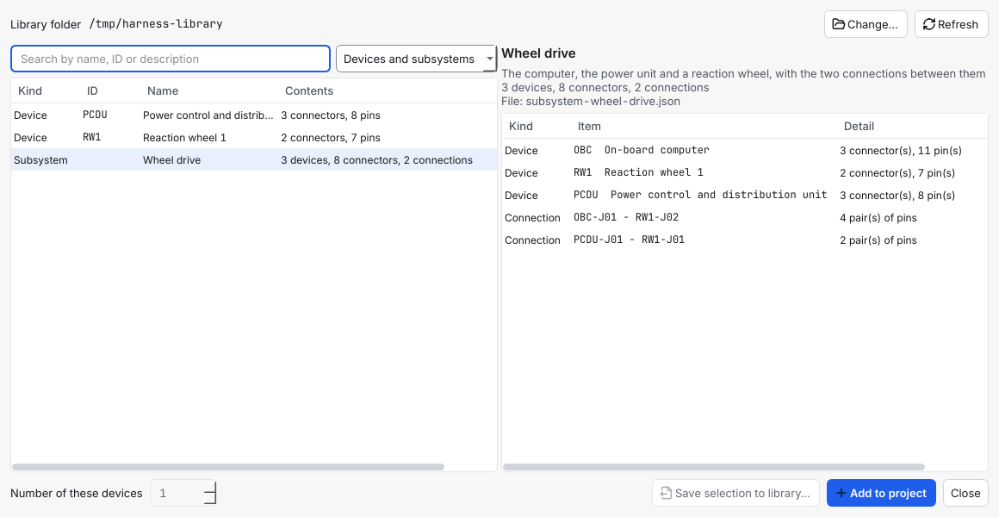
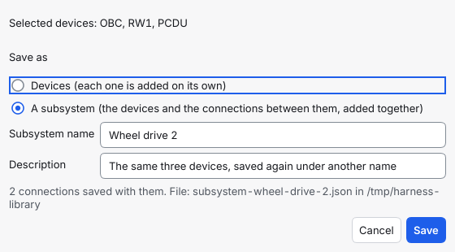

# Use the library

This page shows how a team keeps its devices and subsystems in one **library folder**, how to save a device or a subsystem to it, how to add one to a project, and how to say how many of a device a project has.

> **After 1.7.0, not in the latest release yet.** This is milestone M4 of the workshop feedback (decision D-175). The steps in the app are described from the program's code and its tests, and the two pictures are of the real window started without a screen; nobody has watched the steps on a real screen yet (GUI, not run). The command lines were run, and their output is real.

## Contents

- [When to use the library](#when-to-use-the-library)
- [Before you start](#before-you-start)
- [1. Choose the library folder](#1-choose-the-library-folder)
- [2. Save devices or a subsystem to the library](#2-save-devices-or-a-subsystem-to-the-library)
- [3. Add a device or a subsystem to a project](#3-add-a-device-or-a-subsystem-to-a-project)
- [4. A number of the same device](#4-a-number-of-the-same-device)
- [Share the library: a drive or a Git repository](#share-the-library-a-drive-or-a-git-repository)
- [On the command line](#on-the-command-line)
- [What the program never does](#what-the-program-never-does)
- [Common mistakes](#common-mistakes)

## When to use the library

- You define a device once, down to each pin ([define a device](define-a-device.md)), and want to use it in the next project without typing it again.
- A set of devices always comes together with the same connections (a computer and its reaction wheel, a power chain): you want to add the whole set in one step. That set is a **subsystem** ([concepts](../CONCEPTS.md)).
- Several people work on several projects and want the same devices. The library is a **folder** that all of them point the program at.
- A blank project holds no subsystem. They are in the library, and you add the ones you need.

## Before you start

- A folder that your team can reach: on a shared drive, or a Git repository that everyone has cloned. It may be empty. The program does not copy it, send it or ask a server for it: it only reads the files in it and, when you say so, writes into it. Keeping everybody's copy current is what the drive or Git does ([share the library](#share-the-library-a-drive-or-a-git-repository)).
- To save, you need devices in a project. To add, you need a project that is open and not read-only.

## 1. Choose the library folder

1. Choose **File > Library folder…** (or **Settings > Project > Choose…**) and pick the folder.
2. The folder is a setting of **you**, on this computer. Another person chooses their own path to the same folder, because a shared drive has another name on every computer. **Clear** on the Settings page stops using it.

The program looks for `.json` files in the folder and in the folders two levels below it (a folder whose name starts with a dot, such as `.git`, and a link are not looked into). A file is a library file if it says so in its `format` field: a **device file** (`harness-device-library`, [define a device](define-a-device.md#use-a-device-in-another-project)) or a **subsystem file** (`harness-subsystem-library`, [`FILE_FORMAT.md`](../FILE_FORMAT.md#subsystem-library-file-m4-not-part-of-a-project)). Every other `.json` file, such as a `package.json`, is left alone.

## 2. Save devices or a subsystem to the library

1. Open the library window: **File > Library…** (Ctrl+Shift+O), or **Library…** on the Home page.
2. In the project, select the devices to save, in the diagram or in the project tree (Ctrl+click for more).
3. Press **Save selection to library…** in the window. It stays off until a folder is chosen and a device is selected; the tooltip says which.
4. Choose how to save:
   - **Devices**: each device is saved with its connectors and pins, and is added on its own later. One device is saved as `<ID>.json`, several as `devices.json`; a device with the same ID in that file is replaced and the others stay.
   - **A subsystem**: the devices **and the connections between them**, added together later. Give it a **Subsystem name** and, if you like, a **Description**. A connection with one end on a device that you did not select is left out (the window says how many). The file is `subsystem-<name>.json`.
5. Press **Save**. The window reads the folder again and the new entry is in the list.





The program never replaces a subsystem file. If the name is taken, the window says so under the fields (*The library has a subsystem file … already. Choose another name, or delete that file if it is out of date.*) and **Save** stays off.

## 3. Add a device or a subsystem to a project

1. Open the library window. Its window is not modal: you can keep working in the editor beside it.
2. Look for what you need: type in the search field (words from the name, the ID or the description; every word must be found) and use the filter **Devices and subsystems / Devices / Subsystems**. Press **Refresh** (F5) if a colleague has just added to the folder.
3. Choose an entry. The right side shows a preview: the connectors and pins of a device (connector, pin, signal, function), or the devices and the connections of a subsystem.
4. Press **Add to project** (or Enter in the list). One step is added to the project, and **Edit > Undo** takes all of it back.

What the program does when it adds:

- **Nothing in the project is replaced.** A device whose ID is taken gets the next free one: `OBC` becomes `OBC-2`, its connectors follow (`OBC-2-J01`), and the connections of a subsystem follow too. A note under the list names every renamed ID.
- **A subsystem is added whole.** Every device gets the subsystem name of the file as its **Subsystem**, the connections between the new connectors are added, and the devices stand side by side in one lane of the diagram. If one device or one connection of the subsystem cannot be added, nothing is added and the window says which one and why.
- **Parts and interface types** that the project does not have are added with the status that the file says; the program does not decide it again. A part that the project has already is kept as the project has it, and a note says if the file's part differs.
- **A project that is read-only** cannot be added to; the button is off and says so.

The Devices tab keeps its two buttons **Save to library…** and **Add from library…**; they work as before with one file ([define a device](define-a-device.md#use-a-device-in-another-project)). The library window is the place for a whole folder.

## 4. A number of the same device

Redundancy is easy to say: how many of this device does the design have? There is no need to choose a nominal chain and a redundant chain first.

- **When you add a device** (**Edit > Add device > Device…**, Ctrl+Shift+N): **Number of these devices**. With 1 you get the device. With 2 you get `STAR1` and `STAR1-R` (named *Star tracker (redundant)*, on the redundant chain). With 3 you also get `STAR1-3` (named *Star tracker (copy 3)*), and so on up to 10. It is one undo step.
- **For a device that is in the project**: in the **Devices** tab, raise **Number of these devices** and press **Add copies**. The copies are made with the connectors of the device, and the links of the device are mirrored onto them where the device at the other end has a free connector of the right type; the links that could not be mirrored are named in the message, as with a redundant copy.
- **From the library**: the same number beside **Add to project** (for a device; a subsystem is added once).

The second device is exactly what **Edit > Create redundant copy** has always made, so a project and its outputs are the same whichever way you did it (`PCDU1-R`, its connectors `PCDU1-R-J01`, links ending in `-R`). The older way stays: **Create redundant copy**, the **Chain** field of a device, and the fix of a link between the two chains ([redundancy and zones](redundancy-and-zones.md)).

The number is not stored anywhere; the program counts the devices that exist (`ID`, `ID-R`, `ID-3` ...). So:

- The number only grows. To have fewer, delete a copy as you delete any device (it is refused while a harness of a release uses it, as always).
- A copy has no number of its own: set the number on the device it was copied from (the field says so).
- If you deleted `ID-3` and ask again for 3, `ID-3` is made again; a gap is filled first.

## Share the library: a drive or a Git repository

The library is files, so any way of sharing files shares it.

- **A shared drive.** Everybody chooses the folder on the drive. Two people writing at the same moment can overwrite each other's file; the program does not lock the folder, so agree who saves, or save one device or subsystem per file (the file names are different) and let a person who owns the library do the saving.
- **A Git repository.** Keep the library folder in a repository (the files are written sorted, with two-space indent and a final new line, so Git shows only what changed). A colleague saves to the library, commits and pushes; everybody else pulls, and presses **Refresh** in the library window. The program never starts Git ([use Git and CI](use-git-and-ci.md)).
- **If the drive is not connected** or the folder was moved, the window says so in words (*The folder … does not exist. Is the drive connected?*) and your project is not touched. A file that cannot be read is named under the folder line; the other files are still listed.

## On the command line

The same planners are on the command line ([`CLI.md`](../CLI.md)). With the practice project `wheel-link` (`harness-design-studio new wheel-link --template first-steps`):

```
harness-design-studio export-subsystem wheel-link library/wheel-drive.json --device PCDU1 --device RW1 --name "Wheel drive" --description "A power unit and a reaction wheel"
harness-design-studio export-devices wheel-link library/devices.json --device OBC1
```

```
Saved subsystem 'Wheel drive' (2 device(s), 5 connector(s), 0 connection(s)) to library/wheel-drive.json.
Saved 1 device(s) (4 connector(s)) to library/devices.json.
```

(This project has no connection yet, because `first-steps` joins its devices with interfaces; a project with connections gives a number above 0.) A file that exists is not replaced unless you say `--replace`. In another project:

```
harness-design-studio new second --template blank
harness-design-studio import-subsystem second library/wheel-drive.json --show
harness-design-studio import-subsystem second library/wheel-drive.json --dry-run
harness-design-studio import-subsystem second library/wheel-drive.json
```

```
Wheel drive: 2 device(s), 5 connector(s), 0 connection(s)
A power unit and a reaction wheel
PCDU1: Power unit 1
RW1: Actuator (wheel) 1
PCDU1: OK as PCDU1 (3 connector(s), 33 pin(s))
RW1: OK as RW1 (2 connector(s), 30 pin(s))
0 connection(s) between the new devices.
Dry run: nothing was changed.
PCDU1: OK as PCDU1 (3 connector(s), 33 pin(s))
RW1: OK as RW1 (2 connector(s), 30 pin(s))
0 connection(s) between the new devices.
Added subsystem 'Wheel drive': 2 device(s), 0 connection(s).
```

Run the last command again and the devices come in as `PCDU1-2` and `RW1-2`, with a `note:` line for each. Devices alone are added with `import-devices` ([define a device](define-a-device.md#use-a-device-in-another-project)). There is no command line for the number of devices yet.

## What the program never does

- It never uses a network. The library is the folder you choose.
- It never writes into the library folder unless you press **Save**, and it never replaces a subsystem file.
- It never changes a device, a part or a connection that the project has when it adds from the library.
- It never decides the approval of a part: the status in the file is added as it is, with a note.
- It never adds a subsystem by halves: one problem and nothing is added.

## Common mistakes

- **The list is empty and the folder is right.** The files must say what they are (`harness-device-library` or `harness-subsystem-library` in the `format` field) and be no deeper than two folders below the one you chose. Press **Refresh**.
- **A file is listed as a problem.** The line under the folder says why (not valid JSON, a newer version, no devices). Open it in a text editor; a file that was half-copied from a drive is the usual cause.
- **A subsystem comes without its connections.** A connection with an end on a device that was not selected is left out when saving; the Save window says how many. Select every device of the subsystem before you save.
- **The devices came in with other IDs.** Their IDs were taken in the project. The note says which; rename them in the Devices tab if you want.
- **Add copies is off.** The number is not above the number of devices that exist, or the device is a copy, or the project is read-only.

Next: [define a device](define-a-device.md), [redundancy and zones](redundancy-and-zones.md), [connect two connectors](connect-two-connectors.md)
