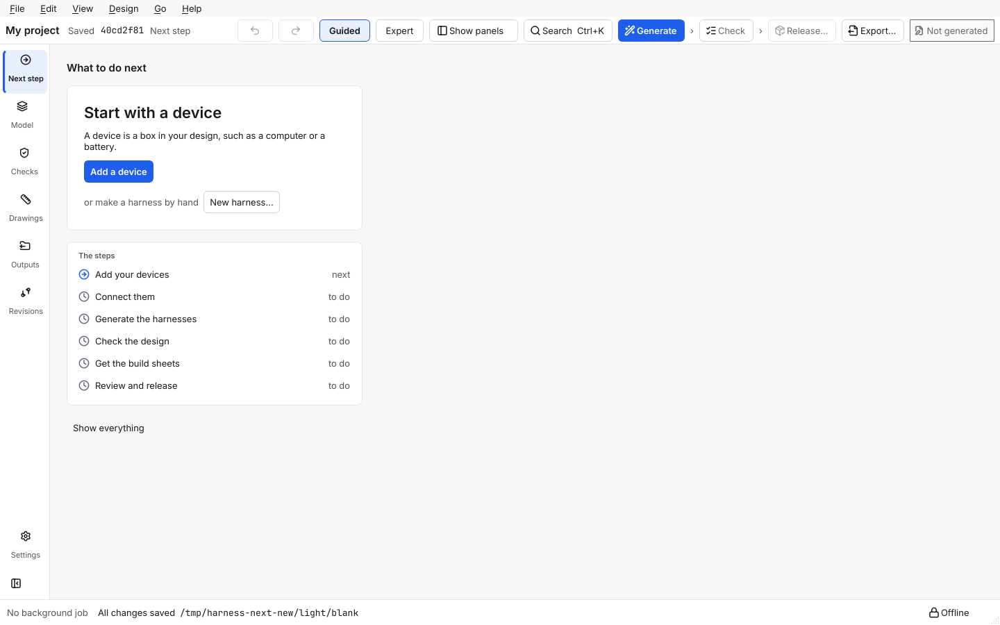
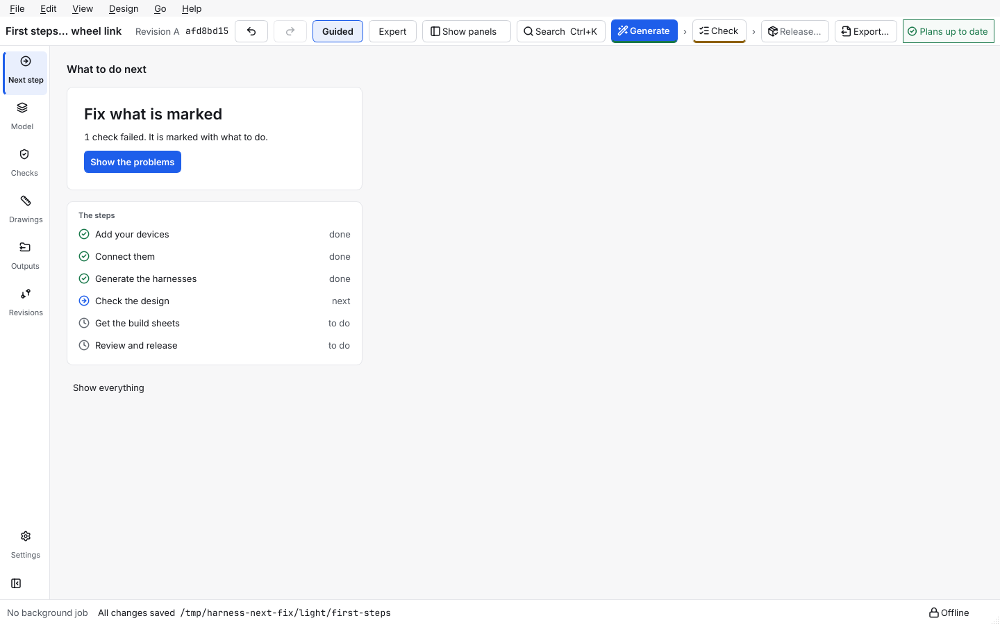
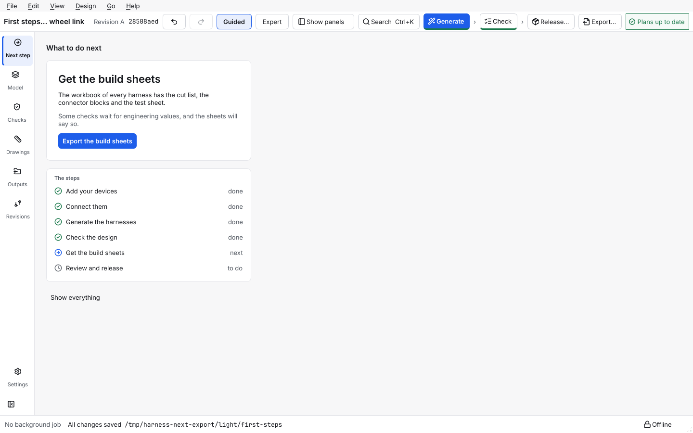
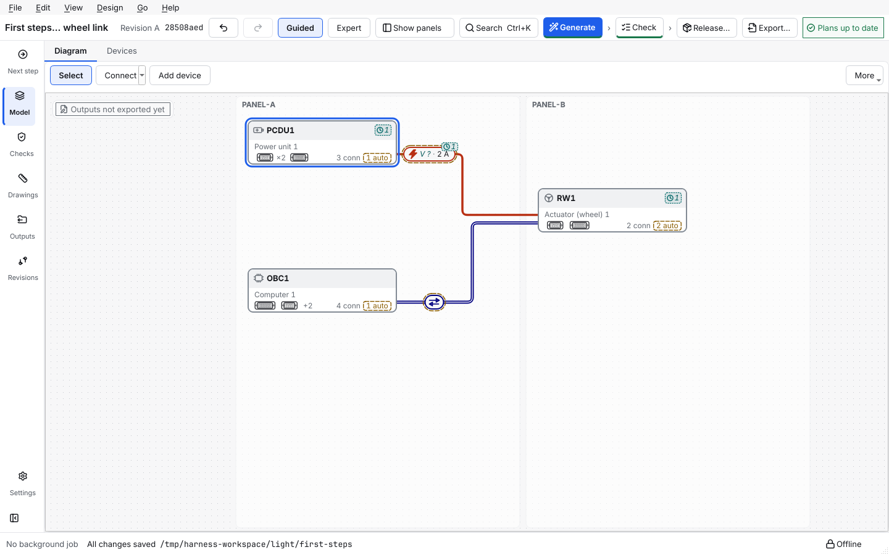
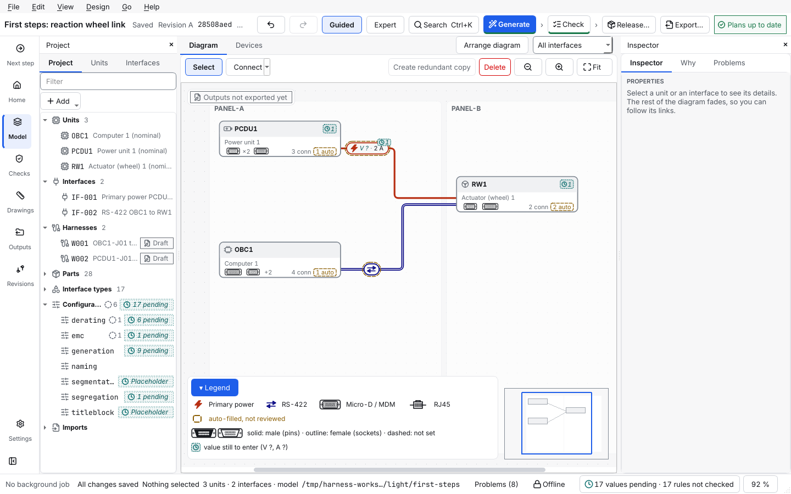

# Use the simple workspace

This page shows the **Next step** page: one page that tells you what to do now, in plain words, with one button. Use it when you are not sure what to do next.

> **New in 1.7.0.** The simple workspace is new in 1.7.0 (decision D-171). It has two stages (the Next step page, and fewer things on screen); the words of the program are not changed by it. A project from an earlier version opens as it is, and nothing that is written to disk changes.

## Contents

- [What it is for](#what-it-is-for)
- [The page](#the-page)
- [What it says, step by step](#what-it-says-step-by-step)
- [Simple or Full](#simple-or-full)
- [What the Simple workspace hides](#what-the-simple-workspace-hides)
- [Where the buttons go](#where-the-buttons-go)

## What it is for

The test users of version 1.6.0 said the editor showed too much at once and that they did not know what to do. The Next step page looks at your project and names **one** thing to do. You press the button, the program opens the right place, and the page then names the next thing.

## The page

Open it with **Next step**, the first item of the rail on the left. It works the same in the Simple and in the Full workspace. It has:

- the heading **What to do next**;
- one card with a short title, one sentence that says why, and **one** main button; on an empty project the card also offers *or make a harness by hand* with the button **New harness…**;
- the six steps of the work, each with an icon **and** a word: *done*, *next*, *to do*, and *not possible* when the project is read-only;
- the link **Show everything**, which switches to the Full workspace (only shown in Simple).

The page of a new, empty project: the card says *Start with a device* and offers **Add a device**, and *or make a harness by hand* with **New harness…**. The six steps below it show *next* on the first one and *to do* on the others:

When checks fail, the card says *Fix what is marked*, how many failed, and offers **Show the problems**. This is the tutorial project after Generate, with one check that fails because its parts are not approved yet:

When the design is checked and nothing fails, the card says *Get the build sheets* and offers **Export the build sheets**. Some checks still wait for engineering values, and the card says so in one sentence:

## What it says, step by step

The page names the first step that is not done. The rules run in this order.

| What is true of the project | Title | Button |
|---|---|---|
| A job is running | Working… | none; please wait |
| The project is read-only (saved by a newer version, or open in another window) | You can only look at this project | none; **Save a copy** is in the banner |
| No device and no harness | Start with a device | **Add a device** |
| No connection and no harness | Connect your devices | **Connect two devices** |
| No harness yet, or the plans are out of date (not for a project whose harnesses were all made by hand) | Generate the harnesses (again) | **Generate the harnesses** |
| The design was not checked | Check the design | **Check the design** |
| Checks failed | Fix what is marked | **Show the problems** |
| The files are not up to date | Get the build sheets | **Export the build sheets** |
| A harness is not released | Review and release | **Go to Releases** |
| Everything is released | Everything is released | **Open the Outputs** |

When some checks wait for engineering values, the *Get the build sheets* card says so in one sentence; it never blocks you, because the build workbook marks what is still open.

## Simple or Full

The setting **Workspace: Simple or Full** is in the **View** menu (first entries) and at the top of the Editing section of the **Settings** page; the two follow each other.

- **Simple** opens a project on the Next step page.
- **Full** opens a project where it opened before.
- **A first run** (a settings file with nothing stored yet) gets Simple. A settings file that already holds values gets **Full**, so nobody who already uses the editor is surprised; they can switch to Simple in the View menu.
- Changing the setting does not move the page you are on. **Show everything** switches to Full and opens the Model area.

This is separate from **Guided / Expert** in the top bar, which only changes how much the diagram shows.

The same project in the Simple workspace, with the side panels, the minimap, the legend and the status counts left out, and **Select**, **Connect**, **Add device** and **More** above the diagram. **Show panels** is in the top bar:

The same project in the Full workspace, with the project tree on the left, the Inspector on the right, the full tool row, the legend and the minimap of the diagram, and the counts in the status bar:

## What the Simple workspace hides

To show less at once, the Simple workspace starts with these things closed or off. Nothing is removed: each one is still in the **View** menu (with its shortcut where it has one, for example Ctrl+Shift+M for the Problems panel), and in the command palette (Ctrl+K).

| Thing | In Simple | In Full |
|---|---|---|
| Project tree and Interfaces tab (left) | closed | open |
| Inspector (right) | closed | open |
| Problems panel (bottom) | closed | closed until asked |
| Minimap and legend of the diagram | off | on |
| Status bar | the save state, the running job, *Offline* and the project path | everything, with the counts, the *Problems* button and the zoom value |
| Tools above the diagram | **Select**, **Connect**, **Add device** and **More** | all of them |
| Rail | Next step, Model, Checks, Drawings, Outputs, Revisions, Settings | the same and Home |

- **More** holds the other tools: *Create redundant copy*, *Delete*, *Zoom out*, *Zoom in*, *Fit all*, *Arrange diagram*, and a **Show only** menu (all interfaces, by signal class, by connector, by bundle).
- **Show panels** (a button in the top bar, and **Show side panels** first in the View menu) opens or closes the project tree and the inspector together. It is only there in Simple.
- Home is hidden in the rail, but it is still in the Go menu, on Ctrl+7 and in the palette.
- Selecting something with the inspector closed shows a short message once per window with a **Show panels** button. Opening a problem from the Problems panel or a check opens the inspector by itself.
- Each workspace remembers its own layout. Switching from Simple to Full gives you back the Full layout you had; closing the window in Simple opens it in Simple next time.

## Where the buttons go

Each button opens something that already exists: **Add a device** and **New harness…** open the same windows as in the Model area; **Connect two devices** opens the diagram with the Connect tool; **Generate the harnesses**, **Check the design** and **Export the build sheets** do what their menu entries do; **Show the problems** opens the Checks area with the failed rules; **Go to Releases** and **Open the Outputs** open those areas.

Next: [generate harnesses](generate-harnesses.md), [read and fix problems](read-and-fix-problems.md), [export the outputs](export-the-outputs.md).
