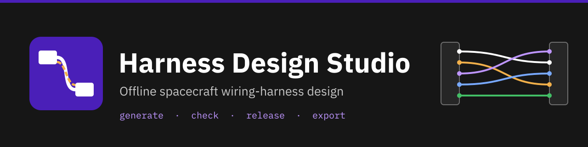
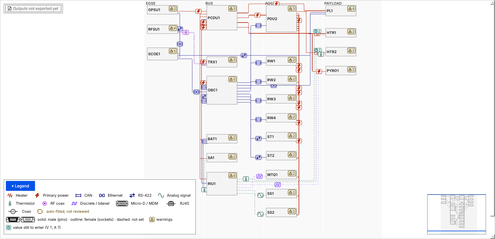
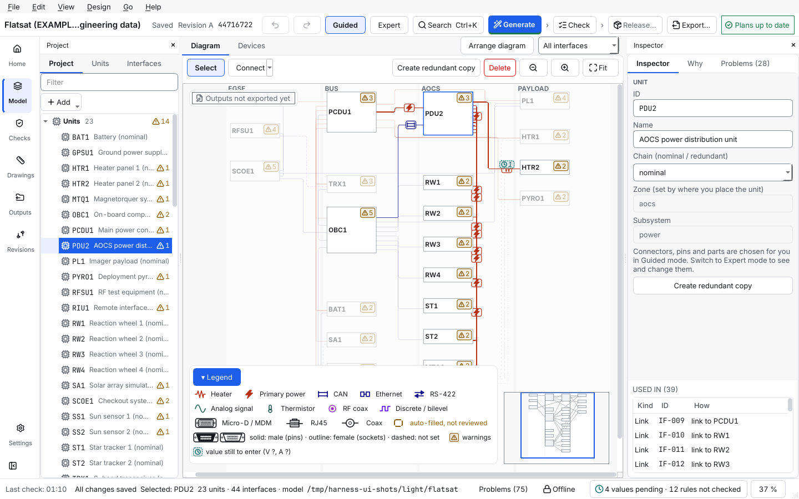

<p align="center"></p>

# Harness Design Studio

> **This repository is Harness Design Studio, a tool built on top of [WireViz](https://github.com/wireviz/WireViz).**
> The first part of this README covers Harness Design Studio. The original WireViz README follows unchanged below the divider: [jump to the original WireViz README](#original-wireviz-readme).

[](https://github.com/0h3xn4/WireViz-harnessdesignstudio/releases/latest)
[](https://github.com/0h3xn4/WireViz-harnessdesignstudio/actions/workflows/harness-ci.yml)
[](HarnessDesignStudio/docs/INSTALL.md)
[](HarnessDesignStudio/docs/INSTALL.md#d-windows-from-120)

An offline desktop tool for designing the electrical harnesses of a spacecraft: you draw the devices and the connections between them, and the tool works out the connectors, pins and wires, checks them, and writes a build workbook and lists for every harness.



*The `flatsat` example, one of the five projects that come with the tool.*



*The window (light theme; a dark theme is built in; the Electrical / AIT engineer role). Later versions add the Edit wire tab and the device library buttons (1.4.0), New harness with the Connectors tab (1.5.0), an Add a device button on a blank project (1.6.0) and, since 1.7.0, a Next step page (not in a release yet: two roles, Systems engineer and Electrical / AIT engineer, which show different things first); see the [user manual](HarnessDesignStudio/docs/user-manual/README.md).*

## Contents

- [What is this?](#what-is-this)
- [Quick start](#quick-start)
- [Where to go next](#where-to-go-next)
- [Features](#features)
- [Requirements](#requirements)
- [Licence and status](#licence-and-status)
- [What this repository adds to WireViz](#what-this-repository-adds-to-wireviz)
- [Related tools](#related-tools)
- [Known problems in the bundled upstream WireViz code](#known-problems-in-the-bundled-upstream-wireviz-code-not-changed-in-this-repository)

## What is this?

A **harness** is the bundle of wires and connectors that joins the boxes (the *devices*) of a spacecraft. Designing it by hand means choosing connectors, giving every signal a pin and a wire, and drawing it all again whenever something changes. In Harness Design Studio you describe the devices and the *interfaces* (power, data, radio) between them. The tool generates the harnesses, gives a reason for each choice, checks them against design rules, and writes a build workbook for every harness (an Excel file to build it from), wire lists and test tables. It keeps a record of every release.

It works offline and produces byte-identical files for the same design, so the files are friendly to Git. It never invents engineering values: until you supply them, results say *pending* or *not checked*. It is a separate program from WireViz (a different codebase, written from scratch), and it can write each harness as WireViz-style YAML.

## Quick start

You need Ubuntu 24.04 or newer on a 64-bit PC (see [Requirements](#requirements)); the Windows packages (from version 1.2.0) are described in [`INSTALL.md`](HarnessDesignStudio/docs/INSTALL.md), way D.

**Easiest: the ready-made package.** Download `harness-design-studio_1.7.0_amd64.deb` and `SHA256SUMS` from the [latest release](https://github.com/0h3xn4/WireViz-harnessdesignstudio/releases/latest), then in the folder with the files:

```
sha256sum -c SHA256SUMS --ignore-missing
sudo apt install ./harness-design-studio_1.7.0_amd64.deb
```

That installs the `harness-design-studio` command line tool (`harness` works as a short alias) and the `harness-design-studio-gui` app; the packages are not signed, so the checksum check is the only proof that the download is intact. The release page also has a `.tar.gz` with an `install.sh` that needs no administrator rights.

**From the source code.** These commands install the command line tool in a private Python environment and make a practice project:

```
sudo apt install python3-venv git
git clone https://github.com/0h3xn4/WireViz-harnessdesignstudio.git
cd WireViz-harnessdesignstudio/HarnessDesignStudio
python3 -m venv .venv && . .venv/bin/activate
pip install ".[gui]"
harness-design-studio new wheel-link --template first-steps
harness-design-studio generate wheel-link
harness-design-studio export wheel-link
```

(`harness` still works as a short name for `harness-design-studio`.) You should see `Project 'First steps: reaction wheel link' created in wheel-link (3 devices, 2 interfaces).`, then `2 added, 0 changed, 0 unchanged, 0 removed, 0 frozen (released); 0 locked pin(s) kept`, then `34 files written to wheel-link/outputs (model afd8bd1502d7).` The build workbook of each harness (`harnesses/W001/W001_build.xlsx`) and the lists are in `wheel-link/outputs/`. The PDF drawings are written only with `harness-design-studio export wheel-link --drawings` (the build workbook and this option are new in 1.7.0). To see the diagram, run `harness-gui` and open the project with **File > Open project…**; the app opens it on the *Next step* page, and the diagram is in the *Model* area.

[`INSTALL.md`](HarnessDesignStudio/docs/INSTALL.md) has all the ways to install (package, tarball, source) and explains what to do if something fails. The full walk-through with the output of every command is [`GETTING_STARTED.md`](HarnessDesignStudio/docs/GETTING_STARTED.md).

## Where to go next

Every guide is listed, with one line each, in the [documentation index](docs/README.md).

| You want to | Go to |
| --- | --- |
| **Get started** | [Install](HarnessDesignStudio/docs/INSTALL.md) · [Getting started](HarnessDesignStudio/docs/GETTING_STARTED.md) (45 minutes, real output of every command) · [Learning path](HarnessDesignStudio/docs/LEARNING_PATH.md) (nine steps) · [Concepts](HarnessDesignStudio/docs/CONCEPTS.md) (ten minutes) |
| **Do a task** | [User manual](HarnessDesignStudio/docs/user-manual/README.md) (one page per task) · [Tips](HarnessDesignStudio/docs/TIPS.md) · [Cheat sheet](HarnessDesignStudio/docs/CHEATSHEET.md) |
| **Look something up** | [User guide](HarnessDesignStudio/docs/guide/USER_GUIDE.md) (the same text opens in the app with **F1**) · [Command line](HarnessDesignStudio/docs/CLI.md) · [Design rules](HarnessDesignStudio/docs/RULES.md) · [Configuration](HarnessDesignStudio/docs/CONFIG.md) · [Outputs](HarnessDesignStudio/docs/OUTPUTS.md) · [File format](HarnessDesignStudio/docs/FILE_FORMAT.md) · [Glossary](HarnessDesignStudio/docs/GLOSSARY.md) |
| **See examples** | [Examples](HarnessDesignStudio/docs/examples/README.md) · [The flatsat tour](HarnessDesignStudio/docs/FLATSAT_EXAMPLE.md) |
| **Bring your data** | [Imports](HarnessDesignStudio/docs/IMPORTS.md) · [KiCad pinouts](HarnessDesignStudio/docs/KICAD.md) · [Engineering values and placeholders](HarnessDesignStudio/docs/PLACEHOLDERS.md) |
| **Fix a problem** | [Troubleshooting](HarnessDesignStudio/docs/TROUBLESHOOTING.md) · [FAQ](HarnessDesignStudio/docs/FAQ.md) |
| **See what changed** | [Changelog](HarnessDesignStudio/CHANGELOG.md) (the root [`CHANGELOG.md`](CHANGELOG.md) explains the two changelogs) |
| **Check the status** | [Status of the tool](HarnessDesignStudio/README.md#status) · [Compliance records](HarnessDesignStudio/compliance/README.md) · [Open decisions](HarnessDesignStudio/docs/OPEN_DECISIONS.md) |
| **Develop or contribute** | [`CONTRIBUTING.md`](CONTRIBUTING.md) · [Developer docs](HarnessDesignStudio/docs/developer/README.md) · [Architecture](HarnessDesignStudio/docs/ARCHITECTURE.md) · [Decisions](HarnessDesignStudio/docs/DECISIONS.md) · [Security](HarnessDesignStudio/docs/SECURITY.md) · [Release procedure](HarnessDesignStudio/docs/RELEASE.md) |
| **Use WireViz itself** | The [original WireViz README](#original-wireviz-readme) below, its [syntax description](docs/syntax.md), [tutorial](tutorial/readme.md) and [examples](examples/readme.md) |

## Features

- **Your design is the source of truth.** Harnesses, drawings and lists are generated from it and can be regenerated at any time.
- **A diagram editor with views** — devices and links on a diagram with marks for problems, locks and values still to enter; a project tree and spreadsheet-like tables for devices and interfaces; a navigation rail (Next step, Home (not listed for the Systems engineer), Model, Checks, Drawings with pins, wires, drawing and why, Outputs with every exported file and its checksum, Revisions, Settings); the steps Generate, Check and Release in one top bar; a Problems panel; light and dark themes; an Export window and one Import wizard.
- **Generates the harnesses** — connectors, pins, wires, shields, with a *Why is it like this?* explanation for every choice.
- **Lets you edit them** (since 1.4.0) — the gauge, type, colour and length of a single wire, wires you draw yourself, several wires on one pin, twisted and shielded groups, a function on every pin and labels on connectors and harnesses; Generate keeps what you set.
- **Lets you start from nothing** (since 1.5.0) — a blank project shows an **Add a device** button (since 1.6.0) for its first device, and **New harness** in the Drawings area makes an empty harness with no interface behind it: you add its connectors in the Connectors tab and draw its wires in the Edit wire tab ([how](HarnessDesignStudio/docs/user-manual/build-a-harness-by-hand.md)). Generate leaves such a harness as it is.
- **Two roles, and less on screen** (the Next step page and fewer things on screen since 1.7.0; the roles after it, not in a release yet) — a first start asks *Who are you working as?*: as a **Systems engineer** a *Next step* page names one thing to do at a time and the tree, the inspector and the Problems panel start closed; as an **Electrical / AIT engineer** every area and panel is there, as the editor always was. **View > Role** changes it at once; it is a view, never a permission ([how](HarnessDesignStudio/docs/user-manual/choose-your-role.md)).
- **Starts from your pinout** (after 1.7.0, not released yet) — join a connector of one device to a connector of another, pin by pin: the tool proposes the pairs from the signal names on the pins, never from their position, you confirm them, **Check my connections** reviews them and changes nothing, and **Create harness** makes a harness only when you press it ([how](HarnessDesignStudio/docs/user-manual/connect-two-connectors.md)).
- **Checks them** against 39 design rules and says clearly which checks could not run because a number is missing.
- **Writes the documents** — a build workbook per harness to build it from (what is ready and what is missing, a cut list with the strip lengths, a block per connector with the contact and crimp tool of each pin, parts, accessories such as sleeving and heat shrink, labels and a test sheet to fill in; the workbook and the build data are new in 1.7.0), wire lists, pinouts, bill of materials, test tables, labels, a block diagram and a change log, and, if you ask for them with `export --drawings`, a wiring-diagram drawing per harness (SVG and PDF).
- **Change control** — review, release and revise a harness; a released harness, and the parts, interface types and configuration it uses, are locked, and every change is recorded; the Revisions area also shows the last Git commit of the project's repository.
- **Starts from the usual links** — RS-422, RS-485 and CAN for communication, Micro-D (9 to 31 pins) for power and data, Ethernet for high data rates, SMA for RF. Other types and connectors can be added.
- **Imports** interface tables (CSV or XLSX), approved parts (also an InvenTree export file), segment lengths, engineering values and KiCad netlists, and **reuses devices** across projects through device library files.
- **Offline and reproducible** — it never uses the network (a test enforces this), and the same design gives byte-identical files.
- **Honest** — it does not invent derating, ampacity, EMC values or approved parts. Until you supply them, results say so.

## Requirements

| | |
| --- | --- |
| System | Ubuntu 24.04 or newer, 64-bit PC (x86-64). From version 1.2.0 also Windows 10 and 11 (64-bit). macOS is not supported (the releases 1.2.0 to 1.5.0 carry disk images that are not maintained, D-168). Other Linux systems are not supported. |
| Python | 3.12 or newer, only if you install from source (the `.deb` brings its own). |
| Disk and screen | About 500 MB; a screen of at least 1280 × 720 for the app (the command line needs no screen). |
| Network | None to run it. Installing from source downloads the Python packages once. |

## Licence and status

- **Version `1.7.0`** (a build workbook for every harness, the build data a technician needs, a simple workspace; decisions D-169, D-170 and D-171) is the latest published release, published on 2026-10-22 (tag `v1.7.0` on commit `e5d8b1e`; the packages for Ubuntu and Windows and `SHA256SUMS` are on the GitHub release page; the packages are not signed). **Version `1.6.0`** (no macOS, a clearer start for a blank project; decision D-168) was published on 2026-10-21 (tag `v1.6.0` on commit `21f4716`; the packages for Ubuntu and Windows and `SHA256SUMS` are on the GitHub release page; the packages are not signed). **Version `1.5.0`** (a harness made by hand, a clearer start on Linux; decisions D-166 and D-167), published on 2026-10-21 (tag `v1.5.0` on commit `4365368`; the packages for Ubuntu, Windows and macOS and `SHA256SUMS` are on the GitHub release page; the packages are not signed; macOS was removed after this release, D-168). **Version `1.4.0`** (wire editing, a device library; decisions D-160 to D-165), published on 2026-10-20 (tag `v1.4.0` on commit `1427aad`; the packages for Ubuntu, Windows and macOS and `SHA256SUMS` are on the GitHub release page; the packages are not signed). **Version `1.3.0`** (the new user interface), published on 2026-10-20 (tag `v1.3.0` on commit `e7cf531`; the packages for Ubuntu, Windows and macOS and `SHA256SUMS` are on the GitHub release page; the packages are not signed). **Version `1.2.0`**, published on 2026-10-19 (tag `v1.2.0` on commit `1cdd6a7`; the packages for Ubuntu, Windows and macOS and `SHA256SUMS` are on the GitHub release page; the packages are not signed). **Version `1.1.0`**, published on 2026-10-18 (tag `v1.1.0` on commit `f998cd9`; the packages and `SHA256SUMS` are on the GitHub release page). It has not been signed off by the owner as a compliance record (the changelog says so; [`compliance/SIGNOFF.md`](HarnessDesignStudio/compliance/SIGNOFF.md) records the release decision for 1.0.0 only and the publication of 1.1.0, 1.2.0, 1.3.0, 1.4.0, 1.5.0, 1.6.0 and 1.7.0 after the fact, with no owner sign-off for them). **Version `1.0.0`**, released on the repository owner's instruction on 2026-10-12 (tag `v1.0.0` on commit `0c6a96a`; the packages and `SHA256SUMS` are on the GitHub release page). The open engineering decisions were recorded as defaults on that day: the tool ships no standard or part data, so the real derating and EMC values and the approved parts list have not been supplied and results rest on placeholders and example parts. [`HarnessDesignStudio/README.md#status`](HarnessDesignStudio/README.md#status) has the details.
- **Created mainly by an AI.** Harness Design Studio was written mainly by Claude (Anthropic's AI assistant, used through Claude Code); the owner set the requirements and approved the decisions and releases. No other person has reviewed it independently, and it makes no claim of compliance with any standard. Check its results before relying on them. The records are in [`HarnessDesignStudio/compliance/`](HarnessDesignStudio/compliance/README.md).
- **Older packages:** some things described in these pages (the `minimal-satellite` and `flatsat` examples, the wiring-diagram drawing with wire colours, *Edit > Wire colours*) are not in the 0.1.0 packages. `harness-design-studio new --list` shows three examples on 0.1.0 and five on 1.0.0 and later. The [changelog](HarnessDesignStudio/CHANGELOG.md) lists what is new.
- **Licence.** The [`LICENSE`](LICENSE) file in this repository is the GPL-3.0 licence of WireViz. The licence of the code in `HarnessDesignStudio/` has not been decided (decision D-02 in [`HarnessDesignStudio/docs/DECISIONS.md`](HarnessDesignStudio/docs/DECISIONS.md), kept open for 1.0.0 in D-143; the package metadata says `LicenseRef-Proprietary`; the copyright holder is the repository owner, GitHub account `0h3xn4`). No licence has been granted for it yet.

## What this repository adds to WireViz

| | WireViz (upstream) | This repository |
| --- | --- | --- |
| Program | The `wireviz` Python package in `src/wireviz`, with its `docs/`, `examples/` and `tutorial/` | Unchanged. |
| Second tool | — | **Harness Design Studio** in [`HarnessDesignStudio/`](HarnessDesignStudio/README.md): a separate, clean-room codebase (no WireViz code is copied or imported, decision D-01). |
| Where each one's documents are | `docs/`, `tutorial/`, `examples/` | The tool's documents are in [`HarnessDesignStudio/docs/`](HarnessDesignStudio/docs/README.md) and `HarnessDesignStudio/compliance/`. [`docs/README.md`](docs/README.md) is the index of both. |
| README | `docs/README.md` | This file, with the original WireViz README embedded unchanged (except for relative links that had to change) below; an untouched copy is at [`docs/upstream/README.upstream.md`](docs/upstream/README.upstream.md). |
| Continuous integration | WireViz's own workflows | The same, plus workflows for the tool: [`harness-ci.yml`](.github/workflows/harness-ci.yml) (tests and the Ubuntu packages), [`harness-platforms.yml`](.github/workflows/harness-platforms.yml) (the tests on Windows), [`harness-packages.yml`](.github/workflows/harness-packages.yml) (the Windows packages, branches `pkg/**`) and [`release.yml`](.github/workflows/release.yml) (publishes a release when a tag is pushed). |
| Install | `pip install wireviz` (needs GraphViz) | Separate: see the [quick start](#quick-start). The two do not need each other. |

## Related tools

- **[WireViz](https://github.com/wireviz/WireViz)** draws single cables and harnesses from YAML. Harness Design Studio can export each harness as WireViz-style YAML (best effort, not checked with the WireViz program).
- **[KiCad](https://www.kicad.org/)**: connector pinouts of a device can be imported from a KiCad netlist ([how](HarnessDesignStudio/docs/KICAD.md)).
- Moving data between this tool and other engineering tools is described, with what does and does not exist, in [Tips: working with other tools](HarnessDesignStudio/docs/TIPS.md).

Next: [install it](HarnessDesignStudio/docs/INSTALL.md), then [getting started](HarnessDesignStudio/docs/GETTING_STARTED.md).

## Known problems in the bundled upstream WireViz code (not changed in this repository)

The pre-release audit ([`AUDIT.md`](AUDIT.md), area H) read the WireViz code in `src/wireviz`. The owner decided that this code is never changed here, so these problems of upstream WireViz 0.4.1 remain. Each was reproduced by the audit; the workaround is given where there is an obvious one. They do not affect Harness Design Studio, which does not use WireViz code.

- **PNG output can delete your input file (H-1).** If the input file has no extension (for example `harness`) and you write PNG (`-f p`), the input is gone afterwards (only `harness.png` and `harness.orig` remain). Give input files a `.yml` extension.
- **One connector at both ends of a cable, addressed by pin labels, is wired wrongly (H-2).** `X1: A, W1: 1, X1: B` becomes a wire from pin 2 to pin 2. Numeric pins work; use pin numbers for such a connection.
- **Connector `loops` need pin numbers in order (H-3).** `loops` use the pin ID as the Graphviz port, so pin labels (`A`, `B`) or numbers that are not 1, 2, 3 ... (`5`, `6`) fail with `port ... unrecognized`; by reading the code, pins in another order are drawn between the wrong positions. Number the pins 1, 2, 3 in order.
- **`&`, `<` and `>` in text fields stop the rendering (H-4).** Pin labels, wire labels, types, manufacturers, notes and image captions fail with a "not well-formed" error. Write `&amp;` instead of `&`; it then appears as `&amp;` in the BOM `.tsv`.
- **YAML turns some labels into truth values or numbers (H-5).** Unquoted `NO`, `ON`, `OFF` and `Yes` become booleans, `007` becomes `7`, `1:30` becomes `90`. Quote such labels: `"NO"`, `"ON"`, `"007"`.
- **The TELALT colour code has a typo (H-6).** Its first five pairs have a one-colour ring (`BU` where the TEL code has `BUWH`).
- **`parse(output_formats="png")` does nothing or crashes (H-7).** A single string is documented as allowed, but only a tuple works. Pass `("png",)`.
- **`parse()` keeps state between calls (H-8).** `image_paths` is a mutable default that fills up, a dict given as input is changed (a second parse of it fails), and a `Path` or `str` for `image_paths` is rejected. Pass a fresh list of `Path` objects and a fresh dict each time.
- **Cable wire numbers are not checked (H-9).** Wire `0` silently takes the colour of the last wire, a wire number above the wire count fails late with an `IndexError` that names no cable, `s` on a cable without a shield is accepted, and the same wire may be used twice. Check the numbers yourself.

Smaller upstream findings (H-10 to H-23: unescaped text in HTML and SVG output, `--prepend` losing sections that share a name, templates searched next to the output, the AWG/mm2 table, a non-UTF-8 locale, and others) are listed in [`AUDIT.md`](AUDIT.md). Packaging of this fork (H-18) was fixed: `setup.py` now reads `docs/upstream/README.upstream.md` as UTF-8 and requires Python 3.7 or newer; the distribution name `wireviz` and the version `0.4.1` are unchanged.

---

# Original WireViz README

The text below is the README of [wireviz/WireViz](https://github.com/wireviz/WireViz), taken from `docs/README.md` at commit [`e4fe099`](https://github.com/wireviz/WireViz/commit/e4fe099f8c7b86736aee7b4227cc794b6e8b36f0) (2025-01-16, WireViz 0.4.1). It is not reworded. Its headings are one level lower and its relative links point to the right place in this repository. The known problems of that code, which this repository does not change, are listed under [Known problems](#known-problems-in-the-bundled-upstream-wireviz-code-not-changed-in-this-repository). An untouched copy and the steps to refresh it: [`docs/upstream/README.upstream.md`](docs/upstream/README.upstream.md), [`upstream-sync.md`](HarnessDesignStudio/docs/developer/upstream-sync.md).

<!-- BEGIN UPSTREAM README -->

## WireViz


[](https://pypi.org/project/wireviz/)
[](https://pypi.org/project/wireviz/)
[](https://pypi.org/project/wireviz/)
[](https://github.com/psf/black)

### Summary

WireViz is a tool for easily documenting cables, wiring harnesses and connector pinouts. It takes plain text, YAML-formatted files as input and produces beautiful graphical output (SVG, PNG, ...) thanks to [GraphViz](https://www.graphviz.org/). It handles automatic BOM (Bill of Materials) creation and has a lot of extra features.


### Features

* WireViz input files are fully text based
  * No special editor required
  * Human readable
  * Easy version control
  * YAML syntax
  * UTF-8 input and output files for special character support
* Understands and uses color abbreviations as per [IEC 60757](https://en.wikipedia.org/wiki/Electronic_color_code#Color_band_system) (black=BK, red=RD, ...)
  <!-- * Optionally outputs colors as abbreviation (e.g. 'YE'), full name (e.g. 'yellow') or hex value (e.g. '#ffff00'), with choice of UPPER or lower case (#158) -->
* Auto-generates standard wire color schemes and allows custom ones if needed
  * [DIN 47100](https://en.wikipedia.org/wiki/DIN_47100) (WT/BN/GN/YE/GY/PK/BU/RD/BK/VT/...)
  * [IEC 60757](https://en.wikipedia.org/wiki/Electronic_color_code#Color_band_system)   (BN/RD/OR/YE/GN/BU/VT/GY/WT/BK/...)
  * [25 Pair Color Code](https://en.wikipedia.org/wiki/25-pair_color_code#Color_coding) (BUWH/WHBU/OGWH/WHOG/GNWH/WHGN/BNWH/...)
  * [TIA/EIA 568 A/B](https://en.wikipedia.org/wiki/TIA/EIA-568#Wiring)  (Subset of 25-Pair, used in CAT-5/6/...)
* Understands wire gauge in mm² or AWG
  * Optionally auto-calculates equivalent gauge between mm² and AWG
* Is suitable for both very simple cables, and more complex harnesses.
* Allows for easy-autorouting for 1-to-1 wiring
* Generates BOM (Bill of Materials)

_Note_: WireViz is not designed to represent the complete wiring of a system. Its main aim is to document the construction of individual wires and harnesses.


### Examples

#### Demo 01

[WireViz input file](examples/demo01.yml):

```yaml
connectors:
  X1:
    type: D-Sub
    subtype: female
    pinlabels: [DCD, RX, TX, DTR, GND, DSR, RTS, CTS, RI]
  X2:
    type: Molex KK 254
    subtype: female
    pinlabels: [GND, RX, TX]

cables:
  W1:
    gauge: 0.25 mm2
    length: 0.2
    color_code: DIN
    wirecount: 3
    shield: true

connections:
  -
    - X1: [5,2,3]
    - W1: [1,2,3]
    - X2: [1,3,2]
  -
    - X1: 5
    - W1: s
```

Output file:


[Bill of Materials](examples/demo01.bom.tsv) (auto-generated)

#### Demo 02


[Source](examples/demo02.yml) - [Bill of Materials](examples/demo02.bom.tsv)

#### Syntax, tutorial and example gallery

Read the [syntax description](docs/syntax.md) to learn about WireViz' features and how to use them.

See the [tutorial page](tutorial/readme.md) for sample code, as well as the [example gallery](examples/readme.md) to see more of what WireViz can do.


### Usage

#### Installation

##### Requirements

WireViz requires Python 3.7 or later.

WireWiz requires GraphViz to be installed in order to work. See the [GraphViz download page](https://graphviz.org/download/) for OS-specific instructions.

_Note_: Ubuntu 18.04 LTS users in particular may need to separately install Python 3.7 or above, as that comes with Python 3.6 as the included system Python install.

##### Installing the latest release

The latest WireViz release can be downloaded from [PyPI](https://pypi.org/project/wireviz/) with the following command:
```
pip3 install wireviz
```

##### Installing the development version

Access to the current state of the development branch can be gained by cloning the repo and installing manually:

```
git clone <repo url>
cd <working copy>
git checkout dev
pip3 install -e .
```

If you would like to contribute to this project, make sure you read the [contribution guidelines](docs/CONTRIBUTING.md)!

#### How to run

```
$ wireviz ~/path/to/file/mywire.yml
```

Depending on the options specified, this will output some or all of the following files:

```
mywire.gv         GraphViz output
mywire.svg        Wiring diagram as vector image
mywire.png        Wiring diagram as raster image
mywire.bom.tsv    BOM (bill of materials) as tab-separated text file
mywire.html       HTML page with wiring diagram and BOM embedded
```

Wildcards in the file path are also supported to process multiple files at once, e.g.:
```
$ wireviz ~/path/to/files/*.yml
```

To see how to specify the output formats, as well as additional options, run:

```
$ wireviz --help
```


#### (Re-)Building the example projects

Please see the [documentation](docs/buildscript.md) of the `build_examples.py` script for info on building the demos, examples and tutorial.

### Changelog

See [CHANGELOG.md](docs/CHANGELOG.md)


### Status

This is very much a work in progress. Source code, API, syntax and functionality may change wildly at any time.


### License

[GPL-3.0](LICENSE)

<!-- END UPSTREAM README -->
